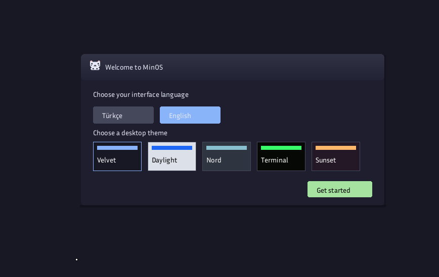
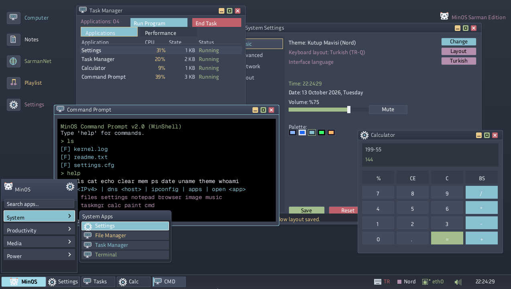
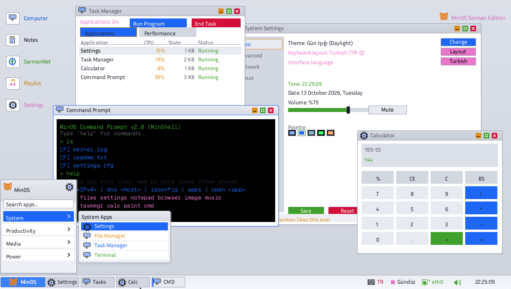

# 🐱 minOs — Sarman Edition

[English](README.en.md) | [Türkçe](README.md)


[](https://www.rust-lang.org/)
[]()
[-lightgrey.svg)](https://github.com/tbagriyanik/minos)
[](https://github.com/tbagriyanik/minos/releases)

minOs is a standalone 64-bit (`x86_64`) operating system written in Rust. Its kernel uses `no_std` and `no_main`, and provides a graphical desktop with built-in applications.

## Current · v2.4.0

- Frozen-app monitoring now runs independently of the main loop, and the FPS 3D app reports real frame-rate measurements.
- Incomplete frames are no longer displayed when the render budget expires.
- Deterministic host tests were added for `TimeBudget` and `OperationGuard`.
- File Manager can open WAV files directly in Music Player, and Image Viewer can set an image as a tiled desktop wallpaper.
- Settings includes three additional desktop images.

See the [full changelog](docs/CHANGELOG.en.md) for details.

## Quick start

See the [build and hardware guide](docs/building.md) for prerequisites and other run options.

```powershell
git clone https://github.com/tbagriyanik/minos.git
cd minos
powershell -ExecutionPolicy Bypass -File .\run.ps1
```

Run host tests with:

```powershell
powershell -ExecutionPolicy Bypass -File .\test_host.ps1
```

## Documentation

- [Features and roadmap](docs/features.md) *(Turkish)*
- [Hardware & Driver Support Matrix](docs/HARDWARE_DRIVER_SUPPORT_MATRIX.md) *(Turkish)*
- [Shell commands and desktop shortcuts](docs/usage.md) *(Turkish)*
- [Requirements, building, QEMU and VirtualBox](docs/building.md) *(Turkish)*
- [Previous release notes](docs/releases.md) *(Turkish)*
- [Detailed technical documentation](https://github.com/tbagriyanik/minOs/wiki)

## Screenshots

| Welcome | Theme 1 | Theme 2 |
|---|---|---|
|  |  |  |

Watch the [project introduction video](https://www.youtube.com/watch?v=fB1MQPZTMEg).

## Contributing

See [CONTRIBUTING.md](CONTRIBUTING.md) for contribution guidelines.
