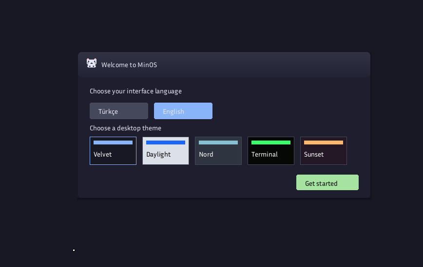
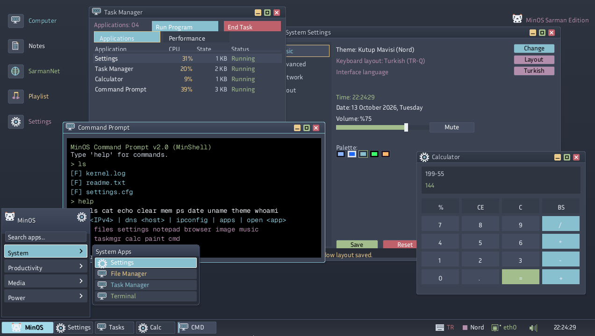
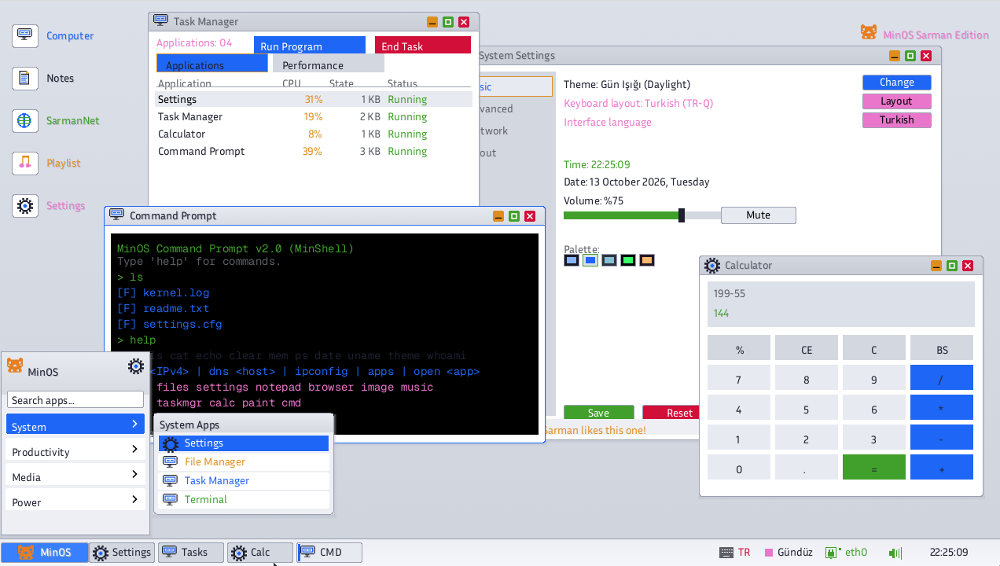

# 🐱 minOs — Sarman Edition

[English](README.en.md) | [Türkçe](README.md)


[](https://www.rust-lang.org/)
[]()
[-lightgrey.svg)](https://github.com/tbagriyanik/minos)
[](https://github.com/tbagriyanik/minos)
[](https://github.com/tbagriyanik/minos/releases)

minOs is a standalone 64-bit (`x86_64`) operating system written in Rust. Its kernel uses `no_std` and `no_main`, and provides a graphical desktop with built-in applications.

## Current · v2.8.0

- The Paint app UI was redesigned end-to-end: two scale-aware tool strips, visible buttons with hover/press animation (Open/Save/Undo/Redo/Clear/Brush/Eraser/shapes), a color-picker popup, brush-tip preview, right-drag erase and Ctrl+N/Ctrl+O/Ctrl+S shortcuts; fast strokes and erasing are now gap-free via interpolation.
- Application instances are lazily loaded: shell apps (File Manager, Settings, Browser, Music, Task Manager) stay resident; all other apps are loaded on first launch via `AppInstances::load` and dropped from memory when their last window closes — idle apps consume no RAM.
- Driver visibility and debugging: a shared status model tracks every hardware driver as `Ready` / `Unavailable` / `Error`, logging error codes and init timing to serial. The Control Panel gained a **Drivers** tab (status table + network/graphics/audio/storage details + **Rescan**); apps whose driver failed are safely blocked.
- File Manager and the Installation Wizard now use confirmation dialogs: creating a new file/folder, renaming and deleting (move to Recycle Bin or permanent delete) all require a labeled confirm window — Enter confirms, Esc cancels. The wizard's `Format` and `One-Click Install` steps ask for the same confirmation.
- Frozen-app monitoring now runs independently of the main loop, and the FPS 3D app reports real frame-rate measurements.
- The FPS game now has a refreshed start/result panel, health and ammo pickups, a health/ammo HUD, victory/defeat states, and a score/restart result panel.
- The Games app adds 8-ball billiards with shaded 3D balls, an aiming line, power bar and basic AI. City Drive's map is larger, with depth-tested trees and improved reverse-camera/driving controls.
- The browser now dispatches basic mouse/touch DOM events with event data and listener removal.
- Incomplete frames are no longer displayed when the render budget expires.
- TLS/X.509 verification now checks leaf and intermediate validity, CA BasicConstraints/pathLen, and any KeyUsage/EKU extensions; the test-only validation bypass was removed. The host suite has 578 tests.
- Kernel logging is now leveled and filterable: `trace/debug/info/warn/error` records tagged by target (`boot`, `driver`, `net`) are written to serial with a `[LEVEL][target]` prefix. Defaults come from the Limine cmdline `log=` token (`log=debug`, `log=info,net:trace`, …) and can be changed at runtime via `log ...` commands on the serial console; CI gained a `cargo clippy -D warnings` gate for the bare-metal kernel target.
- The web browser is now a modern browser: HTTP/1.1 + TLS 1.3 gained HTTP/2 and HTTP/3 (QUIC); HTML5 gained inline SVG rasterization plus `<details>`/`<dialog>`/`<template>`/`<picture>` support; CSS3 gained context-aware selectors (`:nth-child`, `[attr=]`, `:is()`/`:not()`, sibling/ancestor combinators); Canvas 2D gained gradients, transforms, Bézier/arc paths, `save`/`restore` and `getImageData`/`putImageData`; minJs gained `XMLHttpRequest`, `history.pushState` and `requestAnimationFrame`.
- Browser CSS3 `display` (flex/grid/block/inline/inline-block) and `overflow` rules are now applied correctly; a multi-CPU scheduler bug where a CPU skipped its own ready task and idled has been fixed.
- Deterministic host tests were added for `TimeBudget` and `OperationGuard`.
- File Manager can open WAV files directly in Music Player, and Image Viewer can set an image as a tiled desktop wallpaper.
- Settings includes three additional desktop images.
- `munmap` now performs real page teardown: realized frames are dropped from the resource ledger and returned to the PMM, and emptied page-table frames (PT/PD/PDPT) are reclaimed; middle splits are rejected without removing any mapping when the region table is full. A shared-frame reference leak on process exit and fork-failure paths was also fixed.
- Keyboard and mouse now work in default QEMU runs: `run.ps1` now attaches `qemu-xhci + usb-kbd + usb-tablet` (USB HID) by default. `usb-tablet` uses absolute coordinates and QEMU syncs the mouse position directly with the host cursor, so the mouse moves smoothly without lag in QEMU. QEMU 11's default `pc` machine had the i8042 controller but no PS/2 keyboard/mouse device attached, so previous releases never received desktop input events; this is fixed. 
- The desktop UI was polished and accelerated end-to-end: smooth mouse-wheel scrolling in every app; short open animations for windows, the start menu, context menus, the Alt+Tab switcher and the calendar/volume popups; tooltip balloons on the taskbar and tray; slide animations for toast notifications; and a glyph cache for text rendering. System Settings > Display gained **Interface animations** (disables all motion, including smooth scrolling) and **Transparent windows** toggles.
- Accessibility improvements: title bar shows unsaved-changes indicator (●) and long-title ellipsis truncation (…); buttons distinguish selected (green border), focused (yellow focus ring) and disabled (dimmed) states; all windows get correct app ID (app_id) for title and icon.
- The host suite contains 578 tests; all passed in the latest run (578 passed, 0 failed).

See the [full changelog](docs/CHANGELOG.en.md) for details.

## Quick start

See the [build and hardware guide](docs/building.md) for prerequisites and other run options.

```powershell
git clone https://github.com/tbagriyanik/minos.git
cd minos
powershell -ExecutionPolicy Bypass -File .\run.ps1
```

Run host tests with:

```powershell
powershell -ExecutionPolicy Bypass -File .\test_host.ps1
```

The host suite contains **578 tests**, all of which passed in the latest run. The project contains **214,823 Rust lines** in total: **202,460 lines under `src/`**, **5,407 lines under `tests/`**, and the remaining **6,956 lines** in fuzz targets, `build.rs`, `tools/` and root-level test helper files (excluding `target/`). Counts are physical lines in the current working tree's `.rs` files.

## Documentation

- [Features and roadmap](docs/features.md) *(Turkish)*
- [Hardware & Driver Support Matrix](docs/HARDWARE_DRIVER_SUPPORT_MATRIX.md) *(Turkish)*
- [Shell commands, desktop and workspace (virtual desktop) shortcuts](docs/usage.md) *(Turkish)*
- [Requirements, building, QEMU and VirtualBox](docs/building.md) *(Turkish)*
- [Previous release notes](docs/releases.md) *(Turkish)*
- [Detailed technical documentation](https://github.com/tbagriyanik/minOs/wiki)

## Screenshots

| Welcome | Theme 1 | Theme 2 |
|---|---|---|
|  |  |  |

Watch the [project introduction video](https://www.youtube.com/watch?v=fB1MQPZTMEg).

## Contributing

See [CONTRIBUTING.md](CONTRIBUTING.md) for contribution guidelines.
