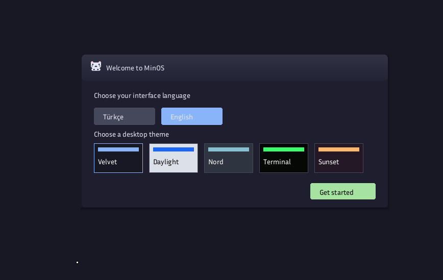
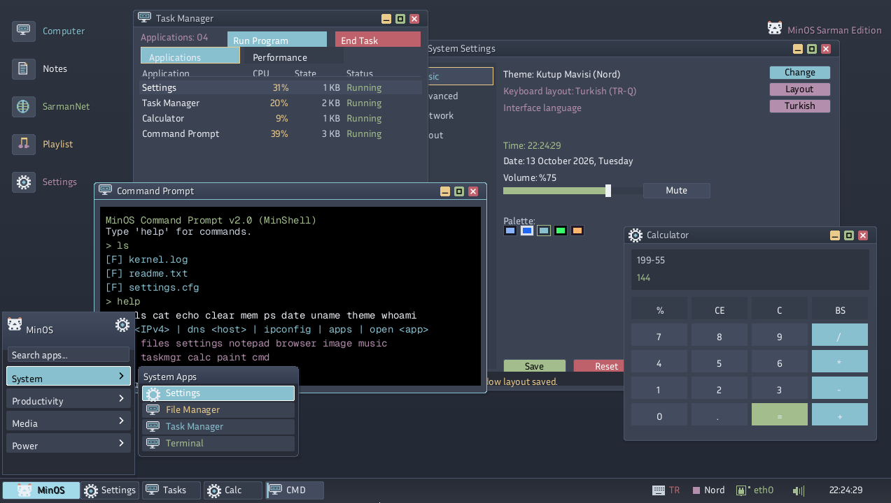
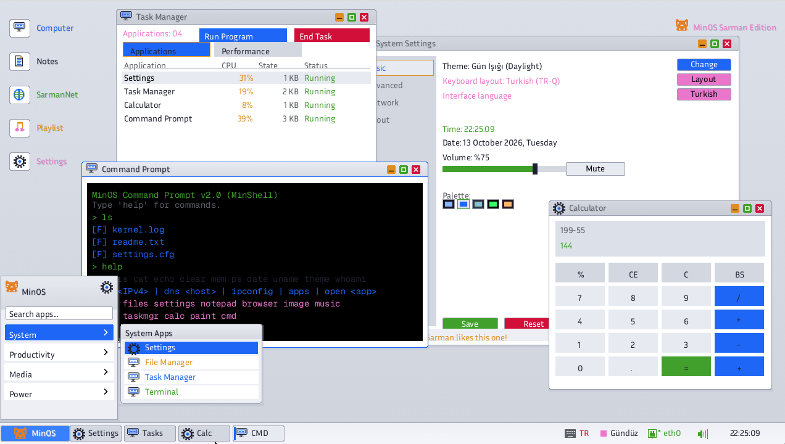

# 🐱 minOs — Sarman Edition

[Türkçe](README.md) | [English](README.en.md)


[](https://www.rust-lang.org/)
[]()
[-lightgrey.svg)](https://github.com/tbagriyanik/minos)
[](https://github.com/tbagriyanik/minos/releases)

minOs, Rust ile geliştirilen bağımsız bir 64-bit (`x86_64`) işletim sistemidir. Çekirdek `no_std` ve `no_main` kullanır; grafik masaüstü ve yerleşik uygulamalar sunar.

## Güncel bilgiler · v2.5.0

- Donmuş uygulamaların izlenmesi ana döngüden bağımsız çalışır; FPS 3D uygulaması gerçek kare hızı ölçümleri üretir.
- FPS Oyunu başlangıç ve sonuç menülerini içerir; temel form kontrollerinde Tab ile gezinme, Enter ile onaylama ve Esc ile vazgeçme desteği bulunur (Hoş Geldin ekranı dahil).
- Render bütçesi aşılırsa tamamlanmamış kare ekranda bırakılmaz.
- TLS/X.509 doğrulaması yaprak ve ara sertifika tarihlerini, CA BasicConstraints/pathLen kısıtlarını ve varsa KeyUsage/EKU uzantılarını denetler; testlerde doğrulama kestirmesi kaldırıldı. Host paketi 319 test içerir.
- `TimeBudget` ve `OperationGuard` için deterministik host testleri eklendi.
- Dosya Yöneticisi'nden WAV dosyalarını doğrudan oynatma ve görüntüyü döşeli masaüstü arka planı yapma eklendi.
- Ayarlar'a üç yeni masaüstü görseli eklendi.
- `munmap` artık gerçek sayfa kaldırma yapar: gerçekleşmiş çerçeveler kaynak defterinden düşülüp PMM'e iade edilir, boşalan sayfa tabloları (PT/PD/PDPT) geri kazanılır; bölge tablosu doluyken ortadan bölme hiçbir eşleme kaldırılmadan reddedilir. Süreç çıkışı ve fork hata yollarındaki paylaşımlı çerçeve referans sızıntısı da giderildi.
- QEMU varsayılan çalıştırmasında klavye ve fare artık çalışıyor: `run.ps1` artık varsayılan olarak `qemu-xhci + usb-kbd + usb-mouse` (USB HID) bağlar. QEMU 11'in varsayılan `pc` makinesinde i8042 denetleyicisi olduğuna karşın PS/2 klavye/fare aygıtı bağlı gelmediği için önceki sürümlerde masaüstü giriş olayları gelmemişti.

Değişikliklerin tam listesi: [Sürüm günlüğü](docs/CHANGELOG.md).

## Hemen deneyin

Gereksinimler ve alternatif çalıştırma seçenekleri için [Derleme ve donanım rehberine](docs/building.md) bakın.

```powershell
git clone https://github.com/tbagriyanik/minos.git
cd minos
powershell -ExecutionPolicy Bypass -File .\run.ps1
```

Host testlerini çalıştırmak için:

```powershell
powershell -ExecutionPolicy Bypass -File .\test_host.ps1
```

## Özellikler

- Grafik masaüstü ve yerleşik uygulama paketi — [özellikler ve yol haritası](docs/features.md)
- Desteklenen donanım ve bilinen sınırlamalar — [Hardware & Driver Support Matrix](docs/HARDWARE_DRIVER_SUPPORT_MATRIX.md)
- MinShell komutları, masaüstü ve workspace (sanal masaüstü) kısayolları — [kullanım rehberi](docs/usage.md)
- Gereksinimler, derleme ve QEMU/VirtualBox — [derleme rehberi](docs/building.md)
- Eski sürüm notları — [arşiv](docs/releases.md)
- Ayrıntılı teknik belgeler — [GitHub Wiki](https://github.com/tbagriyanik/minOs/wiki)

## Ekran görüntüleri

| Welcome | Tema 1 | Tema 2 |
|---|---|---|
|  |  |  |

[Tanıtım videosunu izleyin](https://www.youtube.com/watch?v=fB1MQPZTMEg).

## Katkı

Katkı yönergeleri için [CONTRIBUTING.md](CONTRIBUTING.md) dosyasına bakın.
