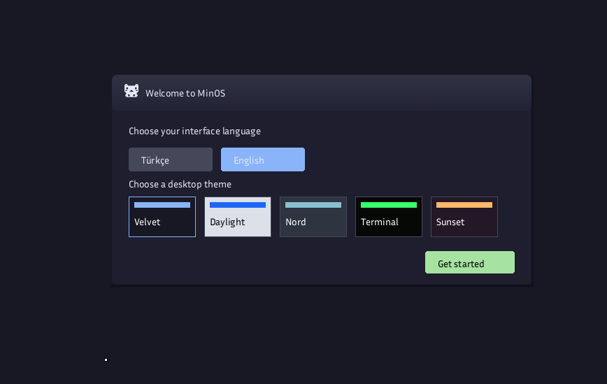
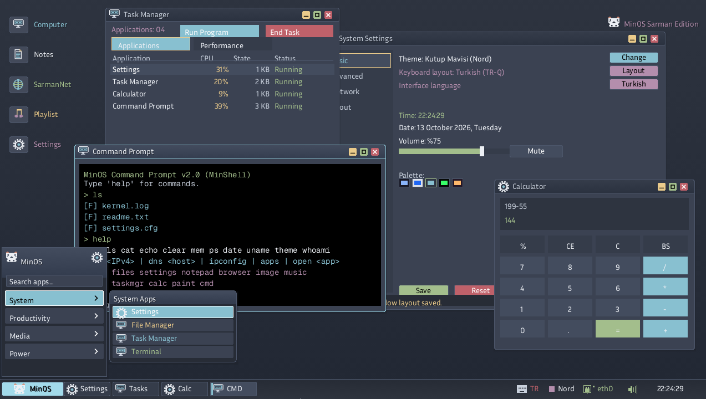
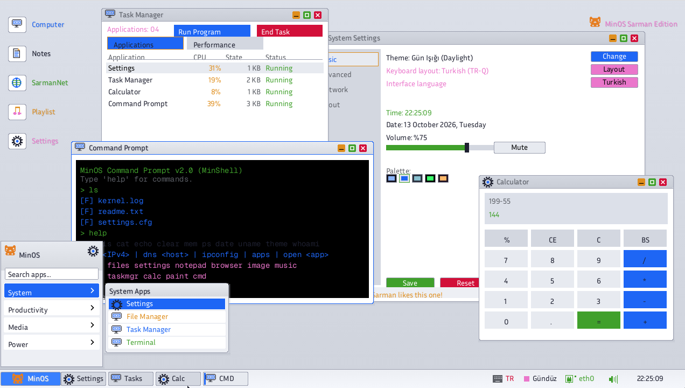

# 🐱 minOs - Sarman Edition

[Türkçe](README.md) | [English](README.en.md)

[](https://www.rust-lang.org/)
[]()
[](https://limine-bootloader.org/)
[]()
[]()
[]()
[]()
[]()
[]()
[-lightgrey.svg)]()
[](https://github.com/tbagriyanik/minos/releases)
[](https://github.com/tbagriyanik/minOs/wiki)

**minOs (Sarman Edition) v2.2.0**, çekirdek tarafında `no_std` ve `no_main` kullanan, Rust ile geliştirilmiş bağımsız bir 64-bit (`x86_64`) işletim sistemidir. Derleme sırasında `fontdue` kullanılarak TTF yazı tiplerinden bitmap atlasları üretilir; çekirdek bu atlasları grafik arayüzünde kullanır.

> 📚 **Resmi Kılavuz ve Dokümantasyon:** Tüm donanım sürücüleri, uygulama kılavuzları, ağ/TLS yapılandırması ve geliştirici belgeleri için **[minOs GitHub Wiki](https://github.com/tbagriyanik/minOs/wiki)** sayfasını ziyaret edebilirsiniz.

---

## Yenilikler (v2.2.0)

- **🔊 WAV Dosyasını Doğrudan Oynatma:** Dosya Yöneticisi'nde `.wav` dosyasına çift tıklamak, seçilen dosyayı Müzik Çalar'da oynatır.
- **🖼️ Resmi Masaüstüne Döşe:** Resim Gösterici, PNG/JPEG/GIF/BMP görüntüleri masaüstüne döşeli arka plan yapabilir.
- **🌄 Yeni Masaüstü Görselleri:** Ayarlar'a `desktop1.png`, `desktop2.png` ve `desktop3.png` seçenekleri eklendi.
- **📁 ISO Örnek Medyaları:** Örnek PNG/JPEG/BMP ve WAV dosyaları ISO içinde `/root/Media` altında paketlenir; CD'den çalışırken `/media/cdrom/root/Media` yolundan erişilir.

- **🔐 TLS 1.3 HTTPS El Sıkışması Tamamlandı:** Tarayıcının `https://` bağlantıları artık TLS 1.3 el sıkışmasını uçtan uca tamamlayıp şifreli HTTP yanıtını işleyebiliyor. RFC 8446'ya uygun üç kritik düzeltme yapıldı:
  - **AAD uzunluğu (§5.2):** Şifreli kayıtların Ek Kimlik Doğrulama Verisi tam olarak 5 bayt (içerik tipi + sürüm + uzunluk) olarak hesaplanıyor; önceki 11 baytlık uzunluk GCM etiketi uyuşmazlığına yol açıyordu.
  - **Finished anahtar türetimi (§4.4.4):** `server/client_hs_traffic_secret` üzerinden doğrudan `finished_key` türetiliyor; araya eklenen fazladan HKDF adımları `verify_data` uyuşmazlığına ve el sıkışmanın `CertificateReceived` aşamasında takılmasına neden oluyordu.
  - **`close_notify` zarif kapanış (§6.1):** Sunucunun gönderdiği `close_notify` (Alert 0) artık fatal hata sayılmıyor; `peer_closed` durumu set edilerek aynı kayıtta gelen uygulama verisi kaybolmadan işleniyor. Böylece `state=Established` sonrası yanıt gövdeleri tarayıcıda görüntülenebiliyor.
- **🌐 Tarayıcı Geliştirmeleri (Önbellek ve Görselleştirme):** HTTP/HTTPS istekleri için VFS tabanlı önbellek sistemi eklendi (`/browser/cache/`); CSS, görseller ve JS dosyaları yeniden kullanılabilir hale getirildi. Web tarayıcısı CSS özelliklerini genişletti: `transform` (translate/scale/rotate), `transition`/`animation` desteği, `flexbox`/`grid` temel özellikleri, gölgeler (`box-shadow`, `text-shadow`), border-radius, opacity ve daha iyi renk desteği. Görsel yükleme ve işleme iyileştirildi (`imgdecode`), SVG temsili desteği ve daha kararlı sayfa render'ı sağlandı. Tarayıcı ayarları sekmesi genişletildi.
- **🌍 Progresif JPEG & @font-face Desteği:** Görsel çözücü (`imgdecode`) artık çoklu tarama (multi-scan) biriktirmeli **progresif JPEG** (SOF2) dosyalarını çözebiliyor; daha önce bu dosyalar baseline gibi yorumlandığı için bozuk/eksik görünüyordu. CSS motoru `@font-face` kurallarını ayrıştırıp font-family kaynaklarını kaydeder, `font-family` özelliği `ElementStyle` üzerinde taşınır. `@keyframes` animasyonları artık yalnızca `opacity` değil `color` ve `background-color` değerlerini de interpolasyonla canlandırır ve sayfa yeniden çizildiğinde baştan başlamadan devam eder.
- **🎨 HTML Renk ve Resim Desteği:** Web tarayıcısı HTML/CSS renkleri ve görselleri şu biçimleri destekler:
  - **Renkler:** İsimli renkler (140+ CSS named color, örn. `red`, `blue`, `aliceblue`), `#RGB`/`#RGBA`, `#RRGGBB`/`#RRGGBBAA`, `rgb()`/`rgba()`, `hsl()`/`hsla()` ve `transparent`.
  - **Görsel formatları:** PNG, JPEG (baseline ve progresif), GIF (ilk kare), WebP (lossless/lossy), BMP (24/32-bit) ve SVG (temel şekiller).
  - **CSS özellikleri:** `color`, `background-color`, `border-color`, opacity blending, `background-image: url(...)`, `background-size` (auto/cover/contain/stretch), `background-repeat`.
  - **Kaynaklar:** `data:image/...` (base64), yerel VFS dosyalar (`/root/Media/...`), uzak HTTP/HTTPS URL'leri (asenkron önbellekli yükleme).
- **⏱️ IPv6 Öncelikli HTTP İsteği (Dual-Stack): `http_get_impl` önce **AAAA** kaydını çözer ve IPv6 hedefe `connect_v6` ile bağlanır (HTTPS yolu TLS 1.3 el sıkışmasını IPv6 soketi üzerinden yürütür); AAAA yoksa veya IPv6 yolu başarısız olursa IPv4 `fetch_once` yoluna düşer. IPv6 yanıtlarında 3xx yönlendirme takibi ve `Transfer-Encoding: chunked` çözümü de uygulanır.
- **🧩 HTTP/2 İstemci Çekirdeği:** `http.rs` içine RFC 7540 çerçeve katmanı (`h2` modülü: DATA/HEADERS/SETTINGS/PING/GOAWAY/WINDOW_UPDATE), HPACK `:method`/`:scheme`/`:authority`/`:path` başlık bloğu kodlayıcısı, `Http2Connection` (tek soket üzerinden çoklu akış, `SETTINGS` ACK, akış `WINDOW_UPDATE`) ve `http2_get()` kolaylık fonksiyonu eklendi. Durum: **altyapı hazır**, tarayıcı akışına bağlanmadı — HTTPS tarafında çerçeveler henüz TLS kaydıyla şifrelenmiyor, `Connection` başlığı ile ALPN h2 pazarlığı ve HPACK dinamik tablosu/HPACK çözümlemesi sonraki adım. Bu nedenle tarayıcı hâlâ HTTP/1.1 kullanır.
- **🐾 Tarayıcı Demo Sayfaları:** Tarayıcıya yerel, ağ bağlantısı gerektirmeyen üç demo sayfası eklendi: `minos://demo` (temel HTML/CSS), `minos://demo-img` (görsel yerleşimi) ve `minos://demo-video` (video yerleşimi). Bu sayfalar çevrimdışıyken HTML/CSS motorunu ve düzen yeteneklerini sınamak için kullanılabilir.
- **🚫 Tarayıcı Donma Düzeltmesi (Engellemeyen Kaynak Yükleme):** Web sayfası açılırken sistemin donması engellendi. `<link rel="stylesheet">`, `<script src="...">` ve `` gibi harici kaynakların `http_get()` ile senkron (engellemeyen) olarak getirilmesi HTML render sırasında kaldırıldı. Bunun yerine kaynak URL'leri `pending_resources` listesine toplanır ve `poll_network()` durum makinesi tarafından her karede tek tek asenkron olarak getirilir. Sayfa her kaynaktan sonra yeniden render edilir; bu sayede ağ işlemleri ana olay döngüsünü bloke etmez ve tarayıcı sayfa yüklenirken yanıt verir.
- **🛠️ Tarayıcı Geliştirici Araçları:** Tarayıcıda `Ctrl+Shift+D` ile açılıp kapanan DevTools paneli eklendi. `Elements` sekmesi sayfadaki bağlantı, görsel, canvas, medya, iframe, WASM ve Worker sayılarını; `Console` JavaScript uyarılarını ve hata günlüğünü; `Network` istek durumunu ve indirmeleri; `Storage` çerezleri ve form otomatik doldurma kayıtlarını gösterir.
- **Genişletilmiş Donanım Sürücüleri (20+ Yeni Sürücü):**
  - ✅ **Ağ:** VirtIO-net, Intel I219-V, Atheros, Marvell Ethernet, Realtek RTL8139 ve NE2000 (ISA PnP + PCI RTL8029AS).
  - ✅ **Bluetooth HCI Protokolü:** Komut (0x01), ACL veri (0x02), Olay (0x04) paket formatlaması/ayrıştırması, Inquiry ve bağlantı yönetimi tamamlandı.
  - ✅ **Depolama:** AHCI/SATA, NVMe SSD, VirtIO-blk, SD/MMC.
  - ✅ **USB:** Mass Storage, Printer, Audio, Touchscreen.
  - ✅ **Grafik:** VirtIO-gpu (Split VirtQueue, 2D komut motoru, masaüstü varsayılan donanımsal 2D render & flush yolu, mode-set), AMD Radeon ve NVIDIA GeForce (BAR0/BAR1 VRAM framebuffer, 2D primitifler, mode-set).
  - ✅ **Sensör & Güç:** ACPI AML yorumlayıcısı (Method, Device, Scope, Math/Logic), `_BST` / `_BIX` / `_BIF` pil durumu okuma, `_S0`..`_S5` uyku ve PowerResource yönetimi, ThermalZone (`_TZ_`, `_TMP`, `_CRT`) ve fan sensörleri.
  - ✅ **Veri Yolu & Zaman:** PCIe, PCI ve Timer (PIT/HPET/APIC/TSC) altyapısı.
- **Canlı USB Tak/Çıkar:** Çalışma sırasında USB cihazlarının anında algılanıp toast bildirimleri gösteriliyor. minOs çalışırken USB klavye veya fare takıldığında veya çıkarıldığında sistem tarafından anında algılanır. Masaüstünde canlı toast bildirimi gösterilir (`USB Klavye takıldı`, `USB Fare çıkarıldı`), açık ekran/pencereler yeniden çizilir ve Sistem Ayarları > Aygıtlar sekmesindeki donanım listesi anında güncellenir.
- **OHCI & UHCI & EHCI Transfer Katmanı:** OHCI (`OhciEd`, `OhciTd`, `OhciHcca` ve DMA kuyruk yönetimi), UHCI (`UhciQh`, `UhciTd`) ve EHCI denetleyicileri için tam transfer katmanı ve port handoff altyapısı entegre edildi.
- **minJs İleri Düzey JavaScript Çalışma Zamanı:** Web tarayıcısı için yerleşik `no_std` JavaScript motoru güçlendirildi: ikili aritmetik operatörler ve tam işlem önceliği (`+`, `-`, `*`, `/`, `%`, `(...)`, tekli `+`/`-`/`!`), döngüler (`for (init; cond; step)`, `for (item of array)`, `for (key in object)`, `while`, `break`, `continue`), değişken mutasyonları (`++`, `--`, `+=`, `-=`, `*=`, `/=`, `%=`), gelişmiş dizi metotları (`.push()`, `.pop()`, `.shift()`, `.unshift()`, `.reverse()`, `.join()`, `.indexOf()`, `.includes()`, `.slice()`, `.concat()`), nesne özellikleri ve köşe parantezli erişim (`obj.prop`, `obj["key"]`, `delete obj.prop`), `Object.keys()` / `Object.values()`, JSON ayrıştırma ve serileştirme (`JSON.stringify()`, `JSON.parse()`), matematiksel ve dize yardımcıları (`Math.{abs, min, max, pow, round, floor, ceil}`, `str.{indexOf, includes, slice, split, trim, toLowerCase, toUpperCase, charAt}`) ve global dönüşümler (`parseInt`, `parseFloat`, `String`, `Number`, `Boolean`).
- **IPv6 Protokol & Soket Altyapısı:** `netstack.rs` katmanına `Ipv6Address`, `IpAddress` (V4/V6), RFC 4291 adres ayrıştırıcı (`::` sıkıştırma ve `[...]` formatı), RFC 2464 Multicast MAC haritalama, RFC 8200 sözde başlık checksum hesaplama, ICMPv6 Echo Request/Reply (`ping6`), Neighbor Discovery (Solicitation/Advertisement) ve `ETHERTYPE_IPV6` (0x86DD) desteği; terminalde `ipconfig` yerel IPv6 (Link-Local EUI-64) gösterimi ve `ping`/`ping6` çift yığın desteği; `socket.rs` katmanına `AF_INET6` (10), `resolve_ip()` / `resolve_ipv6()` ve Web Tarayıcısında IPv6 adres doğrulaması eklendi.
- **exFAT ve ext4 Parçalanma (Fragmentation) & Derin Dizin Bütünlüğü:** ext4 ve exFAT üzerinde derin dizin ağaçlarında dosya oluşturma, silerek delik (hole) açma ve parçalanmış blok/küme zincirlerini dolduracak yeni dosyaları tutarlı şekilde tahsis etme yetenekleri host stres testleriyle (`host_fs_tests.rs`) doğrulandı.
- **Genişletilmiş Güven Deposu (Root CA):** 51 güvenilen kök CA sertifikası çekirdeğe gömüldü (`src/drivers/crypto/roots/`). Let's Encrypt ISRG Root X1 & X2, Google Trust Services (GTS Root R1 & R2), DigiCert Global Root (CA & G2), SSL.com TLS ECC Root CA 2022, GoDaddy, Starfield, IdenTrust, QuoVadis, Certum, Buypass, Actalis, T-TeleSec, Microsoft RSA/ECC Root CA 2017, D-TRUST, Telia, SwissSign, OISTE WISeKey, FNMT-RCM ve SECOM kökleri dahil.
- **ISRG Root X1 Kök CA & TLS Zincir Doğrulaması:** Let's Encrypt ISRG Root X1 kök sertifikası (`isrgrootx1.der`) çekirdeğe gömüldü. Sunucudan gelen sertifika zinciri RFC 5280 kurallarıyla taranarak yaprak ve ara sertifikaların RSA PKCS#1 v1.5 ve ECDSA P-256 imzaları güvenilen ISRG Root X1 açık anahtarına kadar eksiksiz doğrulanır.
- **USB Hub Arkası Cihaz Desteği (xHCI):** Çok katmanlı USB hub mimarisi yerel olarak desteklenir. Hub tanımlayıcıları (`GET_DESCRIPTOR 0x29`), port güç kontrolü (`PORT_POWER`), port sıfırlama (`PORT_RESET`), xHCI 20-bit hiyerarşik `Route String` ve Transaction Translator (TT / Split Transaction) mekanizması entegre edildi. Hub arkasındaki klavye ve fareler otomatik olarak taranıp sürülür.
- **EHCI (USB 2.0), UHCI (USB 1.1) ve OHCI Denetleyici Desteği:** xHCI denetleyicisi bulunmayan eski anakart ve laptop sistemlerinde USB portlarının ve BIOS legacy emülasyonunun sağlıklı çalışabilmesi için EHCI EECP OS handoff devri, CONFIGFLAG port yönlendirmesi, UHCI Global/Host Reset ve OHCI operasyonel mod geçişleri uygulandı.
- **Açılış Konsolunda Akıllı Hata ve Uyarı Renklendirmesi:** UEFI/BIOS metin konsolunda (`[BOOT]`, `[INPUT]`, `[DRIVER]`) algılanamayan donanımlar, hata veren veya uyarı niteliğindeki satırlar açılış ekranında otomatik olarak kırmızı (`#FF6B6B`) renkle vurgulanır.
- **Not Defteri – Bul ve Değiştir & Taşma Menüsü:** `Ctrl+F` ile **Bul** çubuğu, `Ctrl+H` ile **Değiştir** çubuğu açılır. Metin girişi aktif alanda yönlendirilir, `Esc` ile çubuk kapanır. Gelişmiş arama seçenekleri ve küçük ekranlar için taşma (overflow) menüsü entegre edildi.
- **Realtek PCIe Ağ Kartı Desteği (RTL8168/8169/8125/8101):** Fiziksel anakartlarda ve PCIe genişleme yuvalarında en yaygın kullanılan Realtek Gigabit ve Fast Ethernet denetleyicileri için yerel sürücü desteği entegre edildi. Çoklu PCI veri yolu taraması (Bus 0..8), C+ modu başlatması, 64-bit RX/TX descriptor halkaları ve anlık donanımsal kablo/link durumu (PHYSTATUS) takibi eklendi.
- **Realtek RTL8139 Ağ Kartı Desteği (PCI 0x10EC:0x8139):** Klasik PCI Fast Ethernet kartı için C+ modu başlatma, I/O portu tabanlı kayıt erişimi (BAR0 = I/O BAR), 4 kanallı TX ve 8 KiB RX halkası (16 baytlık WRAP payı, CAPR/CBR boş-halka denetimi) ve MII (BMSR) bağlantı yoklaması (yedek: MSR) eklendi (`e1000.rs`, `NicType::RealtekRtl8139`). MAC adresi IDR0'dan okunur; boş/geçersizse 93C46 EEPROM yedeği kullanılır. QEMU'da `-device rtl8139,netdev=n0` ile test edilebilir.
- **NE2000 Sürücüsü (ISA PnP + PCI RTL8029AS):** Novell NE2000 / RTL8019AS uyumlu ISA kartlar ISA PnP izolasyonu (0x279/0xA79/0x203, 72-bit giriş anahtarı, 72 baytlık yanıt yapısından MAC okuma ve kaynak ayarlama) ile; PnP yanıtı yoksa 0x300, 0x280, 0x320 … 0x2E0 jumper I/O tabanlarının taranmasıyla bulunur. DP8390 sayfa yönetimi (CR/PS0-PS1), RTL8019AS sıfırlaması, PSTART/PSTOP = 0x46/0x80 ile 8 KiB RX halkası, 0x40'ta TX tamponu, 0x10 veri portu üzerinden uzak DMA (ISR/RSR ile otomatik 8/16-bit seçimi), 60 bayta dolgu, taşma (OVW) kurtarma ve çerçeve başına BNRY güncellemesi uygulanır (`ne2000.rs`). PCI RTL8029AS (aygıt kimliği 0x8029) kartları aynı çekirdeği `init_pci` üzerinden kullanır. Sürücü, PCI ağ kartı bulunamadığında açılışta otomatik olarak devreye girer; otobüs seçimi `net::BusKind` (`Pci` / `IsaPnp`) ile `netstack`'e bağlanır, böylece DHCP, ARP, DNS, TCP/UDP ve TLS yığını tüm kartlarda değişmeden çalışır. Ayarlar, Kontrol Paneli, sistem durum penceresi ve önyükleme günlüğü etkin kartı adıyla (TR/EN) raporlar.
- **Broadcom NetXreme Ağ Kartı Desteği (BCM57xx, PCI 0x14E4):** Dördüncü büyük NIC üreticisi Broadcom için yerel sürücü eklendi. BCM5701–5782 ailesi tanınır; Register Access Enable, MAC hash tablosu, RX/TX descriptor halkaları ve link durumu (PHYSTATUS) desteği sağlanır.
- **Yüksek Çözünürlüklü Ekranlarda (1080p+) Akıcı Fare & Balistik İvmelenme:** USB fare raporlarındaki 12/16-bit hareket verilerinin dar aralığa kırpılması engellenerek tam eksen duyarlılığı sağlandı. 1080p ve 2K/4K ekranlar için çözünürlük ölçekli dinamik taban hız (~2.8x) ve hassas piksel tıklamalarını bozmayan 4 kademeli balistik ivmelenme uygulandı.
- **Yenilenen Orta Boyutlu & Yüksek Kontrastlı Fare İmleci:** 1080p ve üzeri çözünürlüklerde ideal boyuta sahip, modern 15 piksellik keskin ok imleci tasarlandı. 8 yönlü tam kutu konturu (outline) sayesinde açık ve koyu zeminlerin tamamında yüksek kontrast ve net görünürlük sunar; imleç arkası iz kalmasını önlemek için VRAM yedekleme arabelleği 32x32 piksele çıkarıldı.
- **X.509 Sertifika Doğrulama (Zaman & SNI/CN):** TLS el sıkışmasında sunucu sertifikasının geçerlilik tarih aralığı (`not_before` / `not_after`) CMOS RTC saatiyle, hedef ana makine adı ise CN (`CommonName`) ve SAN (`Subject Alternative Name`) DNS kayıtları üzerinden RFC 6125 kurallarıyla (tek düzeyli joker `*.domain.com` dahil) doğrulanır.
- **Sertifika Zinciri Derinlik Sınırı:** `src/drivers/crypto/x509.rs` içindeki `verify_certificate_chain`, ara sertifika önbelleği bulunmayan çekirdekte aşırı uzun kurumsal/özel CA zincirlerinin DER ayrıştırma maliyeti ve belleğini sınırlamak için zincir en fazla `MAX_CHAIN_DEPTH` (6) sertifika olacak şekilde doğrular; daha uzun zincirler ayrıştırmaya girmeden `ChainTooDeep` ile reddedilir.
- **Sertifika İptal Kontrolü (CRL & OCSP ayrıştırma):** `src/drivers/crypto/revocation_core.rs` DER kodlu CRL (`CertificateList`) ve OCSP (`BasicOCSPResponse`) yanıtlarını ayrıştırır; iptal durumu, seri numarası, iptal zamanı/nedeni ve yanıt tazeliği kontrol edilir. `revocation.rs` fail-closed politika uygular: iptal durumu bilinmiyorsa bağlantı reddedilir. Sınırlar: CRL/OCSP yanıtlarının otomatik indirilmesi (HTTP/OCSP isteği üretimi) henüz yoktur; `Manual` kaynak ile elle işaretleme kullanılabilir.
- **VMware VMXNET3 & Genişletilmiş Ağ Desteği:** Intel e1000 ailesine ek olarak VMware PCI vendor `0x15AD` ve aygıt kimlikleri (`0x07B0` VMXNET3, `0x0720` VMXNET) algılanır; MAC adresi, bağlantı (link) yoklaması ve donanım adı raporlaması entegre edildi.
- **minPak / minpkg SHA-256 Bütünlük Doğrulaması:** Paket yöneticisine indirilen ve kurulan ikili paketlerin SHA-256 özetini kontrol etme özelliği eklendi (`minPak install <paket> [hash]`, `minPak sha256 <dosya>`, `minPak verify <dosya> <hash>`).
- **minpkg Bağımlılık Çözümleme:** `src/apps/pkg_deps.rs` ile sürüm kuralları (`>=`, `>`, `=`, `<=`, `<`), geçişli bağımlılık sıralaması, çakışma ve döngü tespiti yapılır. `minPak install` yerel katalog paketlerini bağımlılık sırasına göre kurar; `minPak depends <paket>` çözüm planını gösterir.
- **USB Klavye ve Fare İyileştirmeleri (xHCI):** xHCI başlatmasındaki temel hatalar giderildi: `HCSPARAMS1.MaxPorts` alanı yanlış bit aralığından okunuyordu, MMIO yazmaç erişimleri taban adresi iki kez ekliyordu, port kayıtları 4 bayt yerine 16 bayt adımla okunmalıydı ve `Address Device` bağlamında A0 (Slot Context) bayrağı eksikti. Bu düzeltmelerle USB klavye/fare QEMU xHCI üzerinde başarıyla numaralandırılıyor. Ayrıca HID kullanım→PS/2 eşlemesindeki kayma düzeltildi (yön tuşları, Home/End, Insert/Delete ve sayısal tuş takımı artık doğru çalışıyor); rapor tanımlayıcısı (Report Descriptor) doğru çözümlenerek boot protokolü sunmayan farelerde mutlak/göreli ayrımı, 12/16-bit eksenler, Report ID ve tekerlek desteği eklendi. Kablosuz klavye+fare alıcıları gibi çok arayüzlü aygıtların tüm HID arayüzleri aynı xHCI slotunda çalışıyor; Caps Lock/Num Lock LED'leri aygıta geri bildiriliyor ve tak/çıkarma sırasında DMA bellek sızıntısı önlendi.
- **Açılış Konsolunda USB HID & PS/2 Fallback Teşhisi:** Açılışta yerel xHCI USB HID denetleyicisi veya aygıtı bulunamadığında önyükleme konsoluna ve seri porta net teşhis günlüğü basılır (`[INPUT] USB HID bulunamadı, PS/2 fallback kullanılıyor`).
- **Açılışta Otomatik Çözünürlük ve Kalıcılık:** Limine önyükleme menüsünden seçilen ekran çözünürlüğü (`kernel_cmdline: res=WxH`) ve Ayarlar uygulamasından diske kaydedilen tercihler (`settings.cfg`), masaüstü açılmadan önce donanıma (BGA) otomatik olarak uygulanır; sistem doğrudan seçili çözünürlükle açılır.
- **Dinamik Çözünürlük ve Masaüstü Uyumlanması:** Çalışma zamanında çözünürlük değiştirildiğinde masaüstü sınırları, imleç hareket alanı, pencere konumları (`keep_windows_on_screen`) ve duvar kağıdı yeni çözünürlüğe anında uyarlanır; ekran tamamen yeniden çizilir (`force_render`).
- **QEMU SDL / GTK Desteği & 64 MB VRAM:** `run.ps1` betiğine `-Display sdl` parametresi eklendi (GTK pixbuf uyarıları engellenir, daha düşük fare gecikmesi sunar). QEMU video belleği 64 MB'a yükseltildi (`-global VGA.vgamem_mb=64`).
- **Statik BSS Bellek Mimarisi (CodeQL Alert #25 Düzeltmesi):** Çekirdek bellek yöneticisi (`MemoryManager`) statik BSS depolama alanına taşınarak yığın belleğin kaçışı ve raw pointer çözümlenmesi güvenli hale getirildi.
- **Genişletilmiş Kripto & TLS 1.3:** SHA-384, SHA-512 ve ECDSA (secp256r1) imza doğrulama/üretme ilkelleri eklendi (190 host testi geçerli); TLS 1.3 tam el sıkışma döngüsü (RSA & ECDSA CertificateVerify, HKDF anahtar planı ve şifreli kayıt işleme) entegre edildi.
- **Erken İstisna Yakalama & Donanımsal Triple Fault Koruması:** Çekirdeğin açılışının ilk anından itibaren BSP GDT+TSS (`IST1`) ve IDT istisna kapıları (`#DE`, `#UD`, `#DF`, `#SS`, `#GP`, `#PF`) yüklenir. Sürücü başlatma aşamasında oluşabilecek donanım hatalarında anakartın ani yeniden başlaması önlenir.
- **Etkileşimli Metin Kurtarma Konsolu (`recovery#`):** Açılışta veya kritik sürücülerde hata meydana geldiğinde grafik karşılama ekranına geçilmeden önce ekranda hata ayrıntıları (vektör, RIP, CR2, hata kodu) gösterilir ve kullanıcıya interaktif komut istemi sunulur (`restart` / `reboot` / `r`, `halt` / `h`, `help`).
- **Genişletilmiş Yüksek Çözünürlük ve 16:10 Desteği:** Çekirdek arka tamponu (backbuffer) `2560x1600` boyutuna genişletildi. 1920x1080 (FHD), 1920x1200 (16:10 WUXGA), 2560x1440 (2K) ve 2560x1600 ekranlar tam desteklenir; 1920 sınır doğrulama algoritması düzeltildi.
- **Dinamik VRAM MMIO Haritalaması:** Açılışta 16 MB VRAM aralığının tamamı sayfa tablolarına 2MB huge page olarak haritalanır; çözünürlük veya pencere çizimlerinde VRAM sınır aşımından kaynaklı sayfa hataları engellenir.
- **Intel HDA & Modern Laptop Uyumluluğu:** Intel Smart Sound (DSP/cAVS) yonga setleri için zaman aşımı ve PCI multi-function denetimleri eklendi; donanım yanıt vermediğinde sistem çökmeden güvenle PC Speaker PWM moduna geri düşer.
- **Ayarlar Penceresi Tıklama İzolasyonu:** Yazı yakınlaştırma (%100, %125, %150) butonlarına tıklandığında çözünürlük butonlarının yanlışlıkla tetiklenmesi önlendi; gerçek donanımda BGA yazımları kısıtlanarak güvenli ekran modu yönetimi sağlandı.
- **Varsayılan Donanım Sürücü Profili:** Normal Live ve Installed açılışlarında tam sürücü profili kullanılır; sürücüsüz açılış için Limine menüsündeki Safe Mode seçeneği korunur.
- **Daha Okunabilir Boot Günlüğü:** Metin konsolu her tamamlanan satırı ekrana aktarır ve zaman tabanı hazır olduktan sonra sonraki satıra geçmeden önce 45 ms bekler. Böylece açılış tanılama mesajları daha rahat izlenir; zaman tabanı hazır olmadan yazılan erken mesajlar geciktirilmez.
- **Tarayıcı Sık Kullanılanlar (Yer İmleri Çubuğu):** Web tarayıcısına interaktif yer imleri çubuğu eklendi; saf HTTP test sitesi, `minos://cats`, `minos://net`, `minos://history`, `minos://demo` ve `minos://demo-img` / `minos://demo-video` hızlı erişim butonları ile `minos://bookmarks` sayfası entegre edildi.
- **🎮 FPS Performans Testi Oyunu:** Yeni `FPS Oyunu` uygulaması (app ID 15) eklendi. Raycasting tabanlı 3D motoru, fare ile bakış, WASD hareket, uzaklasma gürültüsüyle gölgelendirme, düşman hedefleri, radar ve PC Speaker/HDA ses efektleri içerir. Başlat Menüsü → Medya → FPS Oyunu veya Komut İstemi → `fps` / `oyun` ile açılır.
- **🛡️ FPS Oyunu Kilitlenme Düzeltmesi:** Can bittiğinde oyun artık kilitlenmiyor; oyuncu yeniden doğurularak oyuna devam eder. Negatif ekran koordinatları ve yön vektörü kayan nokta sapması nedeniyle oluşan donmalar giderildi.
- **⚙️ Kontrol Paneli Düzenleme:** Ses testi düğmesi kaldırıldı; ağ testi düğmesi yalnızca Ağ sekmesinde görünür; performans testi ve diğer düğmelerin üst üste gelmesi engellendi.
- **🎨 Tema Değiştirme Yalnızca Ayarlar'da:** Tema değiştirme düğmesi başlat çubuğu, masaüstü sağ tık menüsü ve kontrol panelinden kaldırıldı; yalnızca Ayarlar > Ekran sekmesinde kullanılabilir.

### 🛡️ Açılış Kurtarma Konsolu (`recovery#`)

Açılışta veya kritik sürücülerde donanım istisnası (`#PF`, `#GP`, `#DF`) veya arıza tespit edilirse grafik karşılama ekranına geçilmeden önce ekranda hata detayları gösterilir ve etkileşimli komut istemi açılır:

- **`[Enter]`** veya **`restart`** / **`reboot`** / **`r`**: Sistemi hemen güvenli şekilde yeniden başlatır.
- **`halt`** / **`shutdown`** / **`h`**: Sistemi durdurur (`hlt`).
- **`help`**: Kullanılabilir komutları listeler.
- Ayrıntılı kılavuz için: [Açılış Hata ve Kurtarma Konsolu Kılavuzu](docs/usage.md#️-açılış-hata-ve-kurtarma-konsolu-boot-recovery-console)

---

## 🧭 Donanım ve Sürücü Destek Matrisi (Hardware & Driver Matrix)

minOs çekirdeği bünyesindeki yerel sürücülerin ve donanım katmanlarının güncel durum tablosu:

> **Durum Göstergeleri:**
> - 🟢 **Tam Destek:** Günlük kullanımda kararlı, tüm temel ve gelişmiş işlevler eksiksiz devrede.
> - 🟡 **Kısmi Destek:** Temel işlevsellik ve sürücü devrede; bazı ileri seviye profiller/özellikler geliştirme aşamasında.
> - 🔴 **İskelet / WIP:** Aygıt algılama veya altyapı taslağı mevcut; tam protokol entegrasyonu planlama aşamasında.

| Kategori | Donanım / Aygıt | Sürücü Modülü | Durum | Kapsam & Yetenekler |
| :--- | :--- | :--- | :---: | :--- |
| **Grafik & Ekran** | Bochs BGA / QEMU Standard VGA | `gpu.rs` | 🟢 Tam | 1080p+, dinamik çözünürlük değişimi, LFB |
| | VirtIO-GPU (QEMU/KVM) | `virtio_gpu.rs` | 🟢 Tam | Split VirtQueue, 2D komut seti, scanout, masaüstü varsayılan donanımsal 2D render & flush yolu, mode-set |
| | NVIDIA GeForce GPU | `nvidia.rs` | 🟡 Kısmi | BAR0/BAR1 VRAM LFB, 2D çizim, mode-set (3D hızlandırma planlanıyor) |
| | AMD Radeon GPU | `amdgpu.rs` | 🟡 Kısmi | BAR0 64-bit VRAM LFB, 2D çizim, mode-set (3D hızlandırma planlanıyor) |
| | VMware SVGA-II | `gpu.rs` | 🟡 Kısmi | PCI algılama, temel çözünürlük okuma |
| **Ağ & İletişim** | Intel e1000 / e1000e (Gigabit) | `e1000.rs` | 🟢 Tam | DMA ring, DHCP, DNS, TCP/UDP, IPv4/IPv6, ICMPv6, TLS 1.3 |
| | Intel I219-V Ethernet | `i219.rs` | 🟢 Tam | Gigabit Ethernet bağlantısı ve paket aktarımı |
| | Realtek PCIe (RTL8168/8169/8125) | `e1000.rs` | 🟢 Tam | C+ modu, 64-bit RX/TX halkaları, PHYSTATUS link takibi |
| | Realtek RTL8139 (PCI 10/100) | `e1000.rs` | 🟢 Tam | I/O portu, C+ modu, 4 TX kanalı, 8 KiB RX halkası, MII link, 93C46 MAC yedeği |
| | NE2000 / RTL8019AS (ISA, PnP) | `ne2000.rs` | 🟢 Tam | ISA PnP + jumper taraması, uzak DMA, 8K RX halkası, TR/EN raporlama |
| | NE2000 uyumlu PCI (RTL8029AS) | `ne2000.rs` | 🟢 Tam | PCI I/O BAR, uzak DMA, otomatik 8/16-bit seçimi |
| | Broadcom NetXtreme (BCM57xx) | `e1000.rs` | 🟢 Tam | MAC hash, RX/TX, PHY link kontrolü |
| | VirtIO-net (QEMU/KVM/Cloud) | `virtio_net.rs` | 🟢 Tam | Yüksek hızlı sanallaştırılmış ağ adaptörü |
| | Atheros Ethernet | `atheros.rs` | 🟡 Kısmi | Temel bağlantı ve paket transferi (offload filtreleri TODO) |
| | Marvell Ethernet | `marvell.rs` | 🟡 Kısmi | Temel RX/TX paket işleme |
| | Bluetooth HCI | `bluetooth.rs` | 🟡 Kısmi | Komut (0x01), ACL (0x02), Olay (0x04), Inquiry, bağlantı yönetimi (A2DP/GATT TODO) |
| | Wi-Fi (802.11 Kablosuz) | `wifi.rs` | 🔴 İskelet | PCI/USB arayüz tespiti (WPA el sıkışması WIP) |
| **Giriş Aygıtları** | PS/2 Klavye & Fare | `ps2.rs`, `keyboard.rs`, `mouse.rs` | 🟢 Tam | Kesme tabanlı girdi, Türkçe Q / İngilizce tuş eşleme |
| | USB HID Klavye & Fare | `usb_hid.rs`, `usb_transfer.rs` | 🟢 Tam | xHCI/EHCI/UHCI/OHCI tam transfer katmanı (QH, TD, ED, HCCA), 16-bit eksen, tekerlek, hotplug tak/çıkar |
| | USB Dokunmatik Ekran | `usb_touchscreen.rs` | 🟡 Kısmi | Tek parmak dokunma/tıklama (Çoklu dokunma analizi TODO) |
| **Depolama** | ATA / IDE / ATAPI | `ata.rs` | 🟢 Tam | LBA28/48, sabit disk ve CD/DVD-ROM |
| | AHCI / SATA | `ahci.rs` | 🟢 Tam | SATA SSD ve HDD blok I/O |
| | NVMe SSD (PCIe M.2) | `nvme.rs` | 🟢 Tam | NVMe komut kuyrukları ve blok okuma/yazma |
| | VirtIO-blk (QEMU/KVM) | `virtio_blk.rs` | 🟢 Tam | Sanal blok aygıtı entegrasyonu |
| | USB Mass Storage (Flash Disk) | `usb_mass_storage.rs` | 🟢 Tam | SCSI BOT transfer protokolü ile depolama |
| | SD / MMC Kart | `sdmmc.rs` | 🟡 Kısmi | Sektör okuma aktif (CSD ayrıştırma ve güvenilir yazma WIP) |
| **Dosya Sistemleri** | exFAT & ext4 | `exfat_rw.rs`, `ext4_rw.rs` | 🟢 Tam | Derin dizin hiyerarşisi, parçalanma (fragmentation) direnci, tam okuma/yazma |
| | ext2 & FAT32 | `ext2.rs`, `diskfs.rs` | 🟢 Tam | Dosya okuma ve sistem dizinleri |
| **Güç & Sensör** | ACPI AML Yorumlayıcısı & Pil | `acpi_battery.rs` | 🟢 Tam | DSDT/SSDT AML ayrıştırma (Method, Device, Scope, Math/Logic), `_BST`/`_BIX`/`_BIF` canlı yüzde, voltaj, akım, döngü |
| | ACPI Güç Yönetimi | `acpi_power.rs` | 🟢 Tam | `_S0`..`_S5` uyku durumları tespiti, PowerResource (`_ON_`/`_OFF`/`_STA`), dinamik AC/Pil durum izleme |
| | Fan & Sıcaklık Sensörleri | `fan_temp.rs` | 🟡 Kısmi | ACPI ThermalZone (`_TZ_`, `_TMP`, `_CRT`, `_HOT`, `_PSV`) ayrıştırma, Celsius dönüşümü ve fan RPM izleme |
| | Veri Yolu & Zamanlayıcı | `pci.rs`, `pcie.rs`, `timer.rs` | 🟢 Tam | PCI/PCIe konfigürasyonu, TSC/HPET/APIC zamanlayıcıları |
| **Ses & Multimedya**| Intel High Definition Audio (HDA) | `hda.rs`, `audio.rs` | 🟢 Tam | DMA akış halkaları, mikser, WAV/MP3 oynatma |
| | PC Speaker (PWM) | `audio.rs` | 🟢 Tam | Donanımsal zamanlayıcı bip ve PWM tonları |
| | USB Audio | `usb_audio.rs` | 🟡 Kısmi | Hoparlör/kulaklık çıkışı (Mikrofon kaydı TODO) |

---

### ⚠️ Yol Haritası & İleri Düzey Geliştirmeler

- **Bluetooth Üst Katman Profilleri:** Temel HCI katmanı, Inquiry ve bağlantı yönetimi hazırdır; A2DP ses akışı ve BLE GATT profilleri gelecekteki sürümler için planlanmaktadır.
- **NVIDIA / AMD 3D Hızlandırma:** Doğrusal çerçeve belleği (VRAM LFB), 2D çizim ve dinamik çözünürlük değişimi hazırdır; 3D hızlandırma (Vulkan/Gallium) ayrı bir aşamadır.
- **Sensör & Fan Yönetimi:** `fan_temp.rs` için donanıma özel EC (Embedded Controller) fan profilleri.
- **Atheros / Marvell Ethernet:** Temel RX/TX aktarımı aktiftir; donanımsal checksum offload ve gelişmiş paket filtreleri planlanmaktadır.
- **RTL8139 / NE2000 Ağ Sürücüleri:** Paket aktarımı, MAC okuma ve bağlantı durumu tamamlandı. Planlananlar: çoklu segment (jumbo) çerçeveler, 8 ham TX kanalını kullanan daha derin TX kuyruğu, NE2000 için kesme (IRQ) tabanlı RX ve gerçek donanımda otomatik `ne2k_pci` (RTL8029AS) kart doğrulaması. Yönetim (SNMP/IPMI) için henüz promiscuous mod yoktur.
- **USB Audio Kayıt:** Hoparlör çıkışı (playback) aktiftir; mikrofon üzerinden PCM kayıt desteği TODO.
- **SD/MMC Karta Yazma:** Sektör okuma aktiftir; CSD kayıt ayrıştırması ve blok yazma güvenilirliği WIP.
- **CRL/OCSP İptal Kontrolü:** Ayrıştırma algoritmaları entegre edilmiştir; otomatik HTTP/OCSP indirme isteği planlanmaktadır.
- **HTTPS/IPv6 Yolunda Güvenilirlik:** Ad çözümleme artık AAAA desteklidir (`dns_query_aaaa` / `resolve_host_aaaa`, 5 dakikalık AAAA önbelleği). Otomatik geri düşme (IPv6 → IPv4) henüz yalnızca çözümleme aşamasında değil, bağlantı hatalarında sınırlı uygulanır: IPv6 TCP/TLS bağlantısı kurulduktan sonraki hata durumunda IPv4 yoluna otomatik geçiş ve `dns`/`nslookup` çıktısında AAAA raporlaması planlanmaktadır. Ayrıca HTTP/2 istemcisinde HTTPS çerçeve şifreleme, ALPN `h2` pazarlığı ve tam HPACK çözümlemesi (dinamik tablo + tüm başlıklar) tamamlanmayı bekliyor.
- **minJs JavaScript Sınırları:** minJs `no_std` ortamında fonksiyonlar, diziler, nesneler, döngüler (`for`/`while`), JSON ve temel DOM işlemlerini destekler; tam ECMAScript motorlarının sağladığı karmaşık closures/lexical scoping, prototip kalıtım zinciri (prototype chain), `class` kalıtımı ve `async`/`await`/Promise mekanizmaları henüz tam olarak yer almamaktadır.

---

## � Hazır ISO İmajı (Ready-to-Run ISO)

minOs'u derlemeden doğrudan QEMU, VirtualBox (64bit) veya gerçek donanımda test etmek için hazır ISO imajı:

🔗 **Repo Üzerinden Doğrudan İndir:**
[https://github.com/tbagriyanik/minos/blob/main/minos.iso](https://github.com/tbagriyanik/minos/blob/main/minos.iso)

---

## 🎥 Tanıtım Videosu

[](https://www.youtube.com/watch?v=fB1MQPZTMEg)

▶️ [Videoyu YouTube'da izleyin](https://youtu.be/fB1MQPZTMEg)

---

## 📸 Ekran Görüntüleri (Screenshots)

### Welcome Ekranı


### Tema 1


### Tema 2


---

## 📚 Dokümantasyon ve Wiki

Ayrıntılı rehberler ve teknik başvuru kaynakları:

- 📖 **[minOs GitHub Wiki (Ana Sayfa)](https://github.com/tbagriyanik/minOs/wiki)**
  - ℹ️ **[Hakkında & Mimari](https://github.com/tbagriyanik/minOs/wiki/Hakkinda)**: Tasarım felsefesi, `no_std` modeli, PMM ve IDT yapısı.
  - 🚀 **[Kurulum ve Çalıştırma](https://github.com/tbagriyanik/minOs/wiki/Kurulum-ve-Calistirma)**: `run.ps1` seçenekleri, Live USB oluşturma ve diske kurulum.
  - 💻 **[Desteklenen Donanım Listesi](https://github.com/tbagriyanik/minOs/wiki/Desteklenen-Donanimlar)**: xHCI USB HID, Touchpad (Tap-to-click), UVC Kamera, e1000/RTL8139/NE2000 Ethernet ve Wi-Fi.
  - 📦 **[Yerleşik 16 Uygulama](https://github.com/tbagriyanik/minOs/wiki/Uygulamalar)**: Web Tarayıcısı, Not Defteri, Dosya Yöneticisi, Kontrol Paneli, Paket Yöneticisi vb.
  - 🌐 **[Ağ ve İnternet](https://github.com/tbagriyanik/minOs/wiki/Ag-ve-Internet)**: TCP/IP yığını, DNS (A/AAAA), HTTP/1.1, TLS 1.3 (HTTPS) ve HTTP/2 altyapısı.
  - 💾 **[Dosya Sistemleri](https://github.com/tbagriyanik/minOs/wiki/Dosya-Sistemleri)**: VFS, FAT32 (r/w/format), Ext2, ISO9660 ve kalıcılık (`VFS.DAT`).
  - ⌨️ **[Kullanıcı Rehberi ve Kısayollar](https://github.com/tbagriyanik/minOs/wiki/Kullanici-Rehberi)**: Masaüstü kısayolları ve MinShell komut referansı.
  - 🛠️ **[Geliştirici Rehberi](https://github.com/tbagriyanik/minOs/wiki/Gelistirici-Rehberi)**: Kaynak kod dizin haritası, birim testleri (`test_host.ps1`) ve derleme.
  - 🗺️ **[Sürüm Geçmişi ve Yol Haritası](https://github.com/tbagriyanik/minOs/wiki/Surum-Gecmisi)**: Sürüm notları ve gelecek planları.

Yerel Markdown Dokümanları:
- 🇬🇧 [English README](README.en.md)
- [Özellikler ve Yol Haritası](docs/features.md)
- [Komutlar, Kısayollar ve Proje Yapısı](docs/usage.md)
- [Donanım, Gereksinimler ve Derleme](docs/building.md)
- [Önceki Sürüm Notları](docs/releases.md)

---

## 💾 Dosya Sistemleri Desteği ve Format Sınırları

minOs VFS katmanı farklı dosya sistemlerini destekler; ancak her dosya sisteminin yetenek düzeyi farklıdır:

| Dosya Sistemi | Destek Düzeyi | Açıklama |
| :--- | :--- | :--- |
| **FAT32** | **Tam Okuma / Yazma / Biçimlendirme / Kalıcılık** | MBR/GPT disklerde tam dosya okuma, yazma, oluşturma, silme; `settings.cfg` ve `VFS.DAT` sistem kalıcılığı. |
| **Ext2** | **Okuma / Yazma / Biçimlendirme** | `src/fs/ext2.rs` üzerinden ATA disk bölümlerine mount etme, dizin listeleme ve dosya okuma/yazma. |
| **Ext4** | **Okuma / Yazma / Biçimlendirme** | `src/fs/ext4.rs` (biçimlendirme) + `src/fs/ext4_rw.rs` (okuma/yazma) ile 1024 baytlık blok, 256 baytlık inode ve çoklu blok grubu desteklenir. Blok eşleme ext2 uyumludur (direct + single/double indirect); **extents ağacı, journal (JBD2), htree (dir_index) ve inline data desteklenmez** — bu özellikleri etkin birimler mount edilmez. Linux `ext4` sürücüsü birimi sorunsuz bağlar. |
| **exFAT** | **Okuma / Yazma / Biçimlendirme** (varsayılan **kapalı**) | `src/fs/exfat.rs` (biçimlendirme: VBR, FAT, allocation bitmap, up-case tablosu) + `src/fs/exfat_rw.rs` (okuma/yazma: kök/alt dizin, dosya oluşturma/silme, FAT zincirli çok kümeli dosyalar, Unicode adlar). Long-name girdilerinin tam doğrulaması ve timestamp/ACL yazımı henüz yoktur. Derlemek için `cargo build --features exfat` gerekir. |
| **ISO9660** | **Salt Okunur (Read-only)** | Canlı CD/DVD ve kurulum medyası içeriğini okuma desteği. |
| **exFAT Patent Notu** | **Microsoft Patent Lisansı** | exFAT, Microsoft tarafından 2019'da açık spesifikasyon olarak yayımlanmıştır. Microsoft, exFAT uygulama için “ücretsiz, geri alınamaz” bir patent lisansı taahhüdünde bulunmuştur (`https://learn.microsoft.com/en-us/windows/win32/fileio/exfat-specification`). minOs OIN (Open Invention Network) üyesi değil olsa da, bu lisans taahhüdü bireysel/açık kaynak kullanım için yeterli koruma sağlayacak niteliktedir. exFAT desteği varsayılan olarak devre dışı bırakılmıştır; etkinleştirmek bilinçli bir risk kabulü anlamına gelir. |

---

### ⚡ Çekirdek Mimarisi ve Donanım Durumu (UEFI, USB-HID, SMP)

- **Bağımlılık Hijyeni (Sıfır "ölü" Kütüphane):** Çekirdek yalnızca gerçekten çağırdığı 8 küçük crate'e bağımlıdır: `linked_list_allocator` (heap), `p384` (P-384 imza), `bitflags`, `heapless`, `zerocopy`, `crc32fast`, `raw-cpuid` ve `log` — hepsi `src/main.rs`, `src/kernel_primitives.rs`, `src/kernel_diag.rs`, `src/drivers/crypto/x509.rs` üzerinden kullanılıyor. `webpki-roots`, `rand_hc`, `rand_core`, `smoltcp`, `elf`, `embedded-io`, `postcard`, `serde` ve `acpi` **bağımlılıktan çıkarıldı**: kök CA deposu `drivers/crypto/roots/` içinde yerel, RNG `src/random.rs` (xorshift64*), IPC mesajları `src/kernel_formats.rs` (5 baytlık düzen), ağ yığını `drivers/netstack.rs` sıfır bağımlılıkla çalışır. `Cargo.lock` yalnızca erişilebilir paketleri taşır (doğrulama: `cargo metadata` bağımlılık grafiği + lock taraması).

- **UEFI & BIOS Dual-Boot:** Limine v8 önyükleyici sayesinde sistem hem modern x86_64 UEFI sistemlerde hem de geleneksel BIOS (Legacy) ortamlarında sorunsuz önyüklenir.
- **Yerel xHCI USB HID & PS/2 Fallback:** xHCI (USB 3.x) denetleyicileri üzerinden yerel USB klavye ve fare sürücüsü (`src/drivers/usb_hid.rs`) aktiftir. EHCI/UHCI/OHCI denetleyicileri için başlatma/handoff ve transfer katmanı mevcuttur (bkz. `src/drivers/usb.rs`) ancak bu denetleyicilerde HID rapor ayrıştırma henüz yoktur; USB aygıtı bulunamadığında veya BIOS CSM/Legacy USB kapalı olduğunda sistem kararlılık için otomatik olarak PS/2 fallback moduna geçer ve önyükleme konsoluna bilgilendirme günlüğü düşer. QEMU'da PS/2'yi tamamen kapatıp girdiyi yalnızca USB klavye/fare üzerinden test etmek için `.\run.ps1 -NoPs2`; QMP ile otomatik klavye/fare enjeksiyonu dahil uçtan uca doğrulama için `.\test_qemu.ps1 -NoPs2` kullanılabilir.
- **SMP (Symmetric Multiprocessing):** Limine ile bildirilen CPU'lar başlatılır; AP başına GDT/yığın, per-CPU run queue, yerel kuyruk önceliği ve boş kuyrukta work-stealing uygulanır. 1000 Hz APIC scheduler tick'i preemption isteği üretir; başarısız AP'ler için tek CPU fallback'i korunur.

---

### 💻 Doğrudan QEMU Çalıştırma Örnekleri (Ses ve Ağ Dahil)

`run.ps1` otomasyonunu kullanmadan doğrudan QEMU komut satırıyla çalıştırmak isterseniz, ses (HDA) ve ağ (e1000) bayraklarının eksiksiz verilmesi gerekir:

#### Linux (PulseAudio + Intel HDA Duplex + e1000):
```bash
qemu-system-x86_64 -m 512M -smp 2 \
  -cdrom minos.iso -boot d \
  -vga virtio \
  -rtc base=utc,clock=host,driftfix=slew \
  -audiodev pa,id=snd0 \
  -device intel-hda -device hda-duplex,audiodev=snd0 \
  -netdev user,id=n0 -device e1000,netdev=n0
```

#### Windows (SDL veya DirectSound + Intel HDA Output + e1000):
```powershell
# SDL ses arka ucu DirectSoundCapture (mikrofon açma) hatasını önler:
qemu-system-x86_64.exe -m 512M -smp 2 `
  -cdrom .\minos.iso -boot d `
  -vga virtio `
  -rtc base=utc,clock=host,driftfix=slew `
  -audiodev driver=sdl,id=snd0 `
  -device intel-hda -device hda-output,audiodev=snd0 `
  -netdev user,id=n0 -device e1000,netdev=n0
```
> 💡 *Not: DirectSound kullanıyorsanız `hda-duplex` yerine `hda-output` veya `-audiodev driver=sdl` kullanmak mikrofon yakalama aygıtı eksikliğinden kaynaklanan QEMU açılış çökmelerini önler.*
> 💡 *Not: minOs farklı ağ kartlarıyla da çalışır; `-device e1000,netdev=n0` yerine `-device rtl8139,netdev=n0` (PCI RTL8139) veya `-device ne2k_isa,netdev=n0` (ISA NE2000, ISA PnP ile bulunur) kullanabilirsiniz. Sisteme özgü farkı yalnızca sürücü seçimi oluşturur; üst katman (DHCP/ARP/DNS/TCP/UDP/TLS) aynıdır.*
> 💡 *Not: VirtIO-GPU (`-vga virtio`), QEMU/KVM ortamında doğrudan donanım 2D hızlandırma ve scanout flush mekanizması sunar. Standart VGA için `-vga std -global VGA.vgamem_mb=64` kullanılabilir.*
> 💡 *Not: QEMU, VirtualBox ve VMware sanal makinelerinde gerçek zamanlı saat senkronizasyonu için donanım RTC saati UTC olarak çalışır ve minOs bölge/saat dilimi farkını (`settings.cfg: region`, varsayılan UTC+3) uygulayarak ana makine saati ile tam senkronize çalışır.*

#### Donanım Profilleri (Çok Düşük / Yüksek Donanım)

`run.ps1` ve `test_qemu.ps1` iki ek QEMU yapılandırması sunar:

| Profil | Parametre | vCPU | RAM | VRAM | Aygıtlar |
|---|---|---|---|---|---|
| Çok düşük donanım | `-Minimal` | 1 | 128 MB | 16 MB | Ses ve ağ kapalı |
| Varsayılan | — | 2 | 512 MB | 64 MB | Intel HDA + e1000 |
| Yüksek donanım | `-HighEnd` | 1 | 8 GB | 256 MB | Intel HDA + e1000 + USB HID (xHCI) |

```powershell
.\run.ps1 -Minimal          # çok düşük donanım
.\run.ps1 -HighEnd          # yüksek donanım
.\test_qemu.ps1 -Minimal    # çok düşük donanımda otomatik boot testi
.\test_qemu.ps1 -HighEnd    # yüksek donanımda otomatik boot testi
```

> 💡 *Not: `-Memory` veya `-CpuCount` açıkça verilirse profil varsayılanlarını ezer. CI ayrıca `default`, `minimal` ve `high` profilleriyle QEMU boot doğrulaması çalıştırır.*
> ⚠️ *Not: 64 MB ile çekirdek önyüklenemiyor (bellek hatası); doğrulanmış en düşük değer 128 MB'dır. `test_qemu.ps1` profil testleri varsayılan olarak yazılım VGA (`std`) kullanır; VirtIO-GPU için `-Vga virtio` verin.*
> ℹ️ *Not: SMP etkin profilde `-CpuCount` ile verilen vCPU'lar Limine üzerinden başlatılır ve scheduler tarafından kullanılır. AP başlatılamayan firmware/hipervizörlerde güvenli BSP/tek CPU fallback'i uygulanır.*

---

### 🚀 Hızlı Başlangıç

```powershell
git clone https://github.com/tbagriyanik/minOs.git
cd minOs
powershell -ExecutionPolicy Bypass -File .\run.ps1
```

---

## 📄 Lisans

Bu proje açık kaynaklıdır ve eğitim/araştırma amaçlı geliştirilmektedir.
Katkıda bulunmaktan ve geliştirmeler önermekten çekinmeyin! 🐾
