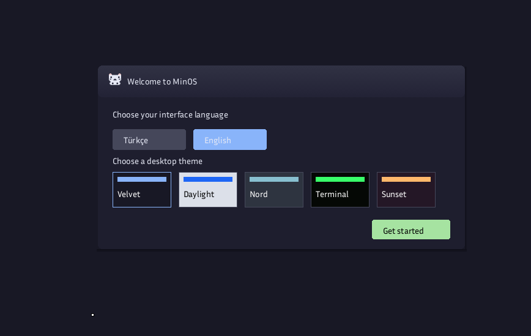
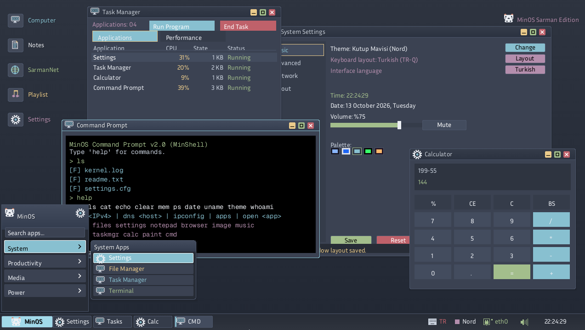
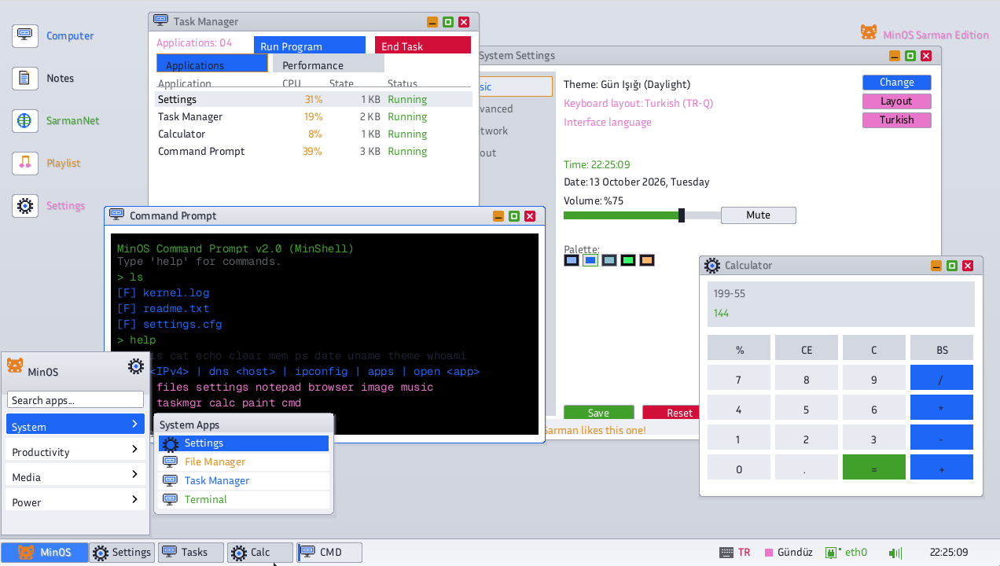

# 🐱 minOs - Sarman Edition

[](https://www.rust-lang.org/)
[]()
[](https://limine-bootloader.org/)
[]()
[]()
[]()
[-lightgrey.svg)]()
[](https://github.com/tbagriyanik/minos/releases)

**minOs (Sarman Edition)**, çekirdek tarafında `no_std` ve `no_main` kullanan, Rust ile geliştirilmiş bağımsız bir 64-bit (`x86_64`) işletim sistemidir. Derleme sırasında `fontdue` kullanılarak TTF yazı tiplerinden bitmap atlasları üretilir; çekirdek bu atlasları grafik arayüzünde kullanır.

---

## 📥 Hazır ISO İndirme (Download)

minOs'u derlemeden doğrudan QEMU, VirtualBox (64bit) veya gerçek donanımda test etmek için hazır ISO imajı:

🔗 **Repo Üzerinden Doğrudan İndir:**  
[https://github.com/tbagriyanik/minos/blob/main/minos.iso](https://github.com/tbagriyanik/minos/blob/main/minos.iso)

---
## 🎥 Tanıtım Videosu

[](https://www.youtube.com/watch?v=fB1MQPZTMEg)

▶️ [Videoyu YouTube'da izleyin](https://youtu.be/fB1MQPZTMEg)
---

## 📸 Ekran Görüntüleri (Screenshots)

### Welcome Ekranı


### Tema 1


### Tema 2


---

## ✨ Özellikler ve Uygulama Paketi

minOs, tam teşekküllü bir masaüstü deneyimi sunan **13 adet yerleşik uygulama** ve pencere yöneticisi içerir:

| Uygulama | Açıklama |
| :--- | :--- |
| **🔘 Başlat Menüsü** | Kategori menüleri (`Sistem`, `Üretkenlik`, `Medya`, `Güç`) altında simgeli grafik listeleme. Klavye ok tuşları, Enter, fare tekerleği gezintisi ve arama. |
| **📁 Dosya Yöneticisi** | Sanal dosya sistemi (VFS/TarFS) gezgini; dosya türü simgeleri (`[LOG]`, `[TXT]`, `[IMG]`, `[SND]`, `[VID]`), boyutlar ve konum çubuğu. `-UsbDisks` ile bağlanan USB belleğin **FAT32** ve CD'nin **ISO9660** içeriği de listelenir. Masaüstü (`/desktop`) gezgenden bağımsız, sabit bir alandır; iki görünüm birbirinin seçim ve gezinme durumunu etkilemez. |
| **⚙️ Sistem Ayarları** | Dört sekme (Temel / İleri / Ağ / Hakkında): beş tema, ses düzeyi, gece ışığı, dil (TR/EN), klavye düzeni, yazı yakınlaştırma, hedef çözünürlük ve bölge seçimi; pencere düzeni kaydetme ve **`settings.cfg` üzerinden kalıcı ayar saklama**. Gerçek ekran modu Limine önyükleme menüsünden seçilir. |
| **📝 Not Defteri** | Üst menü çubuğu (`Dosya`, `Düzen`, `Yardım`), metin temizleme/kaydetme, **Kes / Kopyala / Yapıştır / Tümünü Seç**, **Geri Al / İleri Al** (Ctrl+Z / Ctrl+Y). Türkçe karakter desteği, `Backspace`, `Enter`, **Home / End**, **Shift+ok tuşlarıyla seçim**, satır numaraları ve imleç. |
| **🌐 Web Tarayıcısı** | Yerel `minos://help` ve `minos://cats` sayfaları, sekmeli (tab) gezinme, `file://` adresleriyle yerel dosya görüntüleme ve e1000 üzerinden ARP/ping/DNS test paneli. |
| **🖼️ Resim Gösterici** | Çizim Tahtası'ndan kaydedilen 24-bit `.bmp` çizimlerini ve sanal dosya sistemindeki resimleri açar, yakınlaştırma/uzaklaştırma ve ayrıntılı resim meta verisi paneli sunar; resim yüklenmemişken sevimli kedi maskotunu gösterir. |
| **🎵 Müzik Çalar** | Kullanıcı oynatmayı başlattığında HDA/PC hoparlörü üzerinden ses, animasyonlu spektrum ekolayzerı ve çalma listesi. Sistem açılışında otomatik ses çalınmaz. |
| **🎬 Video Oynatıcı** | Canlı synthwave ufuk sahnesi, neon güneş scanline'ları, aşağı doğru akan 3D perspektif grid yol ve siber araç simülasyonu. |
| **📊 Görev Yöneticisi** | Çekirdek bellek kullanımı, CPU dalgalanma grafiği, görev tablosu, süreç sonlandırma (`Kill`), "Program Aç" başlatma menüsü ve RAM grafik çubuğu. 13 uygulamanın tamamı (Kurulum Sihirbazı ve 3D Gösterici dahil) listelenir. |
| **🧮 Hesap Makinesi** | Klavyeyle giriş yapılabilen ifade hesaplayıcı (`+`, `-`, `*`, `/`); 128 bit sabit nokta aritmetiğiyle geniş sayı aralığı ve altı basamağa kadar ondalık hassasiyet. `Backspace` ve `Esc` ile düzenleme/temizleme. |
| **🎨 Çizim Tahtası** | Piksel tabanlı serbest çizim tuvali, renk paleti ve dairesel silgi aracı. Fare basılı tutuldukça **sürekli/akıcı çizim**, fırça kenarının otomatik kırpılması, doğrudan `/root/Documents/cizim.bmp` formatında kaydetme/açma ve 4096 noktalık tuval geçmişi. |
| **⌨️ Komut İstemi (MinShell)** | UNIX/DOS benzeri etkileşimli kabuk: dosya/klasör yönetimi, bellek durumu, ağ teşhisi, `curl` ile HTTP indirme, uygulama başlatma, Tab tamamlama ve komut geçmişi. |
| **💽 Tek Tıkla Kur (Kurulum Sihirbazı)** | Adımlı kurulum penceresi: **1)** hedef disk seçimi (ATA sabit disk / QCOW2), **2)** `Biçimlendir (FAT32)` butonu ile diski biçimlendirme ve **3)** `Tek Tıkla Kur` ile kalıcı kurulum. Kurulum; `MINOS.SYS` işaret dosyasını, `BENIOKU.TXT`, mevcut `settings.cfg` ayarlarını ve VFS ağacının tamamını (`VFS.DAT` anlık görüntüsü) diske yazar. Disk değiştirildiğinde biçimlendirme/kurulum durumu sıfırlanır; TR/EN dilleri ve ilerleme çubuğu desteklenir. |
| **🧊 3D Gösterici** | Küp, silindir, küre ve piramit mesh'lerini dolgulu gölgelendirme veya tel kafes modunda gösterir; sürükleyerek döndürme, yakınlaştırma, otomatik döndürme ve `.3d` dosyalarından şekil/metin yükleme. Arka-yüz eleme ve uzaktan-yakına ressam sıralaması ile doğru katı cisim görünümü. |

> **Not:** `src/apps/` altındaki **Kontrol Paneli** (`controlpanel.rs`) kod tabanında mevcuttur; ayarlar ve kişiselleştirme işlevleri **Sistem Ayarları** (`settings.rs`) üzerinden yürütülmektedir.

---

## 💻 Komut İstemi (MinShell) Desteklenen Komutlar

MinShell, klavye geçmişi (Yukarı/Aşağı oklar), akıllı sekme tamamlama (`Tab`) ve dinamik çıktı kaydırma desteğiyle aşağıdaki komutları destekler:

### 1. Dosya ve Dizin Yönetimi
| Komut | Kullanım | Açıklama |
| :--- | :--- | :--- |
| `pwd` | `pwd` | Geçerli çalışma dizinini (CWD) ekrana yazar. |
| `cd` | `cd <dizin>` | Çalışma dizinini değiştirir (`cd ..`, `cd /`, `cd ~` veya göreceli/mutlak yollar). |
| `ls` | `ls [dizin]` | Geçerli dizindeki veya hedefteki dosya ve klasörleri boyutlarıyla listeler. |
| `cat` | `cat <dosya>` | Metin dosyasının içeriğini terminale yazdırır. |
| `touch` | `touch <dosya>` | Sanal dosya sisteminde yeni ve boş bir dosya oluşturur. |
| `write` | `write <dosya> <metin>` | Belirtilen dosyaya metin verisi yazar/üzerine kaydeder. |
| `mkdir` | `mkdir <klasor>` | Yeni bir sanal klasör oluşturur. |
| `rm` | `rm <hedef>` | Belirtilen dosya veya dizini siler. |
| `disks` / `df` | `disks` veya `df` | Bağlı IDE/ATA kanallarını, USB (FAT32), Sabit Disk ve CD-ROM sürücülerini listeler. |

### 2. Sistem Bilgisi ve Bellek
| Komut | Kullanım | Açıklama |
| :--- | :--- | :--- |
| `mem` | `mem` | Fiziksel Bellek Yöneticisi (PMM) üzerinden toplam ve boş bellek miktarını (KB) gösterir. |
| `ps` | `ps` | Çekirdek ve aktif sistem süreçlerini (PID, isim) listeler. |
| `date` | `date` | Gerçek Zamanlı Saat (RTC / CMOS) üzerinden güncel tarih ve saati gösterir. |
| `uname` | `uname` | minOs çekirdek sürümünü ve mimari bilgisini (`x86_64 Sarman Edition v2.0`) yazar. |
| `whoami` | `whoami` | Aktif kullanıcı yetkisini gösterir (`sarman (root)`). |
| `theme` | `theme` | Masaüstü temasını komut satırından anında sıradaki temaya geçirir. |
| `clear` | `clear` | Terminal ekranını temizler. |
| `help` | `help` | Kullanılabilir temel komutların özet listesini görüntüler. |

### 3. Ağ Teşhisi ve Araçları
| Komut | Kullanım | Açıklama |
| :--- | :--- | :--- |
| `ipconfig` | `ipconfig` | `eth0` arabiriminin yerel IP, ağ maskesi, ağ geçidi, DNS, MAC adresi ve DHCP durumunu raporlar. |
| `ping` | `ping <IPv4>` | Belirtilen IPv4 hedefine ICMP Echo Request paketi gönderir. |
| `dns` | `dns <alan_adi>` | Belirtilen sunucu adı için yapılandırılmış DNS sunucusuna UDP DNS sorgusu iletir. |
| `curl` | `curl http://<host>[:port][/yol]` | Soket API üzerinden HTTP GET indirir: durum kodu + gövde; chunked kod çözme ve 3xx yönlendirme takibi desteklenir (`https` desteklenmez). |

### 4. Uygulama Başlatma
| Komut | Alternatifler | Açıklama |
| :--- | :--- | :--- |
| `open <uygulama>` | `run <uygulama>` | İstenen masaüstü uygulamasını yeni veya mevcut pencerede açar. |
| Doğrudan İsim | `files`, `notepad`, `calc`, `paint`, `browser`, `image`, `music`, `video`, `taskmgr`, `settings`, `cmd` | Uygulama adı doğrudan komut olarak yazıldığında ilgili grafik arayüz penceresi odaklanır/açılır. |

---

## ⚠️ Durum Raporu: Tam Çalışmayan / Kısmi Düzeydeki Özellikler

minOs geliştirme aşamasında bir işletim sistemi çekirdeğidir. Bazı bileşenler protokol veya simülasyon düzeyinde hazır olup tam donanım/yığın entegrasyonu aşamasındadır:

1. **Ağ Yanıt Kuyruğu (ICMP/DNS Reply Polling):**
   - `ping` komutu e1000 üzerinden gerçek ICMP Echo Request paketini başarıyla TX halkasına iletir; ancak gelen ICMP Echo Reply paketinin asenkron olarak terminale bildirilmesi henüz tam olay döngüsüne bağlanmamıştır.
   - DNS artık eşzamanlı çözümleniyor (`resolve_host()`: önbellek → dotted-quad → 5 sn zaman aşımlı UDP sorgusu) ve `curl`/HTTP yolu bunu kullanıyor; ham `dns` komutu sorguyu iletir, yanıt `take_dns_result()` ile alınır.
2. **Çoklu Çekirdek (SMP) Görev Dağıtımı:**
   - QEMU `-CpuCount N` parametresiyle çoklu sanal çekirdek tanımlanabilir; ancak minOs çekirdeği şimdilik tek çekirdekte iş planlaması yürütür (SMP AP çekirdekleri henüz uyandırılıp iş yükü paylaştırılmaz).
3. **Fiziksel Blok Depolama ve Kalıcı Yazma (FAT32 / Ext2 Persistence):**
   - Sabit disk (IDE/ATA Master) ve USB depolama aygıtlarında **tam sektör okuma ve yazma (`write_sector`, `flush_cache`)** ile **FAT32 dosya formatlama ve dosya yazma/silme** yeteneği aktiftir.
   - **Ext2 okuma/yazma** (`src/fs/ext2.rs`): superblock + BGDT + inode tabanlı, direct + single-indirect blok destekli dosya okuma/yazma/oluşturma/silme ve `mkdir`; açılışta FAT32'den önce Ext2 bölümü denenir.
   - **Bölümleme (`src/fs/part.rs`):** MBR (4 girdi) ve GPT (koruyucu MBR + 128 girdilik dizi, Linux GUID) tarama/listelme ve yazma.
   - Kurulum Sihirbazı diski FAT32 olarak biçimlendirir ve `settings.cfg` gibi sistem ayarlarını diske kalıcı olarak kaydeder. Sonraki açılışlarda ayarlar geri yüklenir.
   - **VFS anlık görüntüsü (`VFS.DAT`):** VFS ağacının tamamı (dosyalar, klasörler, masaüstü öğeleri, çöp kutusu içeriği) her dosya/klasör işleminde otomatik olarak FAT diske `VFS.DAT` olarak yazılır ve açılışta geri yüklenir. Böylece oluşturma, silme, taşıma, kopyalama, yeniden adlandırma ve geri dönüşüm kutusu işlemleri **yeniden başlatma sonrasında bile korunur**. Kurulum sırasında mevcut ağaç biçimlendirilen diske anında kaydedilir.
4. **HDA Donanımsal DMA İlerlemesi ve Çoklu Sanallaştırma Uyumluluğu:**
   - Intel HDA ses sürücüsü; evrensel PCI taraması (Class `0x0403` + bilinen aygıtlar), 64-bit BAR0 desteği, donanımsal CRST/SRST sıfırlama döngüleri, AFG/DAC/Pin D0 güç yönetimi, 128-bayt hizalı donanımsal DMA Position Buffer (offset `0x70`) ve atomik 32-bit SDnCTL yazımı ile QEMU, VirtualBox, VMware ve gerçek donanımda tam uyumlu hale getirilmiştir. Ses çalınırken DMA ilerlemesi (LPIB/DPIB ve BCIS bayrağı) anlık doğrulanır; ana makine ses aygıtı bulunmayan sanallaştırma ortamlarında sistem otomatik olarak kesintisiz PC Speaker PWM yedeğine geçiş yapar. Ayarlar uygulamasındaki Donanım Testleri sekmesinden ses alt sistemi (DMA ve hoparlör) doğrudan test edilebilir.
5. **ATAPI CD-ROM READ CAPACITY:**
   - QEMU DVD-ROM sürücüsü tespit edilir; ancak ISO medyası takılı olmadığında kapasite 0 MB olarak okunur.
6. **Kullanıcı Modu (Ring 3) ve SMP Paralelliği:**
   - Limine SMP protokolü ile çok çekirdekli AP başlatımı, çekirdek yığınları, GDT TSS kullanıcı segmentleri, Ring 3 kullanıcı kipi izolasyonu (`int 0x80` sistem çağrıları, #GP/#PF hata yakalama ve çekirdek güvenliği) ve çekirdekler arası atomik paralel iş kuyruğu (`parallel_checksum`) tam olarak doğrulanmıştır.

---

## 🗺️ Gelecek Planları ve Yol Haritası (Roadmap)

> Detaylı mimari ve faz planı için: [`planlama.md`](planlama.md)

Yakın ve orta vadede minOs için planlanan başlıca geliştirmeler:

- [x] **Gelişmiş TCP/IP Yığını & Socket API:**
  - Soket başına durum makineli TCP (`src/drivers/socket.rs`): 3'lü el sıkışma, sıra/ack takibi, üssel geri çekilmeli yeniden iletim, 8 eşzamanlı soket; `socket()`, `connect()`, `send()`, `recv()`, `close()`, UDP `sendto()`/`recvfrom()`, önbellekli `resolve_host()`.
  - Komut satırından `curl http://...` ile dosya indirme (`src/drivers/http.rs`: chunked çözümü, 3xx yönlendirme takibi).
- [x] **Kalıcı FAT32 / Ext2 Dosya Sistemi Desteği:**
  - Ext2 read-write ve MBR/GPT bölümleme (`src/fs/ext2.rs`, `src/fs/part.rs`) tamamlandı.
- [ ] **Tam Ring 3 Kullanıcı Alanı & Syscall API:**
  - `int 0x80` veya `syscall`/`sysret` mimarisiyle çekirdekten izole kullanıcı alanı süreçleri.
  - Bağımsız kullanıcı programları için dinamik bellek ve sayfa koruması.
- [ ] **SMP (Symmetric Multiprocessing) Desteği:**
  - ACPI / MADT tablolarını okuyarak AP çekirdeklerini uyandırma (INIT-SIPI-SIPI).
  - Çok çekirdekli kilit mekanizmaları ve çekirdekler arası görev zamanlayıcısı (Preemptive Round-Robin Scheduler).
- [ ] **Paket Yöneticisi (`minpkg`):**
  - Uzak sunucudan minimal kullanıcı uygulamalarını ve script'leri çekip kurabilen hafif bir paket yöneticisi.
- [ ] **Gelişmiş Grafik Sürücüleri & 2D Hızlandırma:**
  - Yazılımsal çift tamponlama (double buffering) üzerine donanım hızlandırmalı fare imleci ve VESA/BGA çözünürlük değiştirme desteği.

### 🆕 Modern Arayüz ve Kullanılabilirlik Yenilikleri

- **🌐 Soket API & `curl`:** Çekirdekte BSD tarzı soketler (`socket`/`connect`/`send`/`recv`/`close`, UDP, DNS önbelleği) ve komut istemcisinden `curl http://...` ile HTTP indirme (chunked + yönlendirme destekli).
- **👋 Hoş Geldin Ekranı:** Masaüstü açılmadan önce arayüz dilini (Türkçe/English) ve beş masaüstü temasından birini seçin. Tercihler anında uygulanır ve kalıcı olarak diske kaydedilir.
- **🚀 Limine Açılış Menüsü (Live & Kurulu Sistem Seçenekleri):**
  - **`minOs Live Environment`**: Kurulum yapmadan doğrudan RAM üzerinden çalışan Live CD ortamı.
  - **`minOs Installed System`**: Diske kurulmuş kalıcı minOs sistemine doğrudan giriş.
  - **`Display Resolutions`**: 800×600 (SVGA), 1024×768 (XGA), 1280×720 (HD) ve 1920×1080 (FHD) seçenekleriyle açılış çözünürlüğü menüsü.
- **💽 Tek Tıkla Kur & Kalıcı Depolama (Persistent Storage):** Masaüstündeki veya Başlat menüsündeki "minOs'u Kur" sihirbazı ile seçilen hedef sabit disk (ATA / QCOW2) tek tıkla FAT32 olarak biçimlendirilir, `MINOS.SYS` kurulum işaretçisi, sistem yapılandırması ve VFS ağacının tamamı (`VFS.DAT`) diske yazılır. Kullanıcı dosyaları, klasörleri, masaüstü öğeleri, çöp kutusu içeriği ve ayarlar (`settings.cfg`) sonraki açılışlarda otomatik olarak geri yüklenir.
- **🖱️ Masaüstü ve Giriş Alanı Sağ Tık Simgeleri & Kısayol İpuçları:** Masaüstü sağ tık menüsünde ve metin kutusu/textarea sağ tık menülerinde görsel simgeler ile kısayol bilgileri (Ctrl+C, Ctrl+X, Ctrl+V, Ctrl+O, Ctrl+S) gösterilir.
- **📐 Sağ Kenara Dayalı Scrollbar ve Dıştan Resize:** Kaydırma çubukları pencere sağına tam yaslanır; pencere sağ resize tutamaçları pencere dışından da rahatça yakalanabilir.
- **📜 Not Defteri Satır Numaraları:** Not Defteri satır numaralandırması netleştirildi; dikey kaydırma ve imleç takibiyle tam hizalı çalışır.
- **🇹🇷 Tam Türkçe Karakter Desteği:** Sistem Ayarları, Görev Yöneticisi, Not Defteri, Dosya Yöneticisi, Başlat menüsü ve durum çubukları dahil arayüzdeki tüm metinler Türkçe karakterlerle (`ç`, `Ç`, `ğ`, `Ğ`, `ı`, `I`, `İ`, `ö`, `Ö`, `ş`, `Ş`, `ü`, `Ü`) işlenir.
- **🔤 TTF Tabanlı Fontlar:** Genel arayüz Inria Sans, komut istemi Geist Mono kullanır. Derleme betiği fontların sunduğu karakterlerden bitmap atlas oluşturur; yazı yakınlaştırma ayarı arayüzde uygulanır.
- **⌨️ Klavyeyle Menü Gezintisi (Ok Tuşları & Enter):** Başlat menüsü ve bağlam menülerinde **Yukarı/Aşağı/Sol/Sağ ok tuşları** ile gezinebilir, **Enter** tuşuna basarak seçili uygulamayı veya komutu çalıştırabilirsiniz.
- **🖱️ Fare Tekerleği (Scroll Wheel) Desteği:** Başlat menüsü açıkken fare tekerleğiyle liste seçenekleri arasında geçiş yapılabilir. Pencere içerikleri ve açılış logu dikey olarak kaydırılabilir.
- **📐 Daha Geniş Kenar Tutamaçları (12px Resize Grip):** Pencereleri kenarlarından tutup boyutlandırma alanı 8 pikselden **12 piksele** çıkarıldı. Artık pencerelerin kenar ve köşelerinden tutulması ve boyutlandırılması çok daha kolaydır.
- **🖼️ Masaüstü Simgesi Tıklama Koruması:** Açık ve görünür bir pencere masaüstü simgelerinin üzerine geldiğinde, pencereye tıklanıldığında altındaki masaüstü simgelerinin istemeden açılması engellendi.
- **🎨 Dinamik Tema ve Kontrast:** Kadife Gece, Gün Işığı, Kutup Mavisi, Yeşil Terminal ve Gün Batımı temaları arasında canlı geçiş. Düğme ve seçili öğe metinleri zemin rengine göre siyah veya beyaz seçilerek kontrast korunur.
- **🪟 Akıllı Pencere Yönetimi:** Çift tıkla maksimize etme, ekranın en üstüne sürükleyerek otomatik maksimize (snap) etme, pencere ortalama, simge durumuna küçültme ve yumuşak z-sırası odak yönetimi.
- **🗔 Çoklu Pencere:** Dosya yöneticisi, not defteri ve diğer desteklenen uygulamalar birden fazla pencerede açılabilir. Sistem Ayarları ve Görev Yöneticisi tek örnek olarak çalışır.
- **📌 Menülerin Dış Tıklamayla Kapanması:** Başlat, sağ tık, ses, takvim ve Görev Yöneticisi açılır menüsünün dışına tıklayınca menü kapanır; tıklama hedefteki pencere veya görev çubuğu öğesine iletilir.
- **📋 Not Defteri Açılır Menü Komutları:**
  - **Dosya:** Yeni Belge, Kaydet, Temizle
  - **Düzen:** Kes, Kopyala, Yapıştır, Tümünü Seç
  - **Yardım:** Not Defteri Hakkında
- **📝 Gelişmiş Metin Düzenleme:**
  - **Çift tıkla kelime seçimi:** Herhangi bir kelimeye çift tıklayarak o kelimeyi seçin.
  - **Sürükleyerek seçim:** Sol tuşu basılı tutup fareyi sürükleyerek metin seçin; tıklanan karaktere doğru imleç konumlanır (satır kaydırma ve dikey kaydırma hesaba katılır).
  - **Home / End:** İmleci satır başına/sonuna taşır.
  - **Shift + Ok Tuşları:** Yukarı/Aşağı/Sol/Sağ ile seçimi genişletir.
  - **Geri Al / İleri Al:** `Ctrl+Z` (Geri Al) ve `Ctrl+Y` (İleri Al) — 32 seviyelik düzenleme geçmişi.
- **🎨 Piksel Tabanlı Çizim:**
  - **Basılı Tutup Çizme:** Sol tuşu basılı tuttukça fare hareketi sürekli çizer; hızlı hareketlerde iki nokta arası enterpolasyonla doldurulup kesik çizgi oluşmaz.
  - **Otomatik Vuruş Bittiği:** Tuval dışına çıkıldığında veya tuş bırakıldığında kalem yolu otomatik sonlanır.
  - **Renk Paleti ve Silgi:** Mavi/Kırmızı/Yeşil/Siyah renk örnekleri, dairesel **Silgi** ve **Temizle** düğmeleri.

---

## 🖥️ Minimum Donanım Gereksinimleri (Minimum Hardware Requirements)

| Bileşen | Minimum | Önerilen |
| :--- | :--- | :--- |
| **CPU** | x86_64 (64-bit), SSE2 desteği | x86_64, SSE4.1+ |
| **RAM** | **4 MB** | 32 MB – 64 MB |
| **Depolama** | Yalnızca CD/ISO (RAM tabanlı) | 64 MB+ qcow2 disk |
| **Ekran** | 1280×720 32-bit framebuffer | 1280×720 veya daha yüksek |
| **Ses** | — (isteğe bağlı) | HDA uyumlu |
| **Ağ** | — (isteğe bağlı) | e1000 uyumlu Ethernet |

> **Not:** minOs 4 MB RAM ile stabil çalışır; grafik arayüzü, font atlasları ve çekirdek tamponları bu alanda sığar. QEMU'da test için `-Memory 4M` parametresi yeterlidir. FAT32 disk yazma gibi özellikler için 32+ MB önerilir.

---

## 🛠️ Sistem Gereksinimleri (Prerequisites)

minOs'u kaynak kodundan derlemek ve çalıştırmak için aşağıdaki araçlar gereklidir:

1. **Rust Nightly Toolchain:**
   ```powershell
   rustup default nightly
   rustup component add rust-src
   ```
2. **QEMU x86_64 Emulator:**
   - [QEMU Resmi İndirme Sayfası](https://www.qemu.org/download/#windows)
   - Varsayılan kurulum yolu: `C:\Program Files\qemu\qemu-system-x86_64.exe`
3. **ISO Oluşturma Aracı:**
   - Windows için: `oscdimg.exe` (Windows ADK veya projedeki paketleyici).
   - Linux / macOS için: `xorriso` veya `mkisofs`.
4. **PowerShell 5.1+ (Windows):** Derleme ve ISO paketleme otomasyonları için.

---

## 🚀 Derleme ve Çalıştırma Adımları (Build & Run)

### Tek Komutla Derle ve Başlat (Önerilen)
minOs, çekirdeği derleyen, ISO dosyasını paketleyen ve QEMU'yu başlatan hazır bir betik içerir:

```powershell
# Depoyu klonlayın ve dizine girin
git clone https://github.com/tbagriyanik/minos.git
cd minos

# Derleyin ve QEMU üzerinde çalıştırın
powershell -ExecutionPolicy Bypass -File .\run.ps1
```

#### `run.ps1` Seçenekleri (Switches)

`run.ps1`, çekirdeği `cargo build` ile derledikten sonra ISO'yu paketler ve QEMU'yu başlatır. Aşağıdaki anahtarlar ile davranışı özelleştirebilirsiniz:

| Anahtar | Açıklama |
| :--- | :--- |
| `-BuildOnly` | Yalnızca derler; QEMU'yu başlatmadan çıkar. Hızlı derleme kontrolü için idealdir. |
| `-Debug` | Debug profilinde derler (`target\x86_64-minos\debug\minos-kernel`). Varsayılan **release**'dir. |
| `-NoIso` | ISO dosyasını bağlamaz (`-cdrom` argümanını iptal eder); sistemi doğrudan sabit diskten (`-boot c`) başlatır. |
| `-Live` | Canlı ortamı zorlar; sabit disk kurulu olsa bile ISO üzerinden başlatır (`-boot d`). |
| `-ReprepareDisk` | Sabit diski yeniden biçimlendirip MBR ve VFS ağacını sıfırdan kurar (`build_disk.ps1 -Force`). |
| `-DiskImage dosya.qcow2` | Bağlanacak sanal disk imajının yolu (varsayılan `.\disk.qcow2`). |
| `-UsbDisks` | Sistemdeki USB diskleri **salt okunur** olarak QEMU'ya `usb-storage` aygıtı olarak bağlar. |
| `-UsbDiskReadWrite` | USB diskleri **yazma izniyle** bağlar (dikkatli kullanın). |
| `-CpuCount N` | QEMU'ya verilecek sanal CPU sayısı (varsayılan `2`, aralık `1–64`). |
| `-Memory 1G` | Konuk RAM miktarı (`512M`, `1G` gibi; varsayılan `512M`). |

---

### 💽 ISO Olmadan Sabit Diskten (QCOW2 / RAW) Boot Etme

minOs, canlı ISO olmadan doğrudan kurulu bir sabit disk üzerinden açılabilir.

#### 1. Doğrudan Sabit Diskten Başlatma:
```powershell
powershell -ExecutionPolicy Bypass -File .\run.ps1 -NoIso -DiskImage .\disk.qcow2
```

#### 2. Akıllı Boot Doğrulaması:
- Eğer `-NoIso` ile başlatırsanız veya ISO ortamı yoksa, `run.ps1` diskin önyüklenebilirliğini otomatik denetler:
  - **Disk Boş / Formatsız ise:** QEMU açılmaz; kullanıcıya güvenli bir hata mesajı verilir:
    ```text
    [HATA] Disk formatli/onyuklenebilir degil (.\disk.qcow2). Sistem boot edilemez!
    [IPUCU] Once ISO ile baslatip 'Kur' uygulamasini calistirin veya build_disk.ps1 ile diski hazirlayin.
    ```
  - **Disk Formatlı ve MBR Önyükleyicisi Kurulu ise:** Doğrudan sabit diskten (`-boot c`) açılır.

#### 3. Bağımsız Disk Hazırlama Aşamaları:
Bir diski ISO olmadan boot edilebilir hale getirmek için iki yöntem vardır:

- **Yöntem A (minOs İçinden - Kurulum Sihirbazı):**
  1. `.\run.ps1` ile ISO canlı ortamında başlatın.
  2. Masaüstündeki **"Kur" (Kurulum Sihirbazı)** uygulamasını açın.
  3. Hedef diski seçip **"Tek Tıkla Kur"** düğmesine basın.
  4. minOs çekirdeği diske otomatik olarak:
     - 1 MiB hizalı MBR bölüm tablosu (`LBA 2048`, `0x80 Active`, `FAT32 LBA`),
     - Limine MBR Stage 1 & Stage 2 önyükleyici kodlarını,
     - `/boot/limine/limine.conf`, `limine-bios.sys`, `minos-kernel` ve sistem dosyalarını yazar.
  5. Makineyi kapatıp `.\run.ps1 -NoIso` ile ISO'suz doğrudan açabilirsiniz.

- **Yöntem B (Windows PowerShell ile Hazırlama):**
  ```powershell
  # 256 MB boyutunda önyüklenebilir disk oluşturur ve Limine BIOS'u kurar:
  powershell -ExecutionPolicy Bypass -File .\build_disk.ps1 -DiskImage .\disk.qcow2 -Force
  ```

---

### Adım Adım Manuel Derleme (Manual Steps)

#### 1. Çekirdeği Derleme (Kernel Build)
minOs çekirdeği, özel hedef mimarisi ve `-Zbuild-std` ile gereken çekirdek kütüphanelerini kaynak kodundan derleyerek oluşturulur:

```powershell
cargo build --release -Zjson-target-spec --target x86_64-minos.json `
  -Zbuild-std=core,alloc -Zbuild-std-features=compiler-builtins-mem
```

#### 2. Boot Edilebilir ISO İmajını Paketleme (ISO Creation)
Limine bootloader dosyalarını çekirdekle birleştirmek ve El Torito tablosunu yamalamak için:

```powershell
powershell -ExecutionPolicy Bypass -File .\build_iso.ps1
```
> *İşlem tamamlandığında kök dizinde `minos.iso` dosyası oluşturulur.*

#### 3. QEMU ile Test Etme (Run in QEMU)
```powershell
& 'C:\Program Files\qemu\qemu-system-x86_64.exe' -cdrom minos.iso -m 512M -vga std `
  -audiodev driver=sdl,id=snd0 -device intel-hda -device hda-output,audiodev=snd0 `
  -netdev user,id=n0,hostfwd=tcp::8080-:80 -device e1000,netdev=n0
```

#### 4. VirtualBox Kurulumu & Temel Ayarlar (VirtualBox Setup)

VirtualBox üzerinde minOs çalıştırmak için gereken temel ve önerilen sanal makine yapılandırması:

| Ayar Kategorisi | Önerilen / Minimum Değer | Açıklama |
| :--- | :--- | :--- |
| **İşletim Sistemi Türü** | **Other / Other (64-bit)** | Çekirdek x86_64 long modda çalıştığı için mutlaka 64-bit seçilmelidir. |
| **Temel Bellek (RAM)** | **128 MB – 512 MB** *(Min: 4 MB)* | Canlı masaüstü, font atlasları ve çoklu pencere için 256 MB veya 512 MB idealdir. |
| **İşlemci (CPU)** | **1 veya 2 vCPU** | VT-x / AMD-V sanallaştırma açık olmalıdır. |
| **Ekran Belleği (VRAM)** | **16 MB – 32 MB** | 1280x720 32-bit çözünürlük için en az 16 MB ayrılmalıdır. |
| **Grafik Denetleyicisi** | **VBoxVGA** veya **VMSVGA** | 3D hızlandırmayı kapatın (yazılımsal framebuffer kullanılır). |
| **Sabit Disk (İsteğe Bağlı)** | **256 MB – 1 GB** *(VDI / RAW)* | Canlı ISO testi için disk gerekmez. Kalıcı kurulum için SATA veya IDE olarak ekleyin. |
| **Ses Denetleyicisi** | **Intel HD Audio** | minOs HDA ses çıkış codec'i ile tam uyumludur. |
| **Ağ Bağdaştırıcısı** | **Intel PRO/1000 MT Desktop (82540EM)** | e1000 sürücüsüyle DHCP, ping ve HTTP desteği sağlar. |

> **⚠️ Önemli VirtualBox Sorun Giderme Notları:**
> 1. **`PANIC: limine: This CPU does not support 64-bit mode`:** Sanal makine türünün `Other (64-bit)` olduğundan ve BIOS'ta işlemci sanallaştırmasının (VT-x / AMD-V) açık olduğundan emin olun.
> 2. **Siyah Ekran Hatası:** Sanal makine ayarları -> **Ekran** -> **Grafik Denetleyicisi**'ni **VBoxVGA** olarak ayarlayın ve **3B Hızlandırmayı** devre dışı bırakın.
> 3. **ISO Olmadan Başlatma:** Diske kurulum yaptıysanız (veya `build_disk.ps1` ile hazırladıysanız), CD/DVD sürücüsünden `minos.iso` dosyasını çıkarın. Sistem doğrudan MBR üzerinden açılacaktır.

---

## 🎮 Masaüstü Kullanımı ve Kısayollar

- **Başlat Menüsünde Gezinme:** Klavye **Yukarı / Aşağı / Sol / Sağ ok tuşları** ile menüler arasında dolaşın, **Enter** ile seçili uygulamayı çalıştırın veya **fare tekerleğini** çevirerek kaydırın.
- **Açılış Çözünürlüğü Seçimi:** Limine menüsünde minOs çözünürlük girdilerinden birini seçin. Hoş geldin ekranı ve Sistem Ayarları çözünürlük tercihini kaydeder; çalışan framebuffer modunu değiştirmez.
- **Açılış Günlüğü Kaydırma:** Hoş geldin ekranındaki log paneli üzerinde fare tekerleğini kullanarak daha eski veya yeni satırlara gidin.
- **Pencere Boyutlandırma:** Pencerelerin herhangi bir kenarından veya köşesinden basılı tutarak boyutlandırın (tutma alanı 12px'e çıkarılmıştır).
- **Pencere Taşıma (Drag & Drop):** Herhangi bir pencerenin üst başlık çubuğuna sol tıklayıp basılı tutarak ekran üzerinde sürükleyin.
- **Pencere Kontrolleri:**
  - Kırmızı `[x]` butonu: Pencereyi kapatır.
  - Yeşil `[□]` butonu: Pencereyi maksimize eder (tekrar tıklayınca geri yükler). Başlık çubuğuna **çift tıklamak** da aynı işi yapar.
  - Sarı `[-]` butonu: Pencereyi simge durumuna küçülterek görev çubuğuna indirir.
- **Pencere Yerleştirme (Snap):** Başlık çubuğunu ekranın en üstüne sürükleyip bırakırsanız pencere otomatik olarak maksimize edilir.
- **Pencere Değiştirme:** `Alt+Tab` pencereler arasında soldan sağa ilerler; `Shift+Alt+Tab` aynı sırada geriye gider. Alt tuşunu bırakınca seçili pencere öne gelir.
- **Super Kısayolları:** `Super+D` masaüstünü gösterir/geri getirir, `Super+M` tüm pencereleri küçültür, `Super+E` Dosya Yöneticisi'ni açar. Küçültülmüş pencereler de `Alt+Tab` listesinde görünür ve seçilince geri açılır.
- **Sistem Tepsisi (Sağ Alt):** Sırasıyla **klavye rozeti (`TR`/`EN`)**, **tema düğmesi**, **SES** düğmesi ve **canlı saat** bulunur. Saate tıklayınca canlı takvim, **SES**'e tıklayınca ses paneli açılır.
- **Tema Değiştirme:** Görev çubuğundaki renk örneğine, Sistem Ayarları > **Değiştir** düğmesine, **tema palet şeridindeki renk örneklerine** veya masaüstü sağ tık > **Tema Değiştir**'e tıklayın.
- **Bağlama Duyarlı Sağ Tık:** Masaüstünde, Not Defteri'nde, Dosya Yöneticisi'nde veya pencere başlığında özel sağ tık menüleri açılır.
- **Not Defteri Düzenleme Kısayolları:** `Ctrl+C` (Kopyala), `Ctrl+X` (Kes), `Ctrl+V` (Yapıştır), `Ctrl+A` (Tümünü Seç), `Ctrl+Z` (Geri Al), `Ctrl+Y` (İleri Al), `Delete` (İleri sil), `Home`/`End` (satır başı/sonu) ve `Shift+Ok tuşları` (seçim genişletme).
- **Not Defteri Menüsü:** **Dosya** menüsünden yeni belge, açma, kaydetme ve temizleme; **Düzen** menüsünden kesme, kopyalama, yapıştırma ve tümünü seçme işlemleri yapılır.
- **Çizim Tahtası Kullanımı:** Araç çubuğundan renk, **Silgi**, **Aç** veya **Kaydet** seçin; tuval üzerinde sol tuşu basılı tutarak çizin. `C` tuşu tuvali temizler, `E` tuşu silgiyi açıp kapatır. Çizimler 24-bit BMP olarak `/root/Documents/cizim.bmp` konumuna kaydedilir.
- **Resim Görüntüleyici:** `+`/`=` yakınlaştırır, `-` uzaklaştırır, `0` varsayılan ölçeğe döner. Fare tekerleği de yakınlaştırma/uzaklaştırma için kullanılabilir; geçerli oran arayüzde gösterilir.
- **Medya Tuşları:** Klavyedeki ses açma, ses kısma, susturma, oynat/duraklat, önceki parça ve sonraki parça tuşları çalışır. Ses düzeyi `%5` adımlarla değişir.

---

## 📂 Proje Dizin Yapısı

```
minos/
├── src/
│   ├── arch/x86_64/         # SSE, IDT kesmeleri ve PIC maskeleme
│   ├── drivers/             # video (framebuffer), PS/2 fare & klavye, RTC (CMOS) saat,
│   │                        #   e1000 + TCP/IP yığını (netstack) + soket API (socket.rs) + HTTP (http.rs),
│   │                        #   HDA ses, ATA/ATAPI (PIO) ve USB durum katmanı
│   ├── gui/                 # MinGUI pencere yöneticisi, font motoru, tema motoru (theme.rs),
│   │                        #   kaydırma çubuğu ve pano (clipboard)
│   ├── apps/                # 13 Masaüstü uygulaması (Not Defteri, Dosya Yöneticisi, Görev Yöneticisi, 3D Gösterici...)
│   ├── mm/                  # Fiziksel bellek yöneticisi (PMM)
│   ├── fs/                  # Sanal dosya sistemi (vfs.rs) + disk okuyucuları (diskfs.rs: FAT32 + ISO9660),
│   │                        #   Ext2 read-write (ext2.rs) + MBR/GPT bölümleme (part.rs)
│   └── main.rs              # Çekirdek giriş noktası (_start), Limine istekleri ve ana olay döngüsü
├── boot/                    # Limine bootloader yapılandırma dosyaları (limine.cfg)
├── docs/screenshots/        # Masaüstü ve başlat menüsü ekran görüntüleri
├── build_iso.ps1            # El Torito yamalı hibrit ISO oluşturucu
├── run.ps1                  # Tek tıkla derleme ve QEMU başlatma betiği (-Debug, -BuildOnly, -UsbDisks, -UsbDiskReadWrite, -CpuCount, -Memory, -DiskImage)
├── build.rs                 # fontdue ile TTF → bitmap font atlası üretimi
└── x86_64-minos.json        # Hedef x86_64 Long Mode tanımlama dosyası
```

---

## 📊 Kod İstatistikleri (Code Statistics)

> Son güncelleme: 15 Ekim 2026

| Ölçüt | Değer |
| :--- | :--- |
| **Toplam Rust Kaynak Dosyası** | 51 dosya (`src/**/*.rs`) |
| **Toplam Kod Satırı (ham)** | 27.435 satır |
| **Etkin Kod Satırı** (boş ve `//` yorum satırları hariç) | 23.297 satır |
| **Dil** | Rust (Nightly, `no_std`) |
| **Derleme Hedefi** | `x86_64-minos` (özel bare-metal) |
| **Yerleşik Uygulama Sayısı** | 13 masaüstü uygulaması + Pencere Yöneticisi |
| **Kernel / ISO Boyutu** | ~7.1 MB (fontlar ve Limine bootloader dahil) |

---

## 📄 Lisans

Bu proje açık kaynaklıdır ve eğitim/araştırma amaçlı geliştirilmektedir.
Katkıda bulunmaktan ve geliştirmeler önermekten çekinmeyin! 🐾
