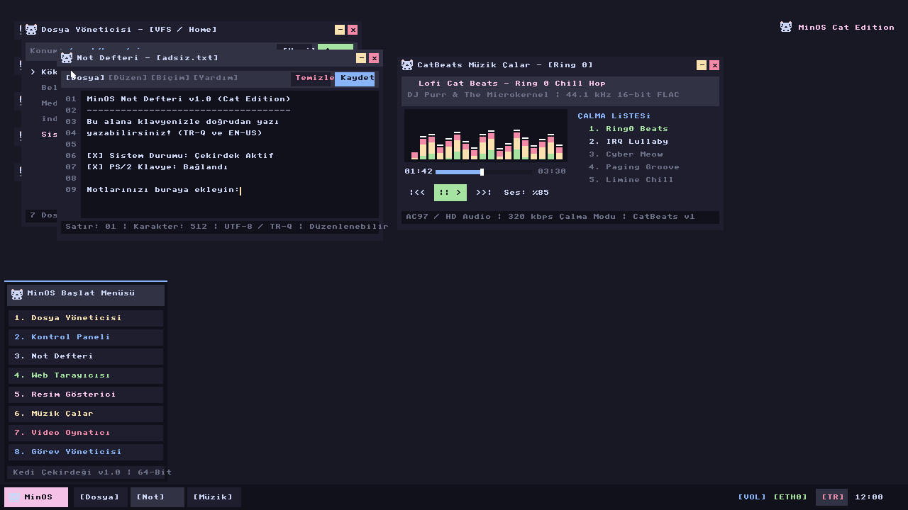
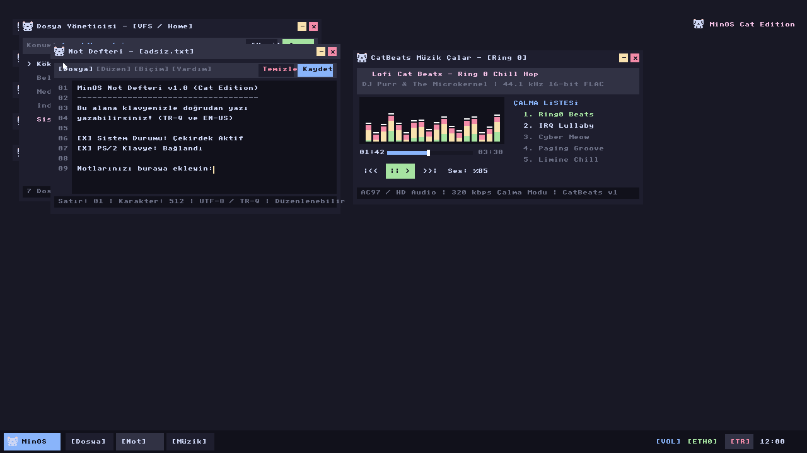
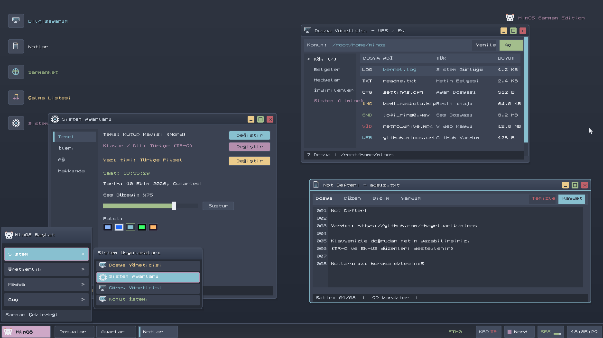
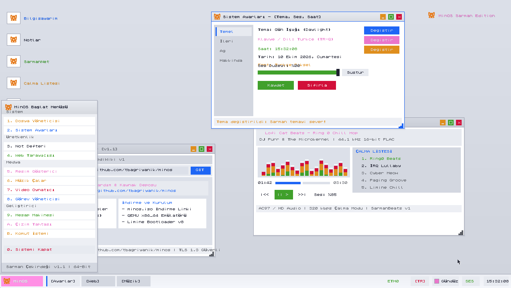
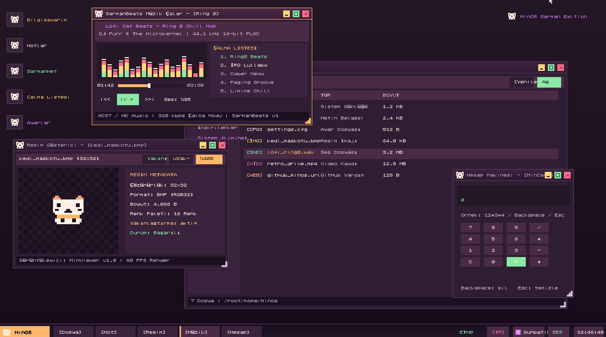

# 🐱 MinOS - Sarman Edition

[](https://www.rust-lang.org/)
[]()
[](https://limine-bootloader.org/)
[]()
[](https://github.com/tbagriyanik/minos/releases)

**MinOS (Sarman Edition)**, Rust dili ile sıfır dış bağımlılık (`no_std`, `no_main`) prensibiyle geliştirilmiş, modern grafik arayüzüne (GUI) ve zengin masaüstü uygulama ekosistemine sahip bağımsız bir 64-bit (`x86_64`) işletim sistemi çekirdeğidir.

---

## 📥 Hazır ISO İndirme (Download)

MinOS'u derlemeden doğrudan QEMU, VirtualBox (64bit) veya gerçek donanımda test etmek için hazır ISO imajı:

🔗 **Repo Üzerinden Doğrudan İndir:**  
[https://github.com/tbagriyanik/minos/blob/main/minos.iso](https://github.com/tbagriyanik/minos/blob/main/minos.iso)

---

## 📸 Ekran Görüntüleri (Screenshots)

### 1. Başlat Menüsü & Çoklu Pencere Ortamı


### 2. Etkileşimli Not Defteri, Müzik Çalar Ekolayzerı & Dosya Yöneticisi


### 3. Sistem Ayarları, Görev Yöneticisi & Uygulama Ekosistemi


### 4. Açık Tema (Daylight Theme)


### 5. Mor / Kadife Gece Teması (Velvet Dark Theme)


---

## ✨ Özellikler ve Uygulama Paketi

MinOS, tam teşekküllü bir masaüstü deneyimi sunan 11 adet yerleşik uygulama ve pencere yöneticisi içerir:

| Uygulama | Açıklama |
| :--- | :--- |
| **🔘 Başlat Menüsü** | Kategori menüleri (`Sistem`, `Üretkenlik`, `Medya`, `Güç`) altında simgeli grafik listeleme. Klavye ok tuşları, Enter ve fare tekerleği gezintisi. |
| **📁 Dosya Yöneticisi** | Sanal dosya sistemi (VFS) gezgini, dosya türü simgeleri (`[LOG]`, `[TXT]`, `[IMG]`, `[SND]`, `[VID]`), boyutlar ve konum çubuğu. |
| **⚙️ Sistem Ayarları** | Tema seçimi/değiştirme, canlı saat & tarih, ses düzeyi kaydırıcısı, ağ durumu (IP/DNS/Gateway), dil/klavye ve pencere düzeni kaydetme paneli. |
| **📝 Not Defteri** | İşlevsel üst menü çubuğu (`Dosya`, `Düzen`, `Biçim`, `Yardım`). Metin temizleme, dosya kaydetme, **Kes / Kopyala / Yapıştır / Tümünü Seç**, **Geri Al / İleri Al** (Ctrl+Z / Ctrl+Y), dinamik font modları (`Piksel`, `Sıkıştırılmış`, `ClearType`). Tam Türkçe karakter desteği (`ç`, `ğ`, `ı`, `İ`, `ö`, `ş`, `ü`), `Backspace`, `Enter`, **Home / End** ve **Shift+ok tuşlarıyla seçim**, satır numaraları ve yanıp sönen imleç. |
| **🌐 Web Tarayıcısı** | Yerel minos://help ve minos://cats sayfaları, e1000 ağ kartı ARP/ping test paneli. |
| **🖼️ Resim Gösterici** | Şeffaf dama tahtası tuvali üzerinde 4x yakınlaştırmalı 32-bit renkli piksel sanatı kedi maskotu ve dosya meta verileri. |
| **🎵 Müzik Çalar** | PC hoparlöründen melodi çıkışı, animasyonlu spektrum ekolayzerı ve çalma listesi. |
| **🎬 Video Oynatıcı** | Canlı synthwave ufuk sahnesi, neon güneş scanline'ları, aşağı doğru akan 3D perspektif grid yol ve siber araç simülasyonu. |
| **📊 Görev Yöneticisi** | Çekirdek bellek kullanımı, CPU dalgalanma grafiği, görev tablosu, süreç sonlandırma (`Kill`) ve RAM grafik çubuğu. |
| **🧮 Hesap Makinesi** | Klavyeyle giriş yapılabilen ifade hesaplayıcı (`+`, `-`, `*`, `/`), `Backspace` ve `Esc` ile temizleme. |
| **🎨 Çizim Tahtası** | Piksel tabanlı serbest çizim tuvali, renk paleti ve dairesel silgi aracı. Fare basılı tutuldukça **sürekli/akıcı çizim** (Windows Paint benzeri), fırça kenarının otomatik kırpılması ve 4096 noktalık tuval geçmişi. |
| **⌨️ Komut İstemi** | Klavyeyle komut ve metin girişi kabul eden retro terminal görünümü. |

### 🆕 Modern Arayüz ve Kullanılabilirlik Yenilikleri

- **🇹🇷 Tam Türkçe Karakter Desteği:** Sistem Ayarları, Görev Yöneticisi, Not Defteri, Dosya Yöneticisi, Başlat menüsü ve durum çubukları dahil arayüzdeki tüm metinler Türkçe karakterlerle (`ç`, `Ç`, `ğ`, `Ğ`, `ı`, `I`, `İ`, `ö`, `Ö`, `ş`, `Ş`, `ü`, `Ü`) işlenir.
- **⌨️ Klavyeyle Menü Gezintisi (Ok Tuşları & Enter):** Başlat menüsü ve bağlam menülerinde **Yukarı/Aşağı/Sol/Sağ ok tuşları** ile gezinebilir, **Enter** tuşuna basarak seçili uygulamayı veya komutu çalıştırabilirsiniz.
- **🖱️ Fare Tekerleği (Scroll Wheel) Desteği:** Başlat menüsü açıkken fare tekerleğiyle liste seçenekleri arasında geçiş yapılabilir. Tüm pencere içerikleri (Not Defteri, Dosya Yöneticisi listeleri) dikey olarak yumuşak şekilde kaydırılır.
- **📐 Daha Geniş Kenar Tutamaçları (12px Resize Grip):** Pencereleri kenarlarından tutup boyutlandırma alanı 8 pikselden **12 piksele** çıkarıldı. Artık pencerelerin kenar ve köşelerinden tutulması ve boyutlandırılması çok daha kolaydır.
- **🖼️ Masaüstü Simgesi Tıklama Koruması:** Açık ve görünür bir pencere masaüstü simgelerinin üzerine geldiğinde, pencereye tıklanıldığında altındaki masaüstü simgelerinin istemeden açılması engellendi.
- **🎨 Dinamik Tema Motoru (5 Tema):** Kadife Gece, Gün Işığı, Kutup Mavisi, Yeşil Terminal ve Gün Batımı temaları arasında tek tıkla canlı geçiş.
- **🪟 Akıllı Pencere Yönetimi:** Çift tıkla maksimize etme, ekranın en üstüne sürükleyerek otomatik maksimize (snap) etme, pencere ortalama, simge durumuna küçültme ve yumuşak z-sırası odak yönetimi.
- **📋 Not Defteri Açılır Menü Komutları:**
  - **Dosya:** Yeni Belge, Kaydet, Temizle
  - **Düzen:** Kes, Kopyala, Yapıştır, Tümünü Seç
  - **Biçim:** Piksel Font, Sıkıştırılmış Font, ClearType Font
  - **Yardım:** Not Defteri Hakkında
- **📝 Windows Notepad Benzeri Metin Düzenleme:**
  - **Çift tıkla kelime seçimi:** Herhangi bir kelimeye çift tıklayarak o kelimeyi seçin.
  - **Sürükleyerek seçim:** Sol tuşu basılı tutup fareyi sürükleyerek metin seçin; tıklanan karaktere doğru imleç konumlanır (satır kaydırma ve dikey kaydırma hesaba katılır).
  - **Home / End:** İmleci satır başına/sonuna taşır.
  - **Shift + Ok Tuşları:** Yukarı/Aşağı/Sol/Sağ ile seçimi genişletir.
  - **Geri Al / İleri Al:** `Ctrl+Z` (Geri Al) ve `Ctrl+Y` (İleri Al) — 32 seviyelik düzenleme geçmişi.
- **🎨 Windows Paint Benzeri Çizim:**
  - **Basılı Tutup Çizme:** Sol tuşu basılı tuttukça fare hareketi sürekli çizer; hızlı hareketlerde iki nokta arası enterpolasyonla doldurulup kesik çizgi oluşmaz.
  - **Otomatik Vuruş Bittiği:** Tuval dışına çıkıldığında veya tuş bırakıldığında kalem yolu otomatik sonlanır.
  - **Renk Paleti ve Silgi:** Mavi/Kırmızı/Yeşil/Siyah renk örnekleri, dairesel **Silgi** ve **Temizle** düğmeleri.

---

## 🛠️ Sistem Gereksinimleri (Prerequisites)

MinOS'u kaynak kodundan derlemek ve çalıştırmak için aşağıdaki araçlar gereklidir:

1. **Rust Nightly Toolchain:**
   ```powershell
   rustup default nightly
   rustup component add rust-src
   ```
2. **QEMU x86_64 Emulator:**
   - [QEMU Resmi İndirme Sayfası](https://www.qemu.org/download/#windows)
   - Varsayılan kurulum yolu: `C:\Program Files\qemu\qemu-system-x86_64.exe`
3. **ISO Oluşturma Aracı:**
   - Windows için: `oscdimg.exe` (Windows ADK veya projedeki paketleyici).
   - Linux / macOS için: `xorriso` veya `mkisofs`.
4. **PowerShell 5.1+ (Windows):** Derleme ve ISO paketleme otomasyonları için.

---

## 🚀 Derleme ve Çalıştırma Adımları (Build & Run)

### Tek Komutla Derle ve Başlat (Önerilen)
MinOS, çekirdeği derleyen, ISO dosyasını paketleyen ve QEMU'yu başlatan hazır bir betik içerir:

```powershell
# Depoyu klonlayın ve dizine girin
git clone https://github.com/tbagriyanik/minos.git
cd minos

# Derleyin ve QEMU üzerinde çalıştırın
powershell -ExecutionPolicy Bypass -File .\run.ps1
```

#### `run.ps1` Seçenekleri (Switches)

`run.ps1`, çekirdeği `cargo build` ile derledikten sonra ISO'yu paketler ve QEMU'yu başlatır. Aşağıdaki anahtarlar ile davranışı özelleştirebilirsiniz:

| Anahtar | Açıklama |
| :--- | :--- |
| `-BuildOnly` | Yalnızca derler; QEMU'yu başlatmadan çıkar. Hızlı derleme kontrolü için idealdir. |
| `-Debug` | Debug profilinde derler (`target\x86_64-minos\debug\minos-kernel`). Varsayılan **release**'dir. |
| `-UsbDisks` | Sistemdeki USB diskleri **salt okunur** olarak QEMU'ya `usb-storage` aygıtı olarak bağlar. |
| `-UsbDiskReadWrite` | USB diskleri **yazma izniyle** bağlar (dikkatli kullanın). |

```powershell
# Yalnızca derle (QEMU başlatma)
powershell -ExecutionPolicy Bypass -File .\run.ps1 -BuildOnly

# Debug profili + USB diskleri salt okunur ekle
powershell -ExecutionPolicy Bypass -File .\run.ps1 -Debug -UsbDisks
```

> **Ses:** `run.ps1` ses çıkışı için QEMU `sdl` audio sürücüsünü (`-audiodev driver=sdl,id=snd0`) ve yalnızca çıkış amaçlı `hda-output` codec'ini kullanır. Bu, DirectSound'un zorunlu mikrofon/capture başlatma hatasını önler.

> **Ağ:** QEMU kullanıcı modu (SLIRP) ve `e1000` ile ARP/ping/TCP çalışır; `8080` portu konuk makinenin `80` portuna yönlendirilir (`hostfwd=tcp::8080-:80`).

---

### Adım Adım Manuel Derleme (Manual Steps)

#### 1. Çekirdeği Derleme (Kernel Build)
MinOS çekirdeği, özel hedef mimarisi, `-Zbuild-std` çekirdek kütüphaneleri ve sıfır dış bağımlılık bayraklarıyla derlenir:

```powershell
cargo build --release -Zjson-target-spec --target x86_64-minos.json `
  -Zbuild-std=core,alloc -Zbuild-std-features=compiler-builtins-mem
```

#### 2. Boot Edilebilir ISO İmajını Paketleme (ISO Creation)
Limine bootloader dosyalarını çekirdekle birleştirmek ve El Torito tablosunu yamalamak için:

```powershell
powershell -ExecutionPolicy Bypass -File .\build_iso.ps1
```
> *İşlem tamamlandığında kök dizinde `minos.iso` dosyası oluşturulur.*

#### 3. QEMU ile Test Etme (Run in QEMU)
```powershell
& 'C:\Program Files\qemu\qemu-system-x86_64.exe' -cdrom minos.iso -m 512M -vga std `
  -audiodev driver=sdl,id=snd0 -device intel-hda -device hda-output,audiodev=snd0 `
  -netdev user,id=n0,hostfwd=tcp::8080-:80 -device e1000,netdev=n0
```

#### 4. VirtualBox Kurulumu & Ayarları (VirtualBox Setup)
VirtualBox'ta **`PANIC: limine: This CPU does not support 64-bit mode`** hatası alıyorsanız aşağıdaki 2 ayarı kontrol edin:

1. **Sanal Makine Türü:** Sanal makineyi oluştururken **İşletim Sistemi Türü** olarak **`Other / Other (64-bit)`** seçildiğinden emin olun.
2. **Sanal Donanım İvmelendirmesi (VT-x / AMD-V):**
   - Windows kullanıyorsanız ve VirtualBox 64-bit seçeneği çıkmıyorsa, **Hyper-V**'nin açık olmadığından ve BIOS'ta **Intel VT-x / AMD-V** donanım sanallaştırmasının aktif olduğundan emin olun.
   - VM Ayarları -> **Sistem** -> **Hızlandırma** sekmesinde **Sanallaştırma Arabirimi** varsayılan/KVM olarak ayarlanmalıdır.
3. **Ses:** VM Ayarları -> **Ses** bölümünde sesi etkinleştirin ve **Ses Denetleyicisi** olarak **Intel HD Audio** seçin. MinOS'un HDA sürücüsü bu denetleyiciyi kullanır.

---

## 🎮 Masaüstü Kullanımı ve Kısayollar

- **Başlat Menüsünde Gezinme:** Klavye **Yukarı / Aşağı / Sol / Sağ ok tuşları** ile menüler arasında dolaşın, **Enter** ile seçili uygulamayı çalıştırın veya **fare tekerleğini** çevirerek kaydırın.
- **Pencere Boyutlandırma:** Pencerelerin herhangi bir kenarından veya köşesinden basılı tutarak boyutlandırın (tutma alanı 12px'e çıkarılmıştır).
- **Pencere Taşıma (Drag & Drop):** Herhangi bir pencerenin üst başlık çubuğuna sol tıklayıp basılı tutarak ekran üzerinde sürükleyin.
- **Pencere Kontrolleri:**
  - Kırmızı `[x]` butonu: Pencereyi kapatır.
  - Yeşil `[□]` butonu: Pencereyi maksimize eder (tekrar tıklayınca geri yükler). Başlık çubuğuna **çift tıklamak** da aynı işi yapar.
  - Sarı `[-]` butonu: Pencereyi simge durumuna küçülterek görev çubuğuna indirir.
- **Pencere Yerleştirme (Snap):** Başlık çubuğunu ekranın en üstüne sürükleyip bırakırsanız pencere otomatik olarak maksimize edilir.
- **Sistem Tepsisi (Sağ Alt):** Sırasıyla **klavye rozeti (`TR`/`EN`)**, **tema düğmesi**, **SES** düğmesi ve **canlı saat** bulunur. Saate tıklayınca canlı takvim, **SES**'e tıklayınca ses paneli açılır.
- **Tema Değiştirme:** Görev çubuğundaki renk örneğine, Sistem Ayarları > **Değiştir** düğmesine, **tema palet şeridindeki renk örneklerine** veya masaüstü sağ tık > **Tema Değiştir**'e tıklayın.
- **Bağlama Duyarlı Sağ Tık:** Masaüstünde, Not Defteri'nde, Dosya Yöneticisi'nde veya pencere başlığında özel sağ tık menüleri açılır.
- **Not Defteri Düzenleme Kısayolları:** `Ctrl+C` (Kopyala), `Ctrl+X` (Kes), `Ctrl+V` (Yapıştır), `Ctrl+A` (Tümünü Seç), `Ctrl+Z` (Geri Al), `Ctrl+Y` (İleri Al), `Delete` (İleri sil), `Home`/`End` (satır başı/sonu) ve `Shift+Ok tuşları` (seçim genişletme).
- **Çizim Tahtası Kullanımı:** Araç çubuğundan renk veya **Silgi** seçin; tuval üzerinde sol tuşu basılı tutarak çizin. `C` tuşu veya **Temizle** düğmesi tuvali temizler.

---

## 📂 Proje Dizin Yapısı

```
minos/
├── src/
│   ├── arch/x86_64/         # SSE, IDT kesmeleri ve PIC maskeleme
│   ├── drivers/             # PS/2 fare, klavye, framebuffer video, RTC (CMOS) saat ve e1000/HDA donanım sürücüleri
│   ├── gui/                 # MinGUI pencere yöneticisi, font motoru, tema motoru (theme.rs) ve masaüstü kompozitörü
│   ├── apps/                # 11 Masaüstü uygulaması (Not Defteri, Dosya Yöneticisi, Görev Yöneticisi...)
│   ├── mm/                  # Fiziksel bellek yöneticisi (PMM)
│   ├── fs/                  # Sanal dosya sistemi (VFS / TarFS)
│   └── main.rs              # Çekirdek giriş noktası (_start) ve ana olay döngüsü
├── boot/                    # Limine bootloader yapılandırma dosyaları (limine.cfg)
├── docs/screenshots/        # Masaüstü ve başlat menüsü ekran görüntüleri
├── build_iso.ps1            # El Torito yamalı hibrit ISO oluşturucu
├── run.ps1                  # Tek tıkla derleme ve QEMU başlatma betiği (-Debug, -BuildOnly, -UsbDisks, -UsbDiskReadWrite)
└── x86_64-minos.json        # Hedef x86_64 Long Mode tanımlama dosyası
```

---

## 📄 Lisans

Bu proje açık kaynaklıdır ve eğitim/araştırma amaçlı geliştirilmektedir.
Katkıda bulunmaktan ve geliştirmeler önermekten çekinmeyin! 🐾
