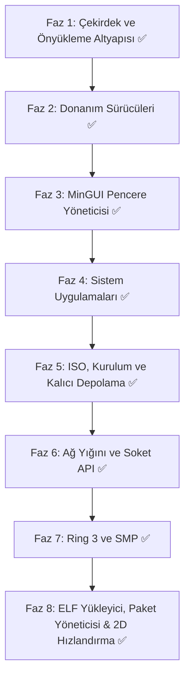

# minOs (v2.1.0): Bağımsız x86_64 İşletim Sistemi Mimari ve Yol Haritası

**minOs**, modern 64-bit mimariye (x86_64) odaklanan, ultra düşük bellek tüketimli (<64 MB RAM), sade grafik arayüzlü (GUI), ses, ağ ve kalıcı depolama destekli açık kaynak bir işletim sistemidir.

> Son senkron: 28 Ekim 2026 — TLS 1.3 (ECDHE secp256r1 + HKDF) el sıkışması tamamlandı; RFC 8446 AAD/`Finished`/`close_notify` düzeltmeleriyle `https://` bağlantıları yanıt gövdesini işleyebiliyor. X.509 zaman/hostname/zincir doğrulaması ve kök CA deposu aktiftir.

---

## 1. Temel Mimarisi ve Teknoloji Seçimleri

| Bileşen | Seçilen Teknoloji / Standart | Açıklama / Durum |
| :--- | :--- | :--- |
| **Hedef Mimari** | `x86_64` (AMD64 / Intel 64) | Uzun mod (Long Mode), 4-seviyeli paging, SSE/SSE2 |
| **Önyükleyici (Bootloader)** | [Limine Bootloader](https://limine-bootloader.org/) | UEFI & Legacy BIOS uyumlu, framebuffer + HHDM + bellek haritası istekleri |
| **Geliştirme Dili** | Freestanding Rust (Nightly, `no_std`/`no_main`) | C kodu yok; çekirdek tamamı Rust + az miktarda inline asm |
| **Bellek Yönetimi** | Fiziksel çerçeve tahsisi (PMM, bitmap) + 4-seviyeli VMM + 2 MB kernel heap (`linked_list_allocator`) | Sayfa bayrakları (`USER`/`NX`) ayrımı testlerle doğrulu |
| **Kesmeler** | IDT yapısı + Local APIC Timer (IRQ/0x20) + PIC maskeleme | Donanım APIC periyodik zamanlayıcı ve EOI yönetimi devrede |
| **Çoklu Görev & Zamanlayıcı** | PCB + Öncelikli Preemptive / Round-Robin Zamanlayıcı | Realtime/High/Normal/Low öncelik seviyeleri ve CPU tick takibi aktif |
| **Çekirdek Tipi** | Modüler Monolitik Çekirdek | Tek adres uzayı, modüler sürücü yapısı |
| **Dosya Sistemi (VFS)** | Sanal Dosya Sistemi + FAT32 (r/w) + Ext2 (r/w) + Ext4/exFAT (r/w) + ISO9660 (salt okunur) + MBR/GPT bölümleme | `VFS.DAT` anlık görüntüsüyle kalıcı depolama |
| **Grafik Altyapısı** | Limine Linear Framebuffer (32-bpp) + Donanım 2D Hızlandırma | Çift tamponlu compositor + BGA/VGA taraması + 64-bit donanımsal rect fill ve bit blit |
| **Ağ Yığını** | Özel mikro TCP/IP (e1000) + soket API + HTTP istemcisi + TLS 1.3 / TLS 1.2 istemcisi | ARP/IPv4/IPv6/ICMP/UDP/DHCP/DNS, soket başına TCP durum makinesi, `curl`; TLS 1.3'te ECDHE (secp256r1) + HKDF, TLS 1.2'de RSA anahtar değişimi, AES-128-GCM ile şifreli HTTP (`https://`) |
| **Kriptografi** | El yazımı `no_std` ilkeller: SHA-256/384/512, HMAC, AES-128/256, GCM, RSA/PKCS#1 v1.5, ECC/ECDSA (secp256r1), X.509 + gömülü kök CA deposu | `src/drivers/crypto/` modülü; harici kripto kütüphanesi bağımlılığı yok, TLS 1.3 HKDF ve TLS 1.2 PRF anahtar türetmesi bu ilkeller üzerine kurulu |
| **Ses Alt Sistemi** | Intel HDA (DMA) + PC Speaker PWM yedeği | PCM çalma, ses düzeyi/karıştırma |

---

## 2. Grafiksel Kullanıcı Arayüzü (MinGUI) & Pencere Yöneticisi

minOs grafik motoru, CPU ve bellek tasarrufu için optimize edilmiş **çift tamponlu (double-buffered)** bir bileşik pencere yöneticisi (compositor) ile çalışır.

### Temel Özellikler
1. **Pencere Sistemi (Window Compositor):**
   - Sürükle-bırak pencere hareketi, yeniden boyutlandırma, simge durumuna küçültme ve kapatma.
   - Pencereler arası odak (focus) yönetimi, z-index derinlik sıralaması.
   - Gölgelendirme ve yumuşak köşe eğrileri (isteğe bağlı alpha blending).
2. **Masaüstü & Görev Çubuğu:**
   - Hızlı başlatıcı (Start/App Menu).
   - Çalışan uygulamalar çubuğu, sistem çekmecesi (saat, ses kontrol simgesi, ağ durumu).
3. **Temalandırma Desteği (Theming Engine):**
   - Beş hazır tema (Kadife Gece, Gün Işığı, Kutup Mavisi, Yeşil Terminal, Gün Batımı).
   - TTF tabanlı bitmap font atlasları (Inria Sans + Geist Mono) ve yazı yakınlaştırma.

---

## 3. Dahili Sistem Uygulamaları

- **Görev Yöneticisi (Task Manager):**
  - Aktif işlemler (PID), CPU kullanım yüzdeleri ve bellek tüketim grafiği.
  - İşlem sonlandırma (kill) özelliği.
- **Ayarlar (Settings):**
  - *Temel:* Ekran çözünürlüğü, tema ve arka plan, ses seviyesi, fare hassasiyeti, saat/tarih.
  - *İleri Seviye:* Ağ konfigürasyonu (Statik IP / DHCP), disk bölümleri ve VFS durumları, çekirdek logları, bellek dökümü.
  - `settings.cfg` üzerinden kalıcı ayar saklama.
- **Dosya Yöneticisi:**
  - Dizin hiyerarşisinde gezinme, dosya açma, kopyala/taşı/sil, geri dönüşüm kutusu, yeniden adlandırma.
  - FAT32 / Ext2 / ISO9660 ortamlarının birleşik görünümü.
- **Konsol / Terminal (MinShell):**
  - Dahili komut kabuğu: dosya yönetimi, `ping`/`dns`/`curl`, `ipconfig`, uygulama başlatma, Tab tamamlama.
- **Tek Tıkla Kur (Kurulum Sihirbazı):**
  - Hedef disk seçimi → FAT32 biçimlendirme → `MINOS.SYS` + `VFS.DAT` ile kalıcı kurulum.
- **Diğerleri:** Not Defteri, Web Tarayıcısı (`http://`, `https://`, `minos://`, `file://`), Resim Gösterici (BMP), Müzik Çalar, Video Oynatıcı, Hesap Makinesi, Çizim Tahtası (BMP kayıt), 3D Gösterici.

---

## 4. Uygulama Adımları ve Aşamalı Yol Haritası

### Faz 1: Çekirdek & Önyükleme İskeleti (Limine Tabanlı) ✅
- Proje dizin yapısı (`src/{arch,drivers,gui,apps,mm,fs}/`, `boot/`) kuruldu.
- Limine protokolü ile çekirdek yükleme (`limine.conf`), framebuffer + HHDM + bellek haritası.
- IDT yapısı, PIC maskeleme (polling G/Ç), SSE etkinleştirme.
- PMM (fiziksel çerçeve yöneticisi) ve VMM (4-seviyeli paging, `USER`/`NX` bayrakları).
- Kernel heap (`linked_list_allocator`, 2 MB) ve süreç tablosu iskeleti.

### Faz 2: Temel Donanım & Girdi Sürücüleri ✅
- PS/2 Klavye (TR-Q/EN-US) ve PS/2 Fare, RTC (CMOS) saat.
- Framebuffer sürücüsü (piksel ilkelleri, kırpma/pitch güvenliği) + BGA/VGA taraması.
- ATA/ATAPI PIO (LBA28 okuma/yazma, cache flush) + USB/CD-ROM blok katmanı.
- Intel e1000 ağ kartı sürücüsü (TX/RX ring, DMA).
- Intel HDA ses (BDL/DMA) + PC Speaker yedeği.

### Faz 3: Grafik Motoru (MinGUI) & Masaüstü ✅
- Font motoru (TTF → bitmap atlas, `build.rs` + `fontdue`) ve çizim kütüphanesi.
- Masaüstü, görev çubuğu, sistem tepsisi, takvim, ses paneli.
- Olay döngüsü (fare, klavye, tekerlek), pencere yöneticisi ve snap/maksimize.

### Faz 4: Masaüstü Uygulamaları ✅
- Görev Yöneticisi (canlı CPU/RAM), Ayarlar (tema/ağ/sistem), Terminal (MinShell), Dosya Yöneticisi.
- Not Defteri (undo/redo, seçim, satır numaraları), Tarayıcı, Resim/Müzik/Video, Hesap Makinesi, Çizim Tahtası, 3D Gösterici.

### Faz 5: Derleme, ISO, Kurulum ve Kalıcı Depolama ✅
- `cargo` (özel `x86_64-minos` hedefi) + `run.ps1` (derle + ISO paketle + QEMU) ve `build_iso.ps1`.
- Önyüklenebilir hibrit ISO (`minos.iso`, Limine BIOS/UEFI).
- FAT32 biçimlendirme + dosya yazma/silme, Ext2 read-write, MBR/GPT bölümleme.
- `VFS.DAT` anlık görüntüsü: tüm dosya/klasör/çöp kutusu işlemleri yeniden başlatmada korunur.

### Faz 6: Ağ Yığını ve Soket API ✅
- ARP/IPv4/ICMP/DHCP/DNS, UDP, tek-bağlantılı TCP + tarayıcı HTTP yolu.
- Soket başına durum makineli TCP (`socket`/`connect`/`send`/`recv`/`close`, UDP, DNS önbelleği).
- HTTP istemcisi (chunked + yönlendirme) ve MinShell `curl` komutu.
- **TLS 1.3 / TLS 1.2 istemcisi** (`src/drivers/tls.rs`): TLS 1.3'te ClientHello (SNI) → ServerHello → EncryptedExtensions → Certificate (X.509) → CertificateVerify → Finished → şifreli Application Data; TLS 1.2'de RSA anahtar değişimli tam el sıkışma; tarayıcıda `https://` desteği.

- **Web Tarayıcısı Sık Kullanılanlar & Yer İmleri:** Adres çubuğu altında interaktif Bookmarks Bar, hafif HTTP test sitesi, minos://bookmarks, minos://help, minos://demo / minos://demo-img / minos://demo-video hızlı erişim çipleri ve sayfa entegrasyonu.
### Faz 7: Ring 3, SMP ve Ses Alt Sistemi Optimizasyonu ✅
- **Ring 3 Kullanıcı Kipi İzolasyonu:** GDT TSS kullanıcı segmentleri, `int 0x80` sistem çağrıları (`SYS_GETPID`, `SYS_YIELD`, `SYS_WRITE`), #GP/#PF hata yakalama ve çekirdek koruması.
- **SMP (Çok Çekirdekli Paralellik):** Limine SMP protokolü ile AP başlatımı, çekirdek başına 64 KiB yığın ve GDT, LAPIC kimliği, paralel atomik iş kuyruğu (`parallel_checksum`).
- **Gelişmiş Ses Alt Sistemi:** Intel HDA için evrensel PCI taraması, 64-bit BAR0, donanımsal CRST/SRST sıfırlama, AFG/DAC/Pin D0 güç yönetimi, donanımsal DMA Position Buffer (offset `0x70`), atomik 32-bit SDnCTL akış kontrolü ve otomatik PC Speaker PWM yedeği (fallback). Ayarlar uygulamasında donanımsal ses testi.

### Faz 8: Kullanıcı Alanı ve Genişletilebilirlik ✅
- **Kullanıcı Alanı ELF Yükleyici Entegrasyonu ✅:** ELF64 ayrıştırıcı (`PT_LOAD`), W^X prensibiyle sayfalama (kod salt okunur/çalıştırılabilir, veri/yığın NX), kullanıcı yığını tahsisi, `LoadedProgram::unmap_and_free()` kaynak temizliği, `arch::x86_64::ring3::execute_loaded_program()` güvenli Ring 3 çalışma/dönüş döngüsü, VFS `/bin/hello.elf` örnek ikilisi ve MinShell `exec <ikili>` komutu tamamlandı.
- **Paket Yöneticisi (`minpkg`) ✅:** Ağ (HTTP/curl) veya dahili repodan paket indirme, VFS `/bin` dizinine kurma (`minpkg install`), kurulu ikili paketleri arayıp listeleme (`minpkg list`), kaldırma (`minpkg remove`) ve terminal (MinShell) arayüz entegrasyonu tamamlandı.
- **Donanım 2D Hızlandırma ✅:** GPU/BGA ve Framebuffer üzerinde 64-bit hizalı blok dolgu (`hw_accel_fill_rect`) ve kopyalama (`hw_accel_bit_blit`), `flush_rect` ve `draw_rect` hızlandırmaları tamamlandı.

### Faz 9: Kriptografi ve TLS 1.2 / 1.3 ✅
- **Kripto İlkelleri (`src/drivers/crypto/`, `no_std`, bağımlılıksız):** SHA-256 (`sha256.rs`), HMAC-SHA256 (`hmac.rs`), AES-128/256 (`aes.rs`), GCM (`gcm.rs`), RSA + PKCS#1 v1.5 (`rsa.rs`), minimal X.509 sertifika ayrıştırıcı (`x509.rs`).
- **TLS 1.2 / 1.3 Oturumları:** TLS 1.2'de `TLS_RSA_WITH_AES_128_GCM_SHA256` (0x009C) ve `ECDHE_RSA` suite'leri, TLS 1.3'te HKDF anahtar planı ve AES-GCM kayıtları; PRF (P_SHA256/P_SHA384), master/pre-master secret türetme, GCM şifreleme/çözme, Finished ve CertificateVerify doğrulaması.
- **Entegrasyon:** Web Tarayıcısı `https://` şeması; şifreli yanıt şifresi çözülüp HTTP ayrıştırıcısına aktarılır. RFC 8446 §5.2 (AAD = 5 bayt), §4.4.4 (`finished_key` doğrudan trafik sırrından) ve §6.1 (`close_notify` zarif kapanış) düzeltmeleriyle el sıkışma `Established` aşamasına ulaşır.
- **Bilinen sınırlar:** Sertifika zinciri doğrulaması (RFC 5280, gömülü kök CA deposu, `MAX_CHAIN_DEPTH` = 6) ve CRL/OCSP **ayrıştırma** aktiftir; ancak CRL/OCSP yanıtlarının otomatik indirilmesi (HTTP/OCSP isteği) henüz yoktur. Sunucu sertifikasının geçerlilik tarihleri (CMOS RTC) ile CN/SAN ana makine adı RFC 6125 kurallarıyla doğrulanır. TLS 1.2 ve TLS 1.3 el sıkışmaları (ECDHE secp256r1, RSA/ECDSA imza, AES-GCM, SHA-256/384) desteklenir; eski/zayıf cipher suite'ler ve CSPRNG tabanlı olmayan istemci random'ı bilinen kısıtlardır.

### Faz 10: Gelişmiş Giriş ve Donanım Sürücüleri (USB HID, Touchpad, UVC Kamera, Wi-Fi) ✅
- **Yerel xHCI USB HID Klavye ve Fare (`src/drivers/usb_hid.rs`):** PCI xHCI (USB 3.x) denetleyicisi, port reset ve aygıt numaralandırma, Boot Protocol klavye ve fare desteği; PS/2 ile birleşik olay döngüsü ve gecikmesiz olay kontrolü (`has_event`).
- **Laptop Dokunmatik Yüzey (Touchpad) İyileştirmesi (`src/drivers/mouse.rs`, `src/drivers/ps2.rs`):** 8 count/mm çözünürlük, 100 sample/sec örnekleme, parmak temas ve dokunarak tıklama (Tap-to-Click, <180ms dokunma), çift parmak ve kaydırma tekerleği desteği.
- **UVC Kamera Alt Sistemi (`src/drivers/camera.rs`):** USB Video Class (Class 0x0E), VideoControl ve VideoStreaming arayüzleri, YUY2 (4:2:2 uncompressed) piksel dönüşümü (`yuv_to_rgb32`), sentetik test deseni üretimi, MinShell `cam` / `camera` komutu ve Ayarlar entegrasyonu.
- **IEEE 802.11 Wi-Fi ve WPA2-PSK Altyapısı (`src/drivers/wifi.rs`):** 802.11 MAC çerçeve yapısı (Beacon, Probe, Data), kablosuz ağ tarama tablosu (`scan_networks`), WPA2-PSK anahtar türetimi (PBKDF2-HMAC-SHA256 ile PMK ve PTK türetimi), MinShell `wifi scan/connect/disconnect/status` komutları.

---

## 5. Faz 11: Web Standartları Uyumluluğu (CSS / TLS / HTTP) 🔄

Bu faz, minOs web tarayıcısının W3C ve IETF standartlarına uygunluğunu artırmayı hedefler. Mevcut CSS, TLS ve HTTP uygulamalarındaki eksiklikler giderilecek, karmaşık web sayfalarında doğru stil ve protokol davranışı sağlanacaktır.

### 5.1 CSS — W3C CSS Working Group

#### Durum Analizi
| Özellik | Durum | Açıklama |
| :--- | :---: | :--- |
| `grid-template-areas` (isimli alan sözdizimi) | ❌ Eksik | CSS Grid Level 1'in önemli parçası; `src/apps/browser/css.rs` ve `html.rs`'de yok |
| CSS Cascade / Specificity (id > class > tag) | ⚠️ Basitleştirilmiş | `match_css_style` sıralı kurallarla eşleştirir; tam W3C özgüllük algoritması yok |
| Media queries (`@media`) | ❌ Eksik | Responsive tasarımın temeli; `@media` bloğu yok |

#### Planlanan Geliştirmeler

**A. `grid-template-areas` Desteği (CSS Grid Level 1)**
- **Dosyalar:** `src/apps/browser/css.rs`, `src/apps/browser/html.rs`, `src/apps/browser/types.rs`
- **Aşama 1 — Ayrıştırıcı:** `grid-template-areas` özelliğini `css.rs`'te ayır; isimli alan haritası oluştur (satır/sütun eşleştirmesi).
- **Aşama 2 — Stil modeli:** `ElementStyle`'e `grid_template_areas: Vec<Vec<String>>` ve `grid_area: Option<(usize, usize, usize, usize)>` alanları ekle.
- **Aşama 3 — Yerleşim motoru:** `html.rs`'te grid hücrelerini isimli alanlara göre yerleştir; `grid-area: header` gibi değerleri çöz.
- **Aşama 4 — Test:** `minos://demo` sayfasına grid-template-areas örneği ekle; host testi yaz.

**B. CSS Cascade / Specificity (W3C Algoritması)**
- **Dosyalar:** `src/apps/browser/css.rs`
- **Aşama 1 — Özgüllük hesaplama:** Her seçici için (id, class, tag) üçlüsü hesapla; `CssRule` yapısına `specificity: (u32, u32, u32)` ekle.
- **Aşama 2 — Sıralama:** Kuralları özgüllüğe göre sırala; eş özgüllükte kaynak sırası (son kural kazanır) kuralı uygula.
- **Aşama 3 — Öncekiler:** `!important` desteği mevcut; cascade katmanları (origin, importance, specificity, order) tam uygula.
- **Aşama 4 — Test:** Karmaşık seçiciler (`#id .class tag`) içeren CSS ile doğru stil uygulanmasını doğrula.

**C. Media Queries (`@media`)**
- **Dosyalar:** `src/apps/browser/css.rs`, `src/apps/browser/html.rs`
- **Aşama 1 — Ayrıştırıcı:** `@media` bloğunu `parse_css_rules` içinde tanıyıp içindeki kuralları ayrı bir listeye al.
- **Aşama 2 — Koşul değerlendirmesi:** `min-width`, `max-width`, `min-height`, `max-height`, `orientation` media özelliklerini çöz.
- **Aşama 3 — Uygulama:** Geçerli viewport boyutuna göre media query kurallarını etkinleştir/devre dışı bırak.
- **Aşama 4 — Test:** Responsive demo sayfası (`minos://demo-responsive`) oluştur; farklı çözünürlüklerde stil değişikliğini doğrula.

---

### 5.2 TLS — RFC 8446 (TLS 1.3)

#### Durum Analizi
| Özellik | Durum | Açıklama |
| :--- | :---: | :--- |
| PSK (Pre-Shared Key) resumption | ❌ Eksik | RFC 8446 §2.2; 0-RTT / session resumption yok; her bağlantı tam el sıkışma |
| ALPN (RFC 7301) | ❌ Eksik | HTTP/2 negotiation için gerekli; şu an sadece HTTP/1.1'e sabit |
| `key_share` grupları | ⚠️ Kısım | Sadece P-256/X25519'dan biri; RFC 8446 istemcinin birden fazla grup önermesini önerir |
| OCSP stapling (RFC 6066) | ⚠️ Kısım | Ayrı OCSP sorgusu yapılıyor; OCSP must-staple / gizlilik standardına uygun değil |

#### Planlanan Geliştirmeler

**A. PSK (Pre-Shared Key) Resumption (RFC 8446 §2.2)**
- **Dosyalar:** `src/drivers/tls.rs`, `src/drivers/http.rs`
- **Aşama 1 — PSK anahtar deposu:** `TlsSession` içinde önceki oturumların PSK anahtarlarını saklayan küçük bir önbellek ekle (max 16 giriş, LRU).
- **Aşama 2 — ClientHello PSK uzantısı:** İstemci, daha önce bağlantı kurduğu sunucular için `pre_shared_key` uzantısı gönder; `psk_key_exchange_modes` ekle.
- **Aşama 3 — 0-RTT / 1-RTT resumption:** Sunucu PSK kabul ederse el sıkışmayı kısalt; uygulama verisini daha erken gönder.
- **Aşama 4 — Test:** Aynı sunucuya iki kez bağlan; ikinci bağlantıda PSK resumption kullanıldığını doğrula.

**B. ALPN (Application-Layer Protocol Negotiation, RFC 7301)**
- **Dosyalar:** `src/drivers/tls.rs`, `src/drivers/http.rs`
- **Aşama 1 — ClientHello ALPN uzantısı:** `http/1.1` ve `http/2` protokol tanımlayıcılarını ClientHello'ya ekle.
- **Aşama 2 — ServerHello ALPN işleme:** Sunucudan gelen ALPN uzantısını ayrıştır; seçilen protokolü kaydet.
- **Aşama 3 — HTTP/2 uyarlaması:** ALPN sonucu `http/2` ise HTTP/2 yığınına geçiş kancası ekle (Faz 5.3).
- **Aşama 4 — Test:** `https://example.com` bağlantısında ALPN negoşiasyonunun çalıştığını doğrula.

**C. `key_share` Çoklu Grup Desteği**
- **Dosyalar:** `src/drivers/tls.rs`, `src/drivers/crypto/ecc.rs`
- **Aşama 1 — X25519 desteği:** `src/drivers/crypto/ecc.rs`'ye X25519 anahtar çifti ve shared secret üretimi ekle.
- **Aşama 2 — Çoklu key_share:** ClientHello'da hem secp256r1 hem X25519 için `key_share` girişleri sun.
- **Aşama 3 — Sunucu seçimi:** Sunucunun seçtiği grubu `key_share` uzantısından tanı; eşleşen grubu kullan.
- **Aşama 4 — Test:** Farklı sunucularla (sadece X25519 destekleyenler dahil) bağlantı kur.

**D. OCSP Stapling (RFC 6066) ve Gizlilik**
- **Dosyalar:** `src/drivers/tls.rs`, `src/drivers/crypto/revocation_core.rs`
- **Aşama 1 — OCSP stapling desteği:** Sunucunun `status_request` uzantısıyla gönderdiği OCSP yanıtını ayrıştır ve doğrula.
- **Aşama 2 — OCSP must-staple:** Sunucu staplememesi durumunda bağlantıyı reddet (fail-closed) veya uyarı ver.
- **Aşama 3 — Gizlilik iyileştirmesi:** Ayrı OCSP sorgusu yerine stapling tercih et; CA'ya site ziyaretini ifşa etmeyi azalt.
- **Aşama 4 — Test:** OCSP stapling sunan bir sunucu ile bağlantı; stapling yoksa davranışı doğrula.

---

### 5.3 HTTP — RFC 9110 / 9112 / 9113

#### Durum Analizi
| Özellik | Durum | Açıklama |
| :--- | :---: | :--- |
| HTTP/2 (RFC 9113) | ❌ Eksik | 2015'ten beri standart; günümüz web trafiğinin çoğunluğu bunu kullanıyor |
| `gzip` / `br` içerik kodlaması | ❌ Eksik | `Transfer-Encoding: chunked` dışında içerik kodlaması yok; RFC 9110 §8.4 |
| Yönlendirme, çerez, POST | ✅ Var | Temel RFC 9110 uygunluğu sağlanmış |

#### Planlanan Geliştirmeler

**A. HTTP/2 (RFC 9113)**
- **Dosyalar:** `src/drivers/http.rs` (yeni `http2.rs` modülü), `src/drivers/tls.rs` (ALPN entegrasyonu)
- **Aşama 1 — HTTP/2 çerçeve katmanı:** `FRAME` yapısı (HEADERS, DATA, SETTINGS, PING, GOAWAY, RST_STREAM, WINDOW_UPDATE), 9 baytlık başlık + payload.
- **Aşama 2 — HPACK sıkıştırması:** Header alanlarının HPACK ile sıkıştırılması/çözülmesi (static table + dynamic table).
- **Aşama 3 — Akış (stream) yönetimi:** Çoklu eşzamanlı istek/yanıt için stream ID'leri ve durum makinesi.
- **Aşama 4 — ALPN entegrasyonu:** `http/2` seçildiğinde HTTP/2 yığınına geçiş.
- **Aşama 5 — Test:** HTTP/2 sunucusu ile çoklu eşzamanlı istek; HEADERS/DATA çerçevesi doğrulaması.

**B. `gzip` / `br` İçerik Kodlaması (RFC 9110 §8.4)**
- **Dosyalar:** `src/drivers/http.rs`, `src/drivers/crypto/` (yeni `deflate.rs` / `brotli.rs`)
- **Aşama 1 — `Accept-Encoding` başlığı:** İstemci isteklerinde `gzip`, `br` kodlamalarını bildir.
- **Aşama 2 — `Content-Encoding` çözümü:** Sunucu yanıtındaki `Content-Encoding: gzip` / `br` başlığını tanı; gövdeyi çöz.
- **Aşama 3 — DEFLATE / gzip çözücü:** `src/drivers/crypto/deflate.rs` (RFC 1951) ve gzip sarmalayıcı (RFC 1952).
- **Aşama 4 — Brotli çözücü (opsiyonel):** `br` için Brotli RFC 7932 çözücü (bellek kısıtlamaları göz önünde).
- **Aşama 5 — Test:** Sıkıştırılmış içerik sunan bir siteye bağlan; gövde doğru çözülüp gösterilsin.

---

## 6. Uygulama Öncelikleri ve Zaman Çizelgesi

| Öncelik | Özellik | Tahmini Çaba | Bağımlılıklar |
| :---: | :--- | :---: | :--- |
| 1 | CSS `grid-template-areas` | Orta | Faz 10 tamamlandı |
| 2 | CSS Cascade / Specificity | Orta | Faz 10 tamamlandı |
| 3 | Media queries (`@media`) | Orta | Faz 10 tamamlandı |
| 4 | TLS PSK resumption | Yüksek | Faz 9 (TLS 1.3) |
| 5 | TLS ALPN (RFC 7301) | Orta | Faz 9 (TLS 1.3) |
| 6 | TLS `key_share` çoklu grup | Orta | Faz 9 (ECC) |
| 7 | TLS OCSP stapling | Orta | Faz 9 (revocation) |
| 8 | HTTP/2 (RFC 9113) | Yüksek | ALPN, TLS 1.3 |
| 9 | `gzip` / `br` kodlama | Orta | HTTP/1.1 |

---

## 7. Test ve Doğrulama Planı

### CSS Testleri
- [ ] `grid-template-areas` ile 2 sütunlu düzen doğru render edilir.
- [ ] `#id .class tag` seçicileri için özgüllük sırası doğru uygulanır.
- [ ] `@media (max-width: 600px)` ile farklı ekran boyutlarında stil değişir.
- [ ] `minos://demo-responsive` sayfası responsive olarak görüntülenir.

### TLS Testleri
- [ ] PSK resumption ile ikinci bağlantı daha hızlı kurulur (1-RTT).
- [ ] ALPN negoşiasyonu `http/1.1` veya `http/2` döndürür.
- [ ] ClientHello'da hem secp256r1 hem X25519 `key_share` gönderilir.
- [ ] OCSP stapling yanıtı ayrıştırılır ve doğrulanır.

### HTTP Testleri
- [ ] HTTP/2 sunucusu ile HEADERS + DATA çerçeveleri işlenir.
- [ ] `Content-Encoding: gzip` yanıtı çözülüp gösterilir.
- [ ] `Accept-Encoding: gzip, br` başlığı isteklerde gönderilir.

---

## 8. Bilinen Sınırlar ve Gelecek

- **CSS:** `@supports`, `@container`, CSS Variables (`var()`), Flexbox gelişmiş özellikleri, CSS Grid `subgrid` henüz planlanmadı.
- **TLS:** TLS 1.3 post-handshake authentication, ESNI/ECH, QUIC/HTTP3 henüz planlanmadı.
- **HTTP:** HTTP/2 server push, HTTP/3 (QUIC), WebSocket henüz planlanmadı.

---

## 9. Ek: Mevcut Kod Konumu

| Bileşen | Dosya |
| :--- | :--- |
| CSS ayrıştırıcı | `src/apps/browser/css.rs` |
| HTML render motoru | `src/apps/browser/html.rs` |
| CSS/HTML tipleri | `src/apps/browser/types.rs` |
| Tarayıcı uygulaması | `src/apps/browser/mod.rs` |
| HTTP istemcisi | `src/drivers/http.rs` |
| TLS 1.2 / 1.3 | `src/drivers/tls.rs` |
| Kripto ilkelleri | `src/drivers/crypto/` |
| Soket API | `src/drivers/socket.rs` |
| Ağ yığını | `src/drivers/netstack.rs` |