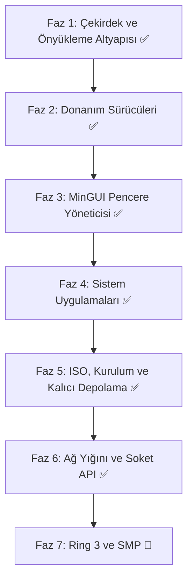

# minOs: Bağımsız x86_64 İşletim Sistemi Mimari ve Yol Haritası

**minOs**, modern 64-bit mimariye (x86_64) odaklanan, ultra düşük bellek tüketimli (<64 MB RAM), sade grafik arayüzlü (GUI), ses, ağ ve kalıcı depolama destekli açık kaynak bir işletim sistemidir.

> Son senkron: 15 Ekim 2026 — tablo ve fazlar gerçekleşen koda göre güncellendi.

---

## 1. Temel Mimarisi ve Teknoloji Seçimleri

| Bileşen | Seçilen Teknoloji / Standart | Açıklama / Durum |
| :--- | :--- | :--- |
| **Hedef Mimari** | `x86_64` (AMD64 / Intel 64) | Uzun mod (Long Mode), 4-seviyeli paging, SSE/SSE2 |
| **Önyükleyici (Bootloader)** | [Limine Bootloader](https://limine-bootloader.org/) | UEFI & Legacy BIOS uyumlu, framebuffer + HHDM + bellek haritası istekleri |
| **Geliştirme Dili** | Freestanding Rust (Nightly, `no_std`/`no_main`) | C kodu yok; çekirdek tamamı Rust + az miktarda inline asm |
| **Bellek Yönetimi** | Fiziksel çerçeve tahsisi (PMM, bitmap) + 4-seviyeli VMM + 2 MB kernel heap (`linked_list_allocator`) | Sayfa bayrakları (`USER`/`NX`) ayrımı testlerle doğrulu |
| **Kesmeler** | IDT yapısı + PIC maskeleme (polling G/Ç) | Donanım IRQ işleyicileri ve APIC henüz yok |
| **Çekirdek Tipi** | Modüler Monolitik Çekirdek | Tek adres uzayı, modüler sürücü yapısı |
| **Dosya Sistemi (VFS)** | Sanal Dosya Sistemi + FAT32 (r/w) + Ext2 (r/w) + ISO9660 (salt okunur) + MBR/GPT bölümleme | `VFS.DAT` anlık görüntüsüyle kalıcı depolama |
| **Grafik Altyapısı** | Limine Linear Framebuffer (32-bpp) | Yazılımsal compositor + çift tamponlama; BGA/VGA yetenek taraması |
| **Ağ Yığını** | Özel mikro TCP/IP (e1000) + soket API + HTTP istemcisi | ARP/IPv4/ICMP/UDP/DHCP/DNS, soket başına TCP durum makinesi, `curl` |
| **Ses Alt Sistemi** | Intel HDA (DMA) + PC Speaker PWM yedeği | PCM çalma, ses düzeyi/karıştırma |

---

## 2. Grafiksel Kullanıcı Arayüzü (MinGUI) & Pencere Yöneticisi

minOs grafik motoru, CPU ve bellek tasarrufu için optimize edilmiş **çift tamponlu (double-buffered)** bir bileşik pencere yöneticisi (compositor) ile çalışır.

### Temel Özellikler
1. **Pencere Sistemi (Window Compositor):**
   - Sürükle-bırak pencere hareketi, yeniden boyutlandırma, simge durumuna küçültme ve kapatma.
   - Pencereler arası odak (focus) yönetimi, z-index derinlik sıralaması.
   - Gölgelendirme ve yumuşak köşe eğrileri (isteğe bağlı alpha blending).
2. **Masaüstü & Görev Çubuğu:**
   - Hızlı başlatıcı (Start/App Menu).
   - Çalışan uygulamalar çubuğu, sistem çekmecesi (saat, ses kontrol simgesi, ağ durumu).
3. **Temalandırma Desteği (Theming Engine):**
   - Beş hazır tema (Kadife Gece, Gün Işığı, Kutup Mavisi, Yeşil Terminal, Gün Batımı).
   - TTF tabanlı bitmap font atlasları (Inria Sans + Geist Mono) ve yazı yakınlaştırma.

---

## 3. Dahili Sistem Uygulamaları

- **Görev Yöneticisi (Task Manager):**
  - Aktif işlemler (PID), CPU kullanım yüzdeleri ve bellek tüketim grafiği.
  - İşlem sonlandırma (kill) özelliği.
- **Ayarlar (Settings):**
  - *Temel:* Ekran çözünürlüğü, tema ve arka plan, ses seviyesi, fare hassasiyeti, saat/tarih.
  - *İleri Seviye:* Ağ konfigürasyonu (Statik IP / DHCP), disk bölümleri ve VFS durumları, çekirdek logları, bellek dökümü.
  - `settings.cfg` üzerinden kalıcı ayar saklama.
- **Dosya Yöneticisi:**
  - Dizin hiyerarşisinde gezinme, dosya açma, kopyala/taşı/sil, geri dönüşüm kutusu, yeniden adlandırma.
  - FAT32 / Ext2 / ISO9660 ortamlarının birleşik görünümü.
- **Konsol / Terminal (MinShell):**
  - Dahili komut kabuğu: dosya yönetimi, `ping`/`dns`/`curl`, `ipconfig`, uygulama başlatma, Tab tamamlama.
- **Tek Tıkla Kur (Kurulum Sihirbazı):**
  - Hedef disk seçimi → FAT32 biçimlendirme → `MINOS.SYS` + `VFS.DAT` ile kalıcı kurulum.
- **Diğerleri:** Not Defteri, Web Tarayıcısı (`http://`, `minos://`, `file://`), Resim Gösterici (BMP), Müzik Çalar, Video Oynatıcı, Hesap Makinesi, Çizim Tahtası (BMP kayıt), 3D Gösterici.

---

## 4. Uygulama Adımları ve Aşamalı Yol Haritası

### Faz 1: Çekirdek & Önyükleme İskeleti (Limine Tabanlı) ✅
- Proje dizin yapısı (`src/{arch,drivers,gui,apps,mm,fs}/`, `boot/`) kuruldu.
- Limine protokolü ile çekirdek yükleme (`limine.cfg`), framebuffer + HHDM + bellek haritası.
- IDT yapısı, PIC maskeleme (polling G/Ç), SSE etkinleştirme.
- PMM (fiziksel çerçeve yöneticisi) ve VMM (4-seviyeli paging, `USER`/`NX` bayrakları).
- Kernel heap (`linked_list_allocator`, 2 MB) ve süreç tablosu iskeleti.

### Faz 2: Temel Donanım & Girdi Sürücüleri ✅
- PS/2 Klavye (TR-Q/EN-US) ve PS/2 Fare, RTC (CMOS) saat.
- Framebuffer sürücüsü (piksel ilkelleri, kırpma/pitch güvenliği) + BGA/VGA taraması.
- ATA/ATAPI PIO (LBA28 okuma/yazma, cache flush) + USB/CD-ROM blok katmanı.
- Intel e1000 ağ kartı sürücüsü (TX/RX ring, DMA).
- Intel HDA ses (BDL/DMA) + PC Speaker yedeği.

### Faz 3: Grafik Motoru (MinGUI) & Masaüstü ✅
- Font motoru (TTF → bitmap atlas, `build.rs` + `fontdue`) ve çizim kütüphanesi.
- Masaüstü, görev çubuğu, sistem tepsisi, takvim, ses paneli.
- Olay döngüsü (fare, klavye, tekerlek), pencere yöneticisi ve snap/maksimize.

### Faz 4: Masaüstü Uygulamaları ✅
- Görev Yöneticisi (canlı CPU/RAM), Ayarlar (tema/ağ/sistem), Terminal (MinShell), Dosya Yöneticisi.
- Not Defteri (undo/redo, seçim, satır numaraları), Tarayıcı, Resim/Müzik/Video, Hesap Makinesi, Çizim Tahtası, 3D Gösterici.

### Faz 5: Derleme, ISO, Kurulum ve Kalıcı Depolama ✅
- `cargo` (özel `x86_64-minos` hedefi) + `run.ps1` (derle + ISO paketle + QEMU) ve `build_iso.ps1`.
- Önyüklenebilir hibrit ISO (`minos.iso`, Limine BIOS/UEFI).
- FAT32 biçimlendirme + dosya yazma/silme, Ext2 read-write, MBR/GPT bölümleme.
- `VFS.DAT` anlık görüntüsü: tüm dosya/klasör/çöp kutusu işlemleri yeniden başlatmada korunur.

### Faz 6: Ağ Yığını ve Soket API ✅
- ARP/IPv4/ICMP/DHCP/DNS, UDP, tek-bağlantılı TCP + tarayıcı HTTP yolu.
- Soket başına durum makineli TCP (`socket`/`connect`/`send`/`recv`/`close`, UDP, DNS önbelleği).
- HTTP istemcisi (chunked + yönlendirme) ve MinShell `curl` komutu.

### Faz 7: Sıradakiler 🔲
- **Tam Ring 3 Kullanıcı Alanı & Syscall API** (`int 0x80` / `syscall`/`sysret`, GDT+TSS).
- **SMP:** AP çekirdeklerini uyandırma, çekirdekler arası zamanlayıcı.
- **Paket Yöneticisi (`minpkg`)**, donanım 2D hızlandırma.
