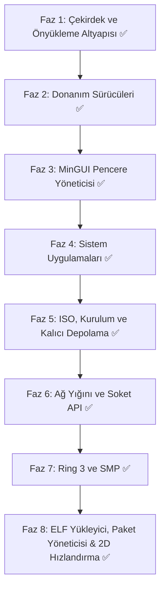

# minOs (v2.0.0): Bağımsız x86_64 İşletim Sistemi Mimari ve Yol Haritası

**minOs**, modern 64-bit mimariye (x86_64) odaklanan, ultra düşük bellek tüketimli (<64 MB RAM), sade grafik arayüzlü (GUI), ses, ağ ve kalıcı depolama destekli açık kaynak bir işletim sistemidir.

> Son senkron: 20 Ekim 2026 — TLS 1.2/1.3, ECDHE (secp256r1) ve X.509 zaman/hostname doğrulaması tamamlandı; tüm fazlar (Faz 1-10) eksiksiz tamamlandı.

---

## 1. Temel Mimarisi ve Teknoloji Seçimleri

| Bileşen | Seçilen Teknoloji / Standart | Açıklama / Durum |
| :--- | :--- | :--- |
| **Hedef Mimari** | `x86_64` (AMD64 / Intel 64) | Uzun mod (Long Mode), 4-seviyeli paging, SSE/SSE2 |
| **Önyükleyici (Bootloader)** | [Limine Bootloader](https://limine-bootloader.org/) | UEFI & Legacy BIOS uyumlu, framebuffer + HHDM + bellek haritası istekleri |
| **Geliştirme Dili** | Freestanding Rust (Nightly, `no_std`/`no_main`) | C kodu yok; çekirdek tamamı Rust + az miktarda inline asm |
| **Bellek Yönetimi** | Fiziksel çerçeve tahsisi (PMM, bitmap) + 4-seviyeli VMM + 2 MB kernel heap (`linked_list_allocator`) | Sayfa bayrakları (`USER`/`NX`) ayrımı testlerle doğrulu |
| **Kesmeler** | IDT yapısı + Local APIC Timer (IRQ/0x20) + PIC maskeleme | Donanım APIC periyodik zamanlayıcı ve EOI yönetimi devrede |
| **Çoklu Görev & Zamanlayıcı** | PCB + Öncelikli Preemptive / Round-Robin Zamanlayıcı | Realtime/High/Normal/Low öncelik seviyeleri ve CPU tick takibi aktif |
| **Çekirdek Tipi** | Modüler Monolitik Çekirdek | Tek adres uzayı, modüler sürücü yapısı |
| **Dosya Sistemi (VFS)** | Sanal Dosya Sistemi + FAT32 (r/w) + Ext2 (r/w) + ISO9660 (salt okunur) + MBR/GPT bölümleme | `VFS.DAT` anlık görüntüsüyle kalıcı depolama |
| **Grafik Altyapısı** | Limine Linear Framebuffer (32-bpp) + Donanım 2D Hızlandırma | Çift tamponlu compositor + BGA/VGA taraması + 64-bit donanımsal rect fill ve bit blit |
| **Ağ Yığını** | Özel mikro TCP/IP (e1000) + soket API + HTTP istemcisi + TLS 1.2 istemcisi | ARP/IPv4/ICMP/UDP/DHCP/DNS, soket başına TCP durum makinesi, `curl`; RSA anahtar değişimi + AES-128-GCM ile şifreli HTTP (`https://`) |
| **Kriptografi** | El yazımı `no_std` ilkeller: SHA-256, HMAC-SHA256, AES-128/256, GCM, RSA/PKCS#1 v1.5, X.509 | `src/drivers/crypto/` modülü; harici kütüphane bağımlılığı yok, TLS 1.2 PRF ve anahtar türetme bu ilkeller üzerine kurulu |
| **Ses Alt Sistemi** | Intel HDA (DMA) + PC Speaker PWM yedeği | PCM çalma, ses düzeyi/karıştırma |

---

## 2. Grafiksel Kullanıcı Arayüzü (MinGUI) & Pencere Yöneticisi

minOs grafik motoru, CPU ve bellek tasarrufu için optimize edilmiş **çift tamponlu (double-buffered)** bir bileşik pencere yöneticisi (compositor) ile çalışır.

### Temel Özellikler
1. **Pencere Sistemi (Window Compositor):**
   - Sürükle-bırak pencere hareketi, yeniden boyutlandırma, simge durumuna küçültme ve kapatma.
   - Pencereler arası odak (focus) yönetimi, z-index derinlik sıralaması.
   - Gölgelendirme ve yumuşak köşe eğrileri (isteğe bağlı alpha blending).
2. **Masaüstü & Görev Çubuğu:**
   - Hızlı başlatıcı (Start/App Menu).
   - Çalışan uygulamalar çubuğu, sistem çekmecesi (saat, ses kontrol simgesi, ağ durumu).
3. **Temalandırma Desteği (Theming Engine):**
   - Beş hazır tema (Kadife Gece, Gün Işığı, Kutup Mavisi, Yeşil Terminal, Gün Batımı).
   - TTF tabanlı bitmap font atlasları (Inria Sans + Geist Mono) ve yazı yakınlaştırma.

---

## 3. Dahili Sistem Uygulamaları

- **Görev Yöneticisi (Task Manager):**
  - Aktif işlemler (PID), CPU kullanım yüzdeleri ve bellek tüketim grafiği.
  - İşlem sonlandırma (kill) özelliği.
- **Ayarlar (Settings):**
  - *Temel:* Ekran çözünürlüğü, tema ve arka plan, ses seviyesi, fare hassasiyeti, saat/tarih.
  - *İleri Seviye:* Ağ konfigürasyonu (Statik IP / DHCP), disk bölümleri ve VFS durumları, çekirdek logları, bellek dökümü.
  - `settings.cfg` üzerinden kalıcı ayar saklama.
- **Dosya Yöneticisi:**
  - Dizin hiyerarşisinde gezinme, dosya açma, kopyala/taşı/sil, geri dönüşüm kutusu, yeniden adlandırma.
  - FAT32 / Ext2 / ISO9660 ortamlarının birleşik görünümü.
- **Konsol / Terminal (MinShell):**
  - Dahili komut kabuğu: dosya yönetimi, `ping`/`dns`/`curl`, `ipconfig`, uygulama başlatma, Tab tamamlama.
- **Tek Tıkla Kur (Kurulum Sihirbazı):**
  - Hedef disk seçimi → FAT32 biçimlendirme → `MINOS.SYS` + `VFS.DAT` ile kalıcı kurulum.
- **Diğerleri:** Not Defteri, Web Tarayıcısı (`http://`, `https://`, `minos://`, `file://`), Resim Gösterici (BMP), Müzik Çalar, Video Oynatıcı, Hesap Makinesi, Çizim Tahtası (BMP kayıt), 3D Gösterici.

---

## 4. Uygulama Adımları ve Aşamalı Yol Haritası

### Faz 1: Çekirdek & Önyükleme İskeleti (Limine Tabanlı) ✅
- Proje dizin yapısı (`src/{arch,drivers,gui,apps,mm,fs}/`, `boot/`) kuruldu.
- Limine protokolü ile çekirdek yükleme (`limine.cfg`), framebuffer + HHDM + bellek haritası.
- IDT yapısı, PIC maskeleme (polling G/Ç), SSE etkinleştirme.
- PMM (fiziksel çerçeve yöneticisi) ve VMM (4-seviyeli paging, `USER`/`NX` bayrakları).
- Kernel heap (`linked_list_allocator`, 2 MB) ve süreç tablosu iskeleti.

### Faz 2: Temel Donanım & Girdi Sürücüleri ✅
- PS/2 Klavye (TR-Q/EN-US) ve PS/2 Fare, RTC (CMOS) saat.
- Framebuffer sürücüsü (piksel ilkelleri, kırpma/pitch güvenliği) + BGA/VGA taraması.
- ATA/ATAPI PIO (LBA28 okuma/yazma, cache flush) + USB/CD-ROM blok katmanı.
- Intel e1000 ağ kartı sürücüsü (TX/RX ring, DMA).
- Intel HDA ses (BDL/DMA) + PC Speaker yedeği.

### Faz 3: Grafik Motoru (MinGUI) & Masaüstü ✅
- Font motoru (TTF → bitmap atlas, `build.rs` + `fontdue`) ve çizim kütüphanesi.
- Masaüstü, görev çubuğu, sistem tepsisi, takvim, ses paneli.
- Olay döngüsü (fare, klavye, tekerlek), pencere yöneticisi ve snap/maksimize.

### Faz 4: Masaüstü Uygulamaları ✅
- Görev Yöneticisi (canlı CPU/RAM), Ayarlar (tema/ağ/sistem), Terminal (MinShell), Dosya Yöneticisi.
- Not Defteri (undo/redo, seçim, satır numaraları), Tarayıcı, Resim/Müzik/Video, Hesap Makinesi, Çizim Tahtası, 3D Gösterici.

### Faz 5: Derleme, ISO, Kurulum ve Kalıcı Depolama ✅
- `cargo` (özel `x86_64-minos` hedefi) + `run.ps1` (derle + ISO paketle + QEMU) ve `build_iso.ps1`.
- Önyüklenebilir hibrit ISO (`minos.iso`, Limine BIOS/UEFI).
- FAT32 biçimlendirme + dosya yazma/silme, Ext2 read-write, MBR/GPT bölümleme.
- `VFS.DAT` anlık görüntüsü: tüm dosya/klasör/çöp kutusu işlemleri yeniden başlatmada korunur.

### Faz 6: Ağ Yığını ve Soket API ✅
- ARP/IPv4/ICMP/DHCP/DNS, UDP, tek-bağlantılı TCP + tarayıcı HTTP yolu.
- Soket başına durum makineli TCP (`socket`/`connect`/`send`/`recv`/`close`, UDP, DNS önbelleği).
- HTTP istemcisi (chunked + yönlendirme) ve MinShell `curl` komutu.
- **TLS 1.2 istemcisi** (`src/drivers/tls.rs`): ClientHello (SNI) → ServerHello → Certificate (X.509) → ServerHelloDone → ClientKeyExchange (RSA) → ChangeCipherSpec → Finished → şifreli Application Data; tarayıcıda `https://` desteği.

- **Web Tarayıcısı Sık Kullanılanlar & Yer İmleri:** Adres çubuğu altında interaktif Bookmarks Bar, hafif HTTP test sitesi, minos://bookmarks, minos://help ve minos://demo hızlı erişim çipleri ve sayfa entegrasyonu.
### Faz 7: Ring 3, SMP ve Ses Alt Sistemi Optimizasyonu ✅
- **Ring 3 Kullanıcı Kipi İzolasyonu:** GDT TSS kullanıcı segmentleri, `int 0x80` sistem çağrıları (`SYS_GETPID`, `SYS_YIELD`, `SYS_WRITE`), #GP/#PF hata yakalama ve çekirdek koruması.
- **SMP (Çok Çekirdekli Paralellik):** Limine SMP protokolü ile AP başlatımı, çekirdek başına 64 KiB yığın ve GDT, LAPIC kimliği, paralel atomik iş kuyruğu (`parallel_checksum`).
- **Gelişmiş Ses Alt Sistemi:** Intel HDA için evrensel PCI taraması, 64-bit BAR0, donanımsal CRST/SRST sıfırlama, AFG/DAC/Pin D0 güç yönetimi, donanımsal DMA Position Buffer (offset `0x70`), atomik 32-bit SDnCTL akış kontrolü ve otomatik PC Speaker PWM yedeği (fallback). Ayarlar uygulamasında donanımsal ses testi.

### Faz 8: Kullanıcı Alanı ve Genişletilebilirlik ✅
- **Kullanıcı Alanı ELF Yükleyici Entegrasyonu ✅:** ELF64 ayrıştırıcı (`PT_LOAD`), W^X prensibiyle sayfalama (kod salt okunur/çalıştırılabilir, veri/yığın NX), kullanıcı yığını tahsisi, `LoadedProgram::unmap_and_free()` kaynak temizliği, `arch::x86_64::ring3::execute_loaded_program()` güvenli Ring 3 çalışma/dönüş döngüsü, VFS `/bin/hello.elf` örnek ikilisi ve MinShell `exec <ikili>` komutu tamamlandı.
- **Paket Yöneticisi (`minpkg`) ✅:** Ağ (HTTP/curl) veya dahili repodan paket indirme, VFS `/bin` dizinine kurma (`minpkg install`), kurulu ikili paketleri arayıp listeleme (`minpkg list`), kaldırma (`minpkg remove`) ve terminal (MinShell) arayüz entegrasyonu tamamlandı.
- **Donanım 2D Hızlandırma ✅:** GPU/BGA ve Framebuffer üzerinde 64-bit hizalı blok dolgu (`hw_accel_fill_rect`) ve kopyalama (`hw_accel_bit_blit`), `flush_rect` ve `draw_rect` hızlandırmaları tamamlandı.

### Faz 9: Kriptografi ve TLS 1.2 / 1.3 ✅
- **Kripto İlkelleri (`src/drivers/crypto/`, `no_std`, bağımlılıksız):** SHA-256 (`sha256.rs`), HMAC-SHA256 (`hmac.rs`), AES-128/256 (`aes.rs`), GCM (`gcm.rs`), RSA + PKCS#1 v1.5 (`rsa.rs`), minimal X.509 sertifika ayrıştırıcı (`x509.rs`).
- **TLS 1.2 / 1.3 Oturumları:** TLS 1.2'de `TLS_RSA_WITH_AES_128_GCM_SHA256` (0x009C) ve `ECDHE_RSA` suite'leri, TLS 1.3'te HKDF anahtar planı ve AES-GCM kayıtları; PRF (P_SHA256/P_SHA384), master/pre-master secret türetme, GCM şifreleme/çözme, Finished ve CertificateVerify doğrulaması.
- **Entegrasyon:** Web Tarayıcısı `https://` şeması; şifreli yanıt şifresi çözülüp HTTP ayrıştırıcısına aktarılır.
- **Bilinen sınırlar:** Sertifika zinciri (kök/ara CA imza doğrulaması) ve iptal kontrolü (OCSP/CRL) yapılmaz; buna karşılık sunucu sertifikasının geçerlilik tarihleri ile CN/SAN ana makine adı RFC 6125 kurallarıyla doğrulanır. TLS 1.2 ve TLS 1.3 el sıkışmaları (ECDHE secp256r1, RSA/ECDSA imza, AES-GCM, SHA-256/384) desteklenir; eski/zayıf cipher suite'ler desteklenmez.

### Faz 10: Gelişmiş Giriş ve Donanım Sürücüleri (USB HID, Touchpad, UVC Kamera, Wi-Fi) ✅
- **Yerel xHCI USB HID Klavye ve Fare (`src/drivers/usb_hid.rs`):** PCI xHCI (USB 3.x) denetleyicisi, port reset ve aygıt numaralandırma, Boot Protocol klavye ve fare desteği; PS/2 ile birleşik olay döngüsü ve gecikmesiz olay kontrolü (`has_event`).
- **Laptop Dokunmatik Yüzey (Touchpad) İyileştirmesi (`src/drivers/mouse.rs`, `src/drivers/ps2.rs`):** 8 count/mm çözünürlük, 100 sample/sec örnekleme, parmak temas ve dokunarak tıklama (Tap-to-Click, <180ms dokunma), çift parmak ve kaydırma tekerleği desteği.
- **UVC Kamera Alt Sistemi (`src/drivers/camera.rs`):** USB Video Class (Class 0x0E), VideoControl ve VideoStreaming arayüzleri, YUY2 (4:2:2 uncompressed) piksel dönüşümü (`yuv_to_rgb32`), sentetik test deseni üretimi, MinShell `cam` / `camera` komutu ve Ayarlar entegrasyonu.
- **IEEE 802.11 Wi-Fi ve WPA2-PSK Altyapısı (`src/drivers/wifi.rs`):** 802.11 MAC çerçeve yapısı (Beacon, Probe, Data), kablosuz ağ tarama tablosu (`scan_networks`), WPA2-PSK anahtar türetimi (PBKDF2-HMAC-SHA256 ile PMK ve PTK türetimi), MinShell `wifi scan/connect/disconnect/status` komutları.