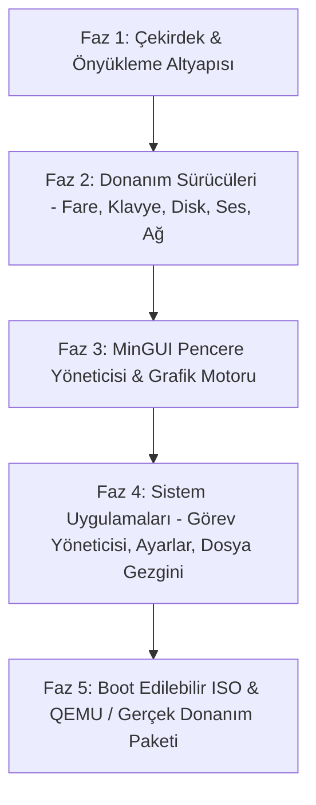

# minOs: Bağımsız x86_64 İşletim Sistemi Mimari ve Yol Haritası

**minOs**, modern 64-bit mimariye (x86_64) odaklanan, ultra düşük bellek tüketimli (<64 MB RAM), donanım hızlandırmalı sade grafik arayüzü (GUI), ses, ağ ve depolama desteğine sahip açık kaynak bir işletim sistemidir.

---

## 1. Temel Mimarisi ve Teknoloji Seçimleri

| Bileşen | Seçilen Teknoloji / Standart | Açıklama / Hedef |
| :--- | :--- | :--- |
| **Hedef Mimari** | `x86_64` (AMD64 / Intel 64) | Uzun mod (Long Mode), modern paging, APIC, SSE/AVX desteği |
| **Önyükleyici (Bootloader)** | [Limine Bootloader](https://limine-bootloader.org/) (veya GRUB2 Multiboot2) | UEFI & Legacy BIOS uyumlu, modern Limine Boot Protocol ile temiz 64-bit başlatma |
| **Geliştirme Dili** | Modern C (C17/C23) & Freestanding Rust / Assembly (NASM) | Sıfır çalışma zamanı bağımlılığı, doğrudan donanım kontrolü |
| **Bellek Yönetimi** | Physical Frame Allocator (Bitmap / Buddy) + 4-Seviyeli Sanal Paging | Düşük parazit maliyeti, sayfa tabanlı izolasyon |
| **Çekirdek Tipi** | Hibrit / Modüler Monolitik Çekirdek | Yüksek performans, modüler sürücü yapısı |
| **Dosya Sistemi (VFS)** | Sanal Dosya Sistemi + FAT32 & TarFS (Initrd) | Kolay dosya erişimi, USB / Disk uyumluluğu |
| **Grafik Altyapısı** | GOP (Graphics Output Protocol) Linear Framebuffer | Donanım bağımsız 32-bpp renk derinliği, double-buffered compositor |
| **Ağ Yığını** | TCP/IP (LwIP ported veya mikro TCP/IP yığını) + Realtek RTL8139 / Intel e1000 | DHCP, ping, DNS ve temel soket desteği |
| **Ses Alt Sistemi** | Intel High Definition Audio (Intel HDA) / AC97 | PCM ses çalma, mikser ve ses düzeyi kontrolü |

---

## 2. Grafiksel Kullanıcı Arayüzü (MinGUI) & Pencere Yöneticisi

minOs grafik motoru, CPU ve bellek tasarrufu için optimize edilmiş **çift tamponlu (double-buffered)** bir bileşik pencere yöneticisi (compositor) ile çalışır.

### Temel Özellikler
1. **Pencere Sistemi (Window Compositor):**
   - Sürükle-bırak pencere hareketi, yeniden boyutlandırma, simge durumuna küçültme ve kapatma.
   - Pencereler arası odak (focus) yönetimi, z-index derinlik sıralaması.
   - Gölgelendirme ve yumuşak köşe eğrileri (isteğe bağlı alpha blending).
2. **Masaüstü & Görev Çubuğu:**
   - Hızlı başlatıcı (Start/App Menu).
   - Çalışan uygulamalar çubuğu, sistem çekmecesi (saat, ses kontrol simgesi, ağ durumu).
3. **Temalandırma Desteği (Theming Engine):**
   - Açık / Koyu (Dark / Light) tema geçişi.
   - Özelleştirilebilir renk paletleri (Accent Colors) ve TTF/Bitmap yazı tipi desteği.

---

## 3. Dahili Sistem Uygulamaları

- **Görev Yöneticisi (Task Manager):**
  - Aktif işlemler (PID), CPU kullanım yüzdeleri ve bellek tüketim grafiği.
  - İşlem sonlandırma (kill) özelliği.
- **Ayarlar (Settings - Temel ve İleri Seviye):**
  - *Temel:* Ekran çözünürlüğü, tema ve arka plan, ses seviyesi, fare hassasiyeti, saat/tarih.
  - *İleri Seviye:* Ağ konfigürasyonu (Statik IP / DHCP), disk bölümleri ve VFS durumları, çekirdek logları (dmesg görüntüleyici), bellek dökümü.
- **Dosya Yöneticisi (MinExplorer):**
  - Dizin hiyerarşisinde gezinme, dosya açma, basit metin düzenleyici entegrasyonu.
- **Konsol / Terminal:**
  - Dahili komut kabuğu (MinShell) ile çekirdek komutları ve betik çalıştırma.

---

## 4. Uygulama Adımları ve Aşamalı Yol Haritası

### Faz 1: Çekirdek & Önyükleme İskeleti (Limine Tabanlı)
- Proje dizin yapısının (`kernel/`, `drivers/`, `gui/`, `apps/`, `libc/`, `boot/`) kurulması.
- Limine protokolü ile çekirdek yükleme yapılandırması (`limine.cfg`).
- GDT, IDT, Kesme (Interrupt) işleyicileri, PIC/APIC kurulumu.
- PMM (Fiziksel Bellek) ve VMM (Sanal Bellek Paging) yöneticisi.
- Bellek tahsisatçısı (`kmalloc`, `kfree`).

### Faz 2: Temel Donanım & Girdi Sürücüleri
- PS/2 Klavye ve PS/2 Fare (paket ayrıştırma, imleç koordinat takibi).
- GOP Framebuffer sürücüsü (çözünürlük tespiti, piksel çizim ilkelleri).
- ATA / IDE / NVMe veya RAMDisk (TarFS/Initrd) üzerinden dosya sistemi (VFS/FAT32).
- Intel e1000 / RTL8139 ağ kartı sürücüsü temeli.
- Intel HDA / AC97 ses denetleyicisi iskeleti.

### Faz 3: Grafik Motoru (MinGUI) & Masaüstü
- Yazı tipi motoru (Font renderer) ve temel çizim kütüphanesi (dikdörtgen, çizgi, degrade, alfa karıştırma).
- Masaüstü arka planı, görev çubuğu ve fare imleci katmanı.
- Olay döngüsü (Event loop: Mouse move, click, Key press).
- Pencere yöneticisi veri yapıları ve tampon render mimarisi.

### Faz 4: Masaüstü Uygulamaları
- Görev Yöneticisi penceresi (Canlı CPU/RAM tüketimi).
- Temel ve İleri Seviye Ayarlar paneli (Tema değiştirici, Ağ/Sistem bilgisi).
- Terminal penceresi ve Dosya Gezgini.

### Faz 5: Derleme Sistemi, ISO Oluşturma ve Test
- `Makefile` / `CMake` ve çapraz derleyici (Cross-compiler) hazırlığı.
- Önyüklenebilir hibrid ISO (`minos.iso`) üretimi (`xorriso`, `limine`).
- QEMU ile tek komutla test ortamı (`make run`).
